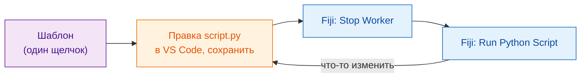
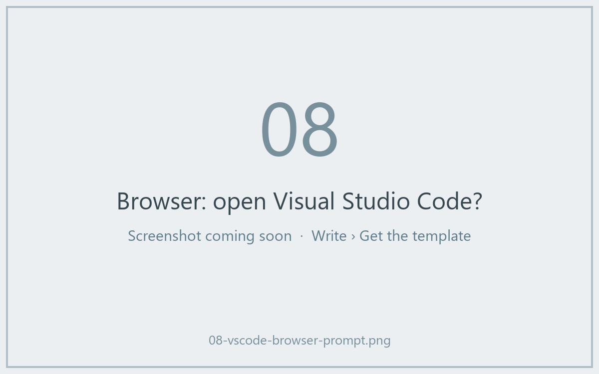
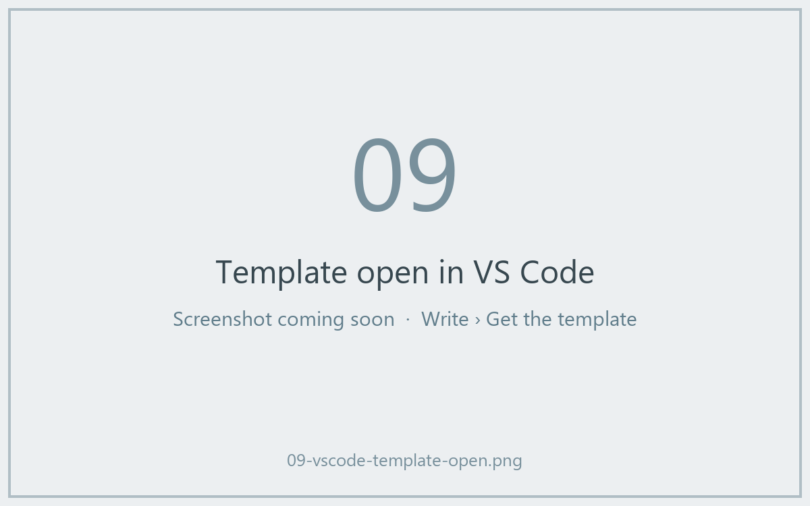

# Получите шаблон

[Открыть шаблон в VS Code](vscode://vscode.git/clone?url=https%3A%2F%2Fgithub.com%2FOxford-Zeiss-Centre-of-Excellence%2FWavu-Script-Template.git){ .md-button .md-button--primary }
[Скачать ZIP](https://github.com/Oxford-Zeiss-Centre-of-Excellence/Wavu-Script-Template/archive/refs/heads/main.zip){ .md-button }
[Использовать шаблон на GitHub](https://github.com/Oxford-Zeiss-Centre-of-Excellence/Wavu-Script-Template/generate){ .md-button }

## Идея простыми словами

Никто не пишет карточку рецепта с чистого листа. **Шаблон** — это готовый,
работающий рецепт (размытие из [первого запуска](../start/first-run.md)),
который вы копируете и меняете. Вы правите один файл, `script.py`, в
[VS Code](https://code.visualstudio.com) — бесплатном редакторе кода — и сразу
проверяете его из Fiji.



## Что происходит после щелчка

1. Браузер спросит, **открыть ли Visual Studio Code**. Разрешите.
2. VS Code спросит, **куда сохранить** новую папку. Выберите место, например
   *Документы*.
3. Папка откроется в VS Code, и слева в списке файлов будет `script.py`.
   Если VS Code предложит расширения для Python, нажмите **Install**.

Для этого нужны установленные **VS Code** и **Git**. Если ничего не
происходит, нажмите **Скачать ZIP**, распакуйте архив и в VS Code выберите
**File › Open Folder…**.





*Использовать шаблон на GitHub* вместо этого создаёт вашу собственную копию
в интернете; это пригодится позже, когда вы захотите
[поделиться со всем миром](../share/with-the-world.md).

## Что лежит в папке

| Файл | Что это |
|---|---|
| `script.py` | **Ваш рецепт.** `PARAMS` (диалог) и `run` (работа). |
| `pixi.toml` | Список покупок для кладовой этого скрипта. |
| `test_script.py` | Проверки, которые работают без Fiji ([по желанию](test-without-fiji.md)). |
| `.vscode/` | Делает [отладку в VS Code](../help/debug-in-vscode.md) делом одного щелчка. |
| `README.md`, `.github/` | Заметки и автоматические релизы ([для продвинутых](../share/with-the-world.md)). |

## Повседневный цикл

1. **Правите** `script.py` в VS Code и **сохраняете** (++ctrl+s++, или ++cmd+s++ на Mac).
2. В Fiji выбираете **Plugins › Wavu › Stop Worker**.
3. Выбираете **Plugins › Wavu › Run Python Script** и указываете свою папку.

!!! warning "Зачем Stop Worker?"
    Кухня читает рецепт, когда открывается. Если она ещё открыта с прошлого
    запуска, она продолжает готовить по *старому* рецепту. **Stop Worker**
    закрывает её, и следующий запуск прочитает сохранённые изменения. Это
    занимает секунду; кладовая остаётся заполненной.

## Добавляем пакет { #adding-a-package }

Нужен scikit-image? Откройте `pixi.toml` и добавьте одну строку в раздел
`[dependencies]`:

```toml
[dependencies]
python = ">=3.10,<3.14"
numpy = ">=1.24"
scipy = ">=1.10"
scikit-image = "*"     # <- новая строка: "*" значит любая версия
```

Сохраните, нажмите **Stop Worker** и запустите снова. Wavu заметит новую
строку, и pixi скачает пакет (это видно в Log). Пакеты, которые есть только
на PyPI (мир `pip`), указываются в `[pypi-dependencies]`.

??? note "Предпочитаете терминал?"
    Эти команды делают то же, что и кнопки, но в терминале:

    ```sh
    git clone https://github.com/Oxford-Zeiss-Centre-of-Excellence/Wavu-Script-Template.git my-analysis
    cd my-analysis
    pixi add scikit-image
    ```

    `pixi add` сам правит `pixi.toml`. Чтобы `pixi` работал в терминале,
    установите его с [pixi.sh](https://pixi.sh); копия, которую скачал Fiji,
    терминалу не видна.

## Одним предложением

Один щелчок — и у вас рабочая папка скрипта; правьте `script.py` в VS Code,
а затем **Stop Worker** и **Run Python Script** в Fiji, чтобы проверить
каждое изменение.

[Далее: от ноутбука к Wavu :material-arrow-right:](from-notebook.md){ .md-button }
