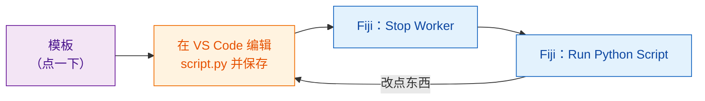

# 获取模板

[在 VS Code 中打开模板](vscode://vscode.git/clone?url=https%3A%2F%2Fgithub.com%2FOxford-Zeiss-Centre-of-Excellence%2FWavu-Script-Template.git){ .md-button .md-button--primary }
[下载 ZIP](https://github.com/Oxford-Zeiss-Centre-of-Excellence/Wavu-Script-Template/archive/refs/heads/main.zip){ .md-button }
[在 GitHub 上使用此模板](https://github.com/Oxford-Zeiss-Centre-of-Excellence/Wavu-Script-Template/generate){ .md-button }

## 用大白话说

没人会从一张白纸开始写食谱卡。**模板**是一份写好的、能用的食谱
（就是[第一次运行](../fiji/first-run.md)里的模糊处理），你复制一份再改。
你只需在 [VS Code](https://code.visualstudio.com)（一款免费的代码编辑器）
里编辑一个文件 `script.py`，就能马上在 Fiji 里试。



## 点击之后会发生什么

1. 浏览器会问是否**打开 Visual Studio Code**（open Visual Studio Code）。允许即可。
2. VS Code 会问新文件夹**保存到哪里**。选个地方，比如*文档*。
3. 文件夹会在 VS Code 中打开，左侧文件列表里有 `script.py`。
   如果 VS Code 推荐安装 Python 扩展，点 **Install**。

这需要先装好 **VS Code** 和 **Git**。如果点了没反应，就用
**下载 ZIP**，解压后在 VS Code 里选 **File › Open Folder…**。

*在 GitHub 上使用此模板*则是创建一份你自己的在线副本；以后想
[分享给全世界](../fiji/with-the-world.md)时会很方便。

## 文件夹里有什么

| 文件 | 是什么 |
|---|---|
| `script.py` | **你的食谱。** `PARAMS`（对话框）和 `run`（实际干活）。 |
| `pixi.toml` | 这个脚本食材柜的购物清单。 |
| `test_script.py` | 不用 Fiji 就能运行的检查。**从这里开始**（[先写测试](test-without-fiji.md)）。 |
| `.vscode/` | 让[在 VS Code 中调试](../help/debug-in-vscode.md)只需点一下。 |
| `README.md`、`.github/` | 说明文档，以及自动发布（[进阶](../fiji/with-the-world.md)）。 |

## 日常循环

1. **先写检查**，写在 `test_script.py` 里：给一张自己造的小图像，应该得到什么结果？
   运行 `pixi run test`，看它失败。
   （[先写测试](test-without-fiji.md)会教你怎么做。你可以跳过这一步，但强烈推荐这样做，
   尤其是当代码由 AI 助手来写的时候。）
2. 在 VS Code 中**编辑** `script.py` 并**保存**（++ctrl+s++，Mac 上是 ++cmd+s++），
   直到 `pixi run test` 通过。
3. 在 Fiji 中选 **Plugins › Wavu › Stop Worker**。
4. 选 **Plugins › Wavu › Run Python Script**，再选你的文件夹。

!!! warning "为什么要 Stop Worker？"
    worker（厨房）开门时读一次食谱。如果它从上次运行后还开着，
    就会继续按*旧*食谱做菜。**Stop Worker** 把它关掉，下次运行时才会读到你保存的修改。
    这只要一秒钟；食材柜里的东西都还在。

## 添加包 { #adding-a-package }

需要 scikit-image？打开 `pixi.toml`，在 `[dependencies]` 下面加一行：

```toml
[dependencies]
python = ">=3.10,<3.14"
numpy = ">=1.24"
scipy = ">=1.10"
scikit-image = "*"     # <- 新加的一行："*" 表示任意版本
```

保存，点 **Stop Worker**，再运行一次。Wavu 会发现新加的这一行，pixi
就会去下载这个包（Log 里能看到）。只在 PyPI（`pip` 的世界）里才有的包，
要放在 `[pypi-dependencies]` 下面。

!!! info "软件包从哪里来？conda-forge 和 PyPI"
    想象有两家商店。**conda-forge** 是 pixi 优先去买的那家：由社区维护的免费商店，卖的都是已经构建好的软件包，包括 numpy、scikit-image、PyTorch 这类带有编译部分的包，甚至还有不是用 Python 写的工具。写在 `[dependencies]` 下面的都来自这里。**PyPI** 是 `pip` 用的商店；有些包只有那里有，这些要写在 `[pypi-dependencies]` 下面。

    简单原则：先到 [conda-forge](https://prefix.dev/channels/conda-forge) 搜索；找不到再用 PyPI。两家商店里的名字可能不同：PyTorch 在 conda-forge 叫 `pytorch`，在 PyPI 叫 `torch`。

??? note "更喜欢用终端？"
    下面几行命令在终端里做的事和那些按钮一样：

    ```sh
    git clone https://github.com/Oxford-Zeiss-Centre-of-Excellence/Wavu-Script-Template.git my-analysis
    cd my-analysis
    pixi add scikit-image
    ```

    `pixi add` 会帮你修改 `pixi.toml`。要在终端里用 `pixi`，请从
    [pixi.sh](https://pixi.sh) 安装；Fiji 下载的那一份不在终端的路径（PATH）上。

## 一句话总结

点一下就得到一个能用的脚本文件夹，在 VS Code 里编辑 `script.py`，然后在 Fiji 里点
**Stop Worker** 和 **Run Python Script** 来试每一次修改。

[下一步：先写测试 :material-arrow-right:](test-without-fiji.md){ .md-button }
