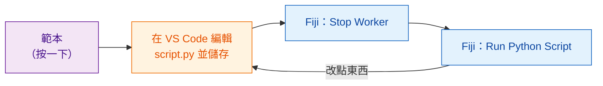

# 取得範本

[在 VS Code 中開啟範本](vscode://vscode.git/clone?url=https%3A%2F%2Fgithub.com%2FOxford-Zeiss-Centre-of-Excellence%2FWavu-Script-Template.git){ .md-button .md-button--primary }
[下載 ZIP](https://github.com/Oxford-Zeiss-Centre-of-Excellence/Wavu-Script-Template/archive/refs/heads/main.zip){ .md-button }
[在 GitHub 上使用這個範本](https://github.com/Oxford-Zeiss-Centre-of-Excellence/Wavu-Script-Template/generate){ .md-button }

## 用白話說

沒有人會從一張白紙開始寫食譜卡。**範本**是一份寫好、能用的食譜
（就是[第一次執行](../start/first-run.md)裡的模糊處理），你複製一份再修改。
你只要在 [VS Code](https://code.visualstudio.com)（一個免費的程式碼編輯器）
裡編輯一個檔案 `script.py`，就能馬上在 Fiji 裡試。



## 按下之後會發生什麼

1. 瀏覽器會問要不要**開啟 Visual Studio Code**（open Visual Studio Code）。允許它。
2. VS Code 會問新資料夾要**存在哪裡**。選一個地方，例如*文件*。
3. 資料夾會在 VS Code 中開啟，左邊的檔案清單裡有 `script.py`。
   如果 VS Code 建議安裝 Python 擴充功能，按 **Install**。

這需要先安裝 **VS Code** 和 **Git**。如果按了沒反應，就用
**下載 ZIP**，解壓縮後在 VS Code 選 **File › Open Folder…**。

*在 GitHub 上使用這個範本*則是建立一份你自己的線上副本；之後想
[分享給全世界](../share/with-the-world.md)時會很方便。

## 資料夾裡有什麼

| 檔案 | 是什麼 |
|---|---|
| `script.py` | **你的食譜。** `PARAMS`（對話框）和 `run`（實際工作）。 |
| `pixi.toml` | 這個腳本食材櫃的購物清單。 |
| `test_script.py` | 不用 Fiji 就能執行的檢查。**從這裡開始**（[先寫測試](test-without-fiji.md)）。 |
| `.vscode/` | 讓[在 VS Code 中除錯](../help/debug-in-vscode.md)只要按一下。 |
| `README.md`、`.github/` | 說明文件，以及自動發布（[進階](../share/with-the-world.md)）。 |

## 日常循環

1. **先寫檢查**，寫在 `test_script.py` 裡：給一張自己造的小影像，應該得到什麼結果？
   執行 `pixi run test`，看它失敗。
   （[先寫測試](test-without-fiji.md)會教你怎麼做。你可以跳過這一步，但強烈建議這樣做，
   尤其是當程式碼由 AI 助理來寫的時候。）
2. 在 VS Code 中**編輯** `script.py` 並**儲存**（++ctrl+s++，Mac 上是 ++cmd+s++），
   直到 `pixi run test` 通過。
3. 在 Fiji 中選 **Plugins › Wavu › Stop Worker**。
4. 選 **Plugins › Wavu › Run Python Script**，再挑你的資料夾。

!!! warning "為什麼要 Stop Worker？"
    worker（廚房）在開門時讀一次食譜。如果它從上次執行後還開著，
    就會繼續照*舊*食譜做菜。**Stop Worker** 把它關掉，下次執行時才會讀到你儲存的修改。
    這只要一秒鐘；食材櫃裡的東西都還在。

## 加入套件 { #adding-a-package }

需要 scikit-image？打開 `pixi.toml`，在 `[dependencies]` 底下加一行：

```toml
[dependencies]
python = ">=3.10,<3.14"
numpy = ">=1.24"
scipy = ">=1.10"
scikit-image = "*"     # <- 新加的一行："*" 表示任何版本都可以
```

儲存、按 **Stop Worker**，再執行一次。Wavu 會注意到新加的那一行，pixi
就會去下載這個套件（Log 會顯示過程）。只在 PyPI（`pip` 的世界）才有的套件，
則要放在 `[pypi-dependencies]` 底下。

!!! info "套件從哪裡來？conda-forge 和 PyPI"
    想像有兩家商店。**conda-forge** 是 pixi 優先去買的那家：由社群經營的免費商店，賣的都是已經組裝好的套件，包括 numpy、scikit-image、PyTorch 這類含有編譯部分的套件，甚至還有不是用 Python 寫的工具。寫在 `[dependencies]` 底下的都從這裡來。**PyPI** 是 `pip` 用的商店；有些套件只有那裡有，這些要寫在 `[pypi-dependencies]` 底下。

    簡單原則：先到 [conda-forge](https://prefix.dev/channels/conda-forge) 搜尋；找不到再用 PyPI。兩家商店的名字可能不一樣：PyTorch 在 conda-forge 叫 `pytorch`，在 PyPI 叫 `torch`。

??? note "比較喜歡用終端機？"
    下面這幾行在終端機裡做的事和那些按鈕一樣：

    ```sh
    git clone https://github.com/Oxford-Zeiss-Centre-of-Excellence/Wavu-Script-Template.git my-analysis
    cd my-analysis
    pixi add scikit-image
    ```

    `pixi add` 會幫你修改 `pixi.toml`。要在終端機裡用 `pixi`，請從
    [pixi.sh](https://pixi.sh) 安裝；Fiji 下載的那一份不在終端機的路徑上。

## 一句話總結

按一下就得到一個能用的腳本資料夾，在 VS Code 裡編輯 `script.py`，然後在 Fiji 裡按
**Stop Worker** 和 **Run Python Script** 來試每一次修改。

[下一步：先寫測試 :material-arrow-right:](test-without-fiji.md){ .md-button }
