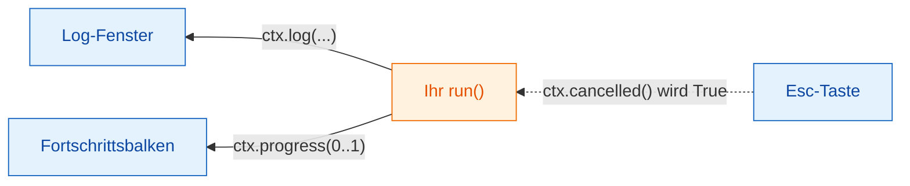

# Log, Fortschritt und Abbrechen

## Die Idee in einfachen Worten

Wenn die Küche viel zu tun hat, sagt Ihnen ein guter Kellner, wie es steht:
„Ihre Suppe ist auf dem Herd“, „gleich fertig“. Und wenn Sie es sich anders
überlegen, können Sie abbestellen, aber der Koch entscheidet, wann er sicher
mit dem Rühren aufhören kann.

In Wavu ist `ctx` dieser Draht zwischen Küche und Tisch:

- `ctx.log("…")` schickt eine Meldung an Fijis **Log**-Fenster.
- `ctx.progress(0.5)` stellt Fijis **Fortschrittsbalken** auf die Hälfte.
- `ctx.cancelled()` sagt Ihnen, ob der Benutzer **Esc** gedrückt hat.



## Ins Log schreiben { #logging }

```python
ctx.log(f"Segmenting a {img.shape} image")
```

Die Zeile erscheint sofort in Fijis Log, während Ihr Code noch läuft. Ein
einfaches `print(...)` in `run` tut dasselbe. Schreiben Sie *vor* jedem
langsamen Schritt ins Log, damit der Benutzer weiß, dass Fiji nicht hängt.

## Fortschritt { #progress }

Geben Sie eine Zahl von `0.0` (noch nichts getan) bis `1.0` (fertig) an:

```python
for i, plane in enumerate(planes):
    ...                                   # eine Ebene bearbeiten
    ctx.progress((i + 1) / len(planes))
```

Fijis Fortschrittsbalken füllt sich, und die Statusleiste unten im
Fiji-Hauptfenster zeigt den Skriptnamen und einen Prozentwert, etwa
*Wavu: script 40%*.

## Abbrechen: warum Ihr Code mithelfen muss { #cancel-why-your-code-has-to-help }

Klicken Sie auf ein Fiji-Fenster und drücken Sie **Esc**. Im Log steht
*Cancelling script…*. Python lässt sich aber mitten in einer Berechnung
nicht sicher von außen unterbrechen, deshalb **setzt** Wavu nur **eine
Flagge** (ein Signal). Ihr Code schaut an sinnvollen Stellen nach dieser Flagge und hört
höflich auf. Das nennt man **kooperatives Abbrechen**.

Die Vorlage macht das in ihrer Schleife:

```python
for i, plane in enumerate(planes):
    if ctx.cancelled():
        ctx.log("Cancelled")
        return {}
    ...
```

Kürzer geht es mit `ctx.check_cancelled()`: Es beendet den Durchlauf sofort,
wenn Esc gedrückt wurde (es löst einen speziellen Fehler `wavu.Cancelled`
aus, den Wavu stillschweigend behandelt).

```python
ctx.check_cancelled()       # zwischen zwei langsamen Schritten
masks = model.eval(img)
ctx.check_cancelled()
```

!!! warning "Esc während eines einzigen langen Aufrufs"
    Verbringt Ihr Skript fünf Minuten in einem einzigen Aufruf, etwa einem
    großen `model.eval(...)`, wirkt Esc erst, *nachdem* dieser Aufruf
    zurückkehrt. Teilen Sie die Arbeit auf (Ebene für Ebene, Kachel für
    Kachel), dann fühlt sich das Abbrechen sofort an.

## Ein Muster zum Abschreiben

```python
def run(ctx, inputs, params):
    img = inputs["image"]
    ctx.log("Step 1/3: smoothing")
    smooth = smooth_image(img)
    ctx.progress(0.3)
    ctx.check_cancelled()

    ctx.log("Step 2/3: segmenting")
    labels = segment(smooth)
    ctx.progress(0.8)
    ctx.check_cancelled()

    ctx.log("Step 3/3: measuring")
    table = measure(labels, img)
    ctx.progress(1.0)
    return {"labels": labels, "cells": table}
```

(`smooth_image`, `segment` und `measure` stehen für Ihre eigenen Funktionen.)

## In einem Satz

Mit `ctx.log` reden Sie, mit `ctx.progress` zeigen Sie, wie weit Sie sind,
und wenn Sie zwischen den Schritten `ctx.cancelled()` prüfen, kann Esc Ihr
Skript anhalten.

[Weiter: echte Bilder :material-arrow-right:](real-images.md){ .md-button }
