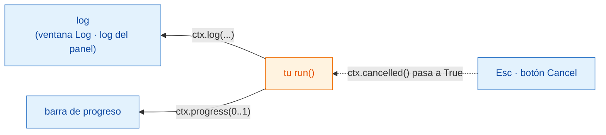

# Log, progreso y cancelar

## La idea en palabras sencillas

Cuando la cocina está ocupada, un buen camarero te cuenta cómo va: "tu sopa
está en el fuego", "ya casi está". Y si cambias de opinión, puedes anular el
pedido, pero es el cocinero quien decide cuándo es seguro dejar de remover.

En Wavu, `ctx` es esa línea entre la cocina y la mesa:

- `ctx.log("…")` envía un mensaje al **log**.
- `ctx.progress(0.5)` mueve la **barra de progreso** hasta la mitad.
- `ctx.cancelled()` te dice si el usuario ha pedido **parar**.

Tu código es el mismo en los dos visores; solo cambia dónde aparecen las
cosas:

| | Fiji | napari |
|---|---|---|
| `ctx.log` y `print` | la ventana **Log** | el cuadro de log del panel de Wavu |
| `ctx.progress` | la barra de progreso de Fiji, más *Wavu: script 40%* en la barra de estado | la barra de progreso del panel de Wavu |
| cómo cancela el usuario | pulsa **Esc** | pulsa **Cancel** en el panel |
| un error en tu código | una ventana de error, con los detalles en el Log | `Error: …` en el log del panel, más una notificación |



## Escribir en el log

```python
ctx.log(f"Segmenting a {img.shape} image")
```

La línea aparece en el log al momento, mientras tu código sigue en marcha.
Un simple `print(...)` dentro de `run` hace lo mismo. Escribe en el log
*antes* de cualquier paso lento, para que el usuario sepa que nada se ha
colgado.

## Progreso

Indica un número de `0.0` (nada hecho) a `1.0` (terminado):

```python
for i, plane in enumerate(planes):
    ...                                   # trabajar en un plano
    ctx.progress((i + 1) / len(planes))
```

La barra de progreso se llena. En Fiji, la barra de estado, en la parte
inferior de la ventana principal, muestra además el nombre del script y un
porcentaje, como *Wavu: script 40%*.

## Cancelar: por qué tu código tiene que ayudar { #cancel-why-your-code-has-to-help }

En Fiji, haz clic en una ventana de Fiji y pulsa **Esc**; el Log dice
*Cancelling script…*. En napari, pulsa **Cancel** en el panel de Wavu; el
log dice *Cancelling...* y, cuando tu script se ha detenido, *Cancelled.*
Pero Python no se puede interrumpir de forma segura desde fuera en mitad de
un cálculo, así que Wavu solo **levanta una bandera**. Tu código comprueba la
bandera en momentos razonables y se detiene con educación. Esto se llama
**cancelación cooperativa**.

La plantilla lo hace dentro de su bucle:

```python
for i, plane in enumerate(planes):
    if ctx.cancelled():
        ctx.log("Cancelled")
        return {}
    ...
```

Una forma más corta: `ctx.check_cancelled()` detiene la ejecución en el acto
si el usuario ha cancelado (lanza un error especial, `wavu.Cancelled`, que
Wavu gestiona sin hacer ruido).

```python
ctx.check_cancelled()       # entre dos pasos lentos
masks = model.eval(img)
ctx.check_cancelled()
```

!!! warning "Cancelar durante una llamada larga"
    Si tu script pasa cinco minutos dentro de una sola llamada, como un gran
    `model.eval(...)`, Esc o **Cancel** solo surten efecto *después* de que
    esa llamada termine.
    Dividir el trabajo (plano a plano, tesela a tesela) hace que cancelar
    parezca instantáneo.

## Un patrón para copiar

```python
def run(ctx, inputs, params):
    img = inputs["image"]
    ctx.log("Step 1/3: smoothing")
    smooth = smooth_image(img)
    ctx.progress(0.3)
    ctx.check_cancelled()

    ctx.log("Step 2/3: segmenting")
    labels = segment(smooth)
    ctx.progress(0.8)
    ctx.check_cancelled()

    ctx.log("Step 3/3: measuring")
    table = measure(labels, img)
    ctx.progress(1.0)
    return {"labels": labels, "cells": table}
```

(`smooth_image`, `segment` y `measure` representan tus propias funciones.)

## En una frase

Usa `ctx.log` para hablar, `ctx.progress` para mostrar cuánto llevas, y
comprueba `ctx.cancelled()` entre pasos para que Esc (Fiji) o **Cancel**
(napari) puedan detener tu script.

[Siguiente: imágenes reales :material-arrow-right:](real-images.md){ .md-button }
