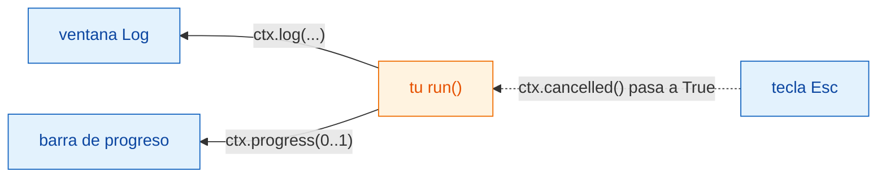
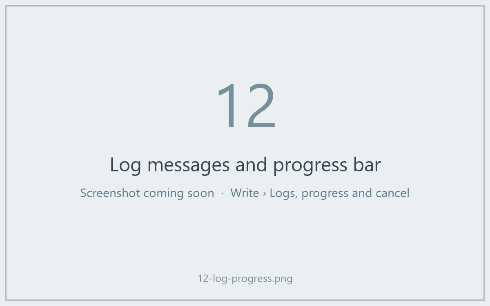

# Log, progreso y cancelar

## La idea en palabras sencillas

Cuando la cocina está ocupada, un buen camarero te cuenta cómo va: "tu sopa
está en el fuego", "ya casi está". Y si cambias de opinión, puedes anular el
pedido, pero es el cocinero quien decide cuándo es seguro dejar de remover.

En Wavu, `ctx` es esa línea entre la cocina y la mesa:

- `ctx.log("…")` envía un mensaje a la ventana **Log** de Fiji.
- `ctx.progress(0.5)` mueve la **barra de progreso** de Fiji hasta la mitad.
- `ctx.cancelled()` te dice si el usuario ha pulsado **Esc**.



## Escribir en el Log

```python
ctx.log(f"Segmenting a {img.shape} image")
```

La línea aparece en el Log de Fiji al momento, mientras tu código sigue en
marcha. Un simple `print(...)` dentro de `run` hace lo mismo. Escribe en el
Log *antes* de cualquier paso lento, para que el usuario sepa que Fiji no se
ha colgado.

## Progreso

Indica un número de `0.0` (nada hecho) a `1.0` (terminado):

```python
for i, plane in enumerate(planes):
    ...                                   # trabajar en un plano
    ctx.progress((i + 1) / len(planes))
```

La barra de progreso de Fiji se llena, y la barra de estado, en la parte
inferior de la ventana principal de Fiji, muestra el nombre del script y un
porcentaje, como *Wavu: script 40%*.



## Cancelar: por qué tu código tiene que ayudar { #cancel-why-your-code-has-to-help }

Haz clic en una ventana de Fiji y pulsa **Esc**. El Log dice
*Cancelling script…*. Pero Python no se puede interrumpir de forma segura
desde fuera en mitad de un cálculo, así que Wavu solo **levanta una bandera**.
Tu código comprueba la bandera en momentos razonables y se detiene con
educación. Esto se llama **cancelación cooperativa**.

La plantilla lo hace dentro de su bucle:

```python
for i, plane in enumerate(planes):
    if ctx.cancelled():
        ctx.log("Cancelled")
        return {}
    ...
```

Una forma más corta: `ctx.check_cancelled()` detiene la ejecución en el acto
si se ha pulsado Esc (lanza un error especial, `wavu.Cancelled`, que Wavu
gestiona sin hacer ruido).

```python
ctx.check_cancelled()       # entre dos pasos lentos
masks = model.eval(img)
ctx.check_cancelled()
```

!!! warning "Esc durante una llamada larga"
    Si tu script pasa cinco minutos dentro de una sola llamada, como un gran
    `model.eval(...)`, Esc solo surte efecto *después* de que esa llamada
    termine. Dividir el trabajo (plano a plano, tesela a tesela) hace que
    cancelar parezca instantáneo.

## Un patrón para copiar

```python
def run(ctx, inputs, params):
    img = inputs["image"]
    ctx.log("Step 1/3: smoothing")
    smooth = smooth_image(img)
    ctx.progress(0.3)
    ctx.check_cancelled()

    ctx.log("Step 2/3: segmenting")
    labels = segment(smooth)
    ctx.progress(0.8)
    ctx.check_cancelled()

    ctx.log("Step 3/3: measuring")
    table = measure(labels, img)
    ctx.progress(1.0)
    return {"labels": labels, "cells": table}
```

(`smooth_image`, `segment` y `measure` representan tus propias funciones.)

## En una frase

Usa `ctx.log` para hablar, `ctx.progress` para mostrar cuánto llevas, y
comprueba `ctx.cancelled()` entre pasos para que Esc pueda detener tu script.

[Siguiente: imágenes reales :material-arrow-right:](real-images.md){ .md-button }
