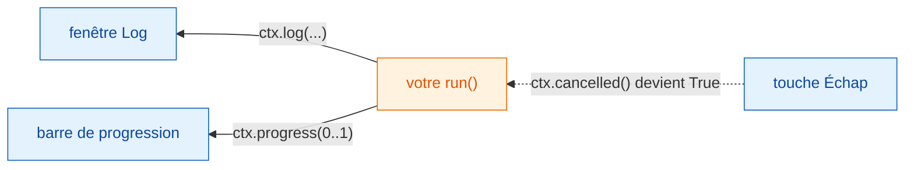
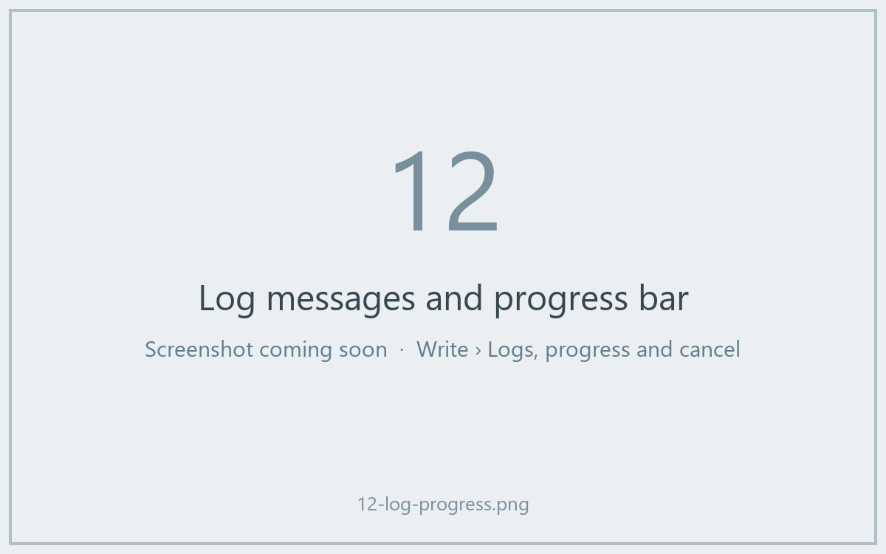

# Log, progression et annulation

## L'idée en mots simples

Quand la cuisine est occupée, un bon serveur vous dit où on en est : « votre
soupe est sur le feu », « c'est presque prêt ». Et si vous changez d'avis,
vous pouvez annuler, mais c'est le cuisinier qui décide quand il peut
arrêter de remuer sans risque.

Dans Wavu, `ctx` est cette ligne entre la cuisine et la table :

- `ctx.log("…")` envoie un message à la fenêtre **Log** de Fiji.
- `ctx.progress(0.5)` amène la **barre de progression** de Fiji à
  mi-chemin.
- `ctx.cancelled()` vous dit si l'utilisateur a appuyé sur **Échap** (Esc).



## Écrire dans le Log { #logging }

```python
ctx.log(f"Segmenting a {img.shape} image")
```

La ligne apparaît immédiatement dans le Log de Fiji, pendant que votre code
tourne encore. Un simple `print(...)` dans `run` fait la même chose. Écrivez
dans le Log *avant* toute étape lente, pour que l'utilisateur sache que Fiji
n'est pas bloqué.

## Progression { #progress }

Donnez un nombre entre `0.0` (rien n'est fait) et `1.0` (terminé) :

```python
for i, plane in enumerate(planes):
    ...                                   # traiter un plan
    ctx.progress((i + 1) / len(planes))
```

La barre de progression de Fiji se remplit, et la barre d'état en bas de la
fenêtre principale de Fiji affiche le nom du script et un pourcentage, comme
*Wavu: script 40%*.



## Annuler : pourquoi votre code doit aider { #cancel-why-your-code-has-to-help }

Cliquez sur une fenêtre de Fiji et appuyez sur **Échap**. Le Log affiche
*Cancelling script…*. Mais on ne peut pas interrompre Python proprement de
l'extérieur au milieu d'un calcul : Wavu se contente donc de **lever un
drapeau**. Votre code regarde ce drapeau aux moments opportuns et s'arrête
poliment. On appelle cela l'**annulation coopérative**.

Le modèle le fait dans sa boucle :

```python
for i, plane in enumerate(planes):
    if ctx.cancelled():
        ctx.log("Cancelled")
        return {}
    ...
```

Plus court : `ctx.check_cancelled()` arrête l'exécution sur-le-champ si
Échap a été pressé (il lève une erreur spéciale, `wavu.Cancelled`, que Wavu
gère en silence).

```python
ctx.check_cancelled()       # entre deux étapes lentes
masks = model.eval(img)
ctx.check_cancelled()
```

!!! warning "Échap pendant un seul long appel"
    Si votre script passe cinq minutes dans un seul appel, comme un gros
    `model.eval(...)`, Échap ne prend effet qu'*après* le retour de cet
    appel. Découper le travail (plan par plan, tuile par tuile) rend
    l'annulation quasi instantanée.

## Un modèle à copier

```python
def run(ctx, inputs, params):
    img = inputs["image"]
    ctx.log("Step 1/3: smoothing")
    smooth = smooth_image(img)
    ctx.progress(0.3)
    ctx.check_cancelled()

    ctx.log("Step 2/3: segmenting")
    labels = segment(smooth)
    ctx.progress(0.8)
    ctx.check_cancelled()

    ctx.log("Step 3/3: measuring")
    table = measure(labels, img)
    ctx.progress(1.0)
    return {"labels": labels, "cells": table}
```

(`smooth_image`, `segment` et `measure` représentent vos propres fonctions.)

## En une phrase

Utilisez `ctx.log` pour parler, `ctx.progress` pour montrer où vous en êtes,
et vérifiez `ctx.cancelled()` entre les étapes pour qu'Échap puisse arrêter
votre script.

[Suite : les vraies images :material-arrow-right:](real-images.md){ .md-button }
