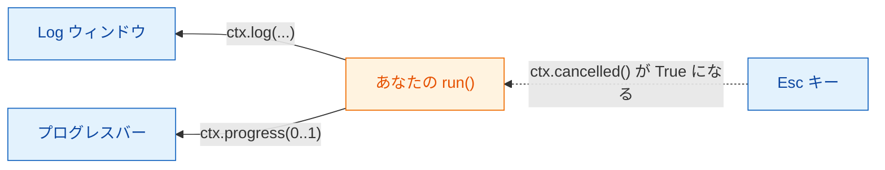
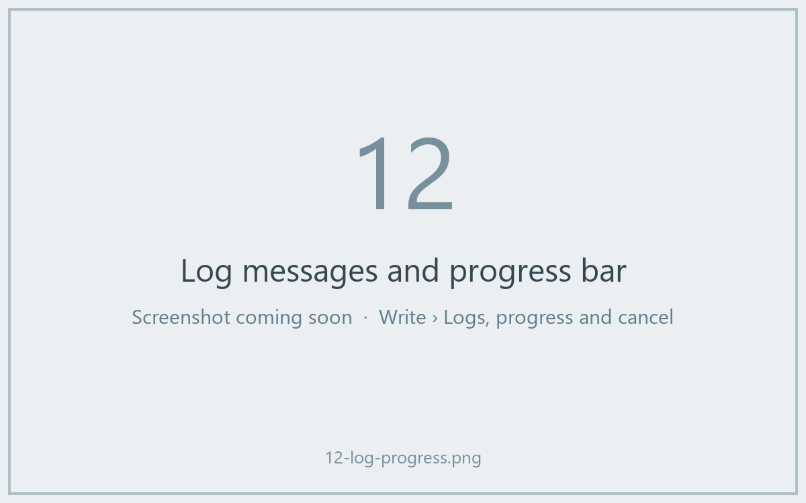

# ログ、進捗、キャンセル

## やさしく言うと

厨房が忙しいとき、良いウェイターは様子を教えてくれます。「スープを火に
かけています」「もうすぐできます」。気が変わったら注文を取り消すことも
できますが、かき混ぜるのをいつ止めても安全かを決めるのは料理人です。

Wavu では、`ctx` が厨房とテーブルをつなぐ連絡線です。

- `ctx.log("…")` は Fiji の **Log** ウィンドウにメッセージを送ります。
- `ctx.progress(0.5)` は Fiji の **プログレスバー** を半分まで進めます。
- `ctx.cancelled()` は、ユーザーが **Esc** を押したかどうかを教えてくれます。



## ログを書く

```python
ctx.log(f"Segmenting a {img.shape} image")
```

この行は、コードがまだ動いている間に、すぐ Fiji の Log に表示されます。
`run` の中の普通の `print(...)` も同じ働きをします。時間のかかる処理の
*前に* ログを書いておけば、Fiji が固まったわけではないとユーザーに伝わります。

## 進捗

`0.0`（何もしていない）から `1.0`（完了）までの数を渡します。

```python
for i, plane in enumerate(planes):
    ...                                   # 1 枚の面を処理する
    ctx.progress((i + 1) / len(planes))
```

Fiji のプログレスバーが伸び、Fiji のメインウィンドウ下部のステータスバーに、
*Wavu: script 40%* のようにスクリプト名とパーセントが表示されます。



## キャンセル：コードが手伝う必要がある理由 { #cancel-why-your-code-has-to-help }

Fiji のウィンドウをクリックして **Esc** を押します。Log には
*Cancelling script…* と出ます。でも Python は、計算の途中で外から安全に
止めることができません。そこで Wavu は **旗を揚げる** だけにしています。
あなたのコードが区切りの良いところで旗を確認し、行儀よく止まります。
これを **協調的キャンセル** と呼びます。

テンプレートはループの中でこれをやっています。

```python
for i, plane in enumerate(planes):
    if ctx.cancelled():
        ctx.log("Cancelled")
        return {}
    ...
```

もっと短い書き方もあります。`ctx.check_cancelled()` は、Esc が押されて
いればその場で実行を止めます（Wavu が静かに処理する特別なエラー
`wavu.Cancelled` を発生させます）。

```python
ctx.check_cancelled()       # 時間のかかる 2 つの処理の間で
masks = model.eval(img)
ctx.check_cancelled()
```

!!! warning "長い 1 回の呼び出し中の Esc"
    たとえば大きな `model.eval(...)` 1 回のように、スクリプトが 1 つの
    呼び出しの中に 5 分いると、Esc が効くのはその呼び出しが終わった *後* です。
    処理を分ける（面ごと、タイルごと）と、キャンセルがすぐ効くように
    感じられます。

## まねできるパターン

```python
def run(ctx, inputs, params):
    img = inputs["image"]
    ctx.log("Step 1/3: smoothing")
    smooth = smooth_image(img)
    ctx.progress(0.3)
    ctx.check_cancelled()

    ctx.log("Step 2/3: segmenting")
    labels = segment(smooth)
    ctx.progress(0.8)
    ctx.check_cancelled()

    ctx.log("Step 3/3: measuring")
    table = measure(labels, img)
    ctx.progress(1.0)
    return {"labels": labels, "cells": table}
```

（`smooth_image`、`segment`、`measure` は、あなた自身の関数のつもりです。）

## ひとことで言うと

話すには `ctx.log`、どこまで進んだかを見せるには `ctx.progress` を使い、
処理の合間に `ctx.cancelled()` を確認すれば、Esc でスクリプトを止められます。

[次へ：実際の画像 :material-arrow-right:](real-images.md){ .md-button }
