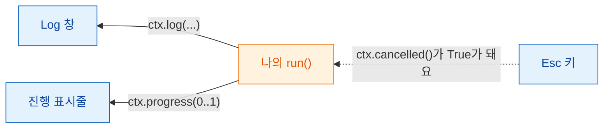
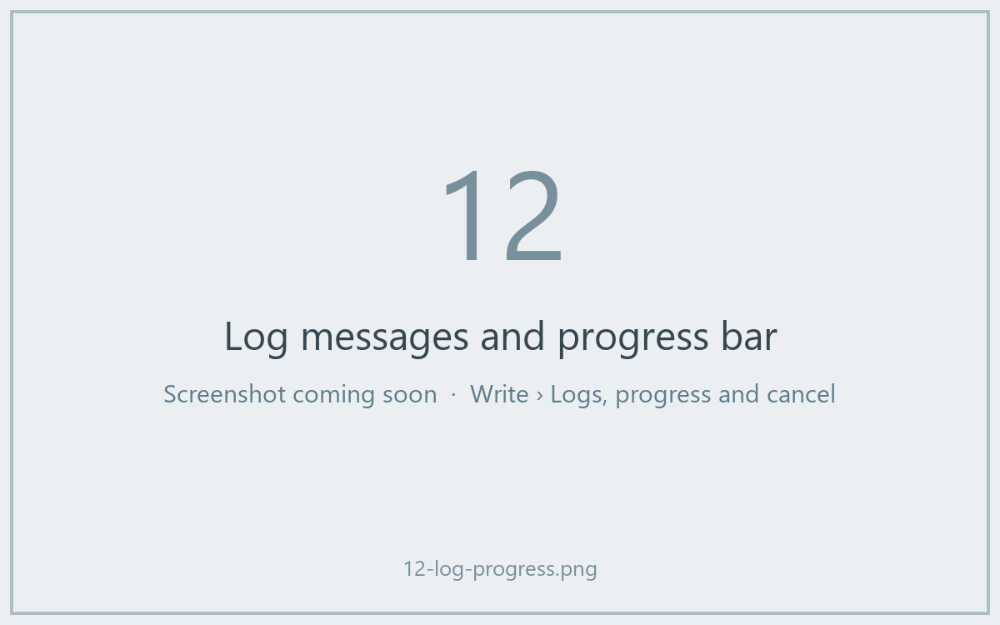

# 로그, 진행 상황, 취소

## 쉬운 말로 설명하면

주방이 바쁠 때 좋은 웨이터는 "수프가 불 위에 있어요", "거의 다 됐어요"처럼
진행 상황을 알려 줘요. 마음이 바뀌면 주문을 취소할 수도 있지만, 언제 젓기를
멈춰도 안전한지는 요리사가 정해요.

Wavu에서는 `ctx`가 주방과 테이블을 잇는 연락선이에요.

- `ctx.log("…")`는 Fiji의 **Log** 창에 메시지를 보내요.
- `ctx.progress(0.5)`는 Fiji의 **진행 표시줄**을 절반까지 옮겨요.
- `ctx.cancelled()`는 사용자가 **Esc**를 눌렀는지 알려 줘요.



## 로그 남기기

```python
ctx.log(f"Segmenting a {img.shape} image")
```

코드가 아직 돌고 있는 동안에도 그 줄이 바로 Fiji의 Log에 나타나요. `run`
안의 평범한 `print(...)`도 똑같이 동작해요. 느린 작업 *전에* 로그를 남기면
사용자가 Fiji가 멈춘 게 아니라는 걸 알 수 있어요.

## 진행 상황

`0.0`(아무것도 안 함)부터 `1.0`(끝)까지의 숫자를 주세요.

```python
for i, plane in enumerate(planes):
    ...                                   # 평면 하나 처리
    ctx.progress((i + 1) / len(planes))
```

Fiji의 진행 표시줄이 차오르고, Fiji 메인 창 아래쪽 상태 표시줄에 스크립트
이름과 백분율이 *Wavu: script 40%*처럼 나와요.



## 취소: 왜 코드가 도와야 하나요 { #cancel-why-your-code-has-to-help }

Fiji 창을 클릭하고 **Esc**를 누르세요. Log에 *Cancelling script…*가 나와요.
하지만 Python은 계산 도중에 밖에서 안전하게 끊을 수 없어요. 그래서 Wavu는
**깃발만 올려요.** 코드가 적당한 때에 깃발을 확인하고 얌전히 멈추는 거예요.
이걸 **협력적 취소(cooperative cancel)**라고 해요.

템플릿은 반복문 안에서 이렇게 해요.

```python
for i, plane in enumerate(planes):
    if ctx.cancelled():
        ctx.log("Cancelled")
        return {}
    ...
```

더 짧은 방법도 있어요. `ctx.check_cancelled()`는 Esc가 눌렸으면 그 자리에서
실행을 멈춰요(Wavu가 조용히 처리하는 특별한 `wavu.Cancelled` 오류를 내요).

```python
ctx.check_cancelled()       # 느린 두 단계 사이에서
masks = model.eval(img)
ctx.check_cancelled()
```

!!! warning "긴 호출 하나 도중의 Esc"
    스크립트가 큰 `model.eval(...)` 같은 호출 하나 안에서 5분을 보낸다면,
    Esc는 그 호출이 끝난 *뒤에야* 효과가 있어요. 작업을 나누면(평면별로,
    타일별로) 취소가 즉시 되는 것처럼 느껴져요.

## 그대로 따라 쓸 패턴

```python
def run(ctx, inputs, params):
    img = inputs["image"]
    ctx.log("Step 1/3: smoothing")
    smooth = smooth_image(img)
    ctx.progress(0.3)
    ctx.check_cancelled()

    ctx.log("Step 2/3: segmenting")
    labels = segment(smooth)
    ctx.progress(0.8)
    ctx.check_cancelled()

    ctx.log("Step 3/3: measuring")
    table = measure(labels, img)
    ctx.progress(1.0)
    return {"labels": labels, "cells": table}
```

(`smooth_image`, `segment`, `measure`는 여러분이 만든 함수 자리예요.)

## 한 문장으로

`ctx.log`로 말하고, `ctx.progress`로 얼마나 왔는지 보여 주고, 단계 사이에
`ctx.cancelled()`를 확인하면 Esc로 스크립트를 멈출 수 있어요.

[다음: 실제 이미지 :material-arrow-right:](real-images.md){ .md-button }
