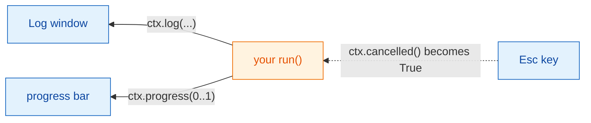
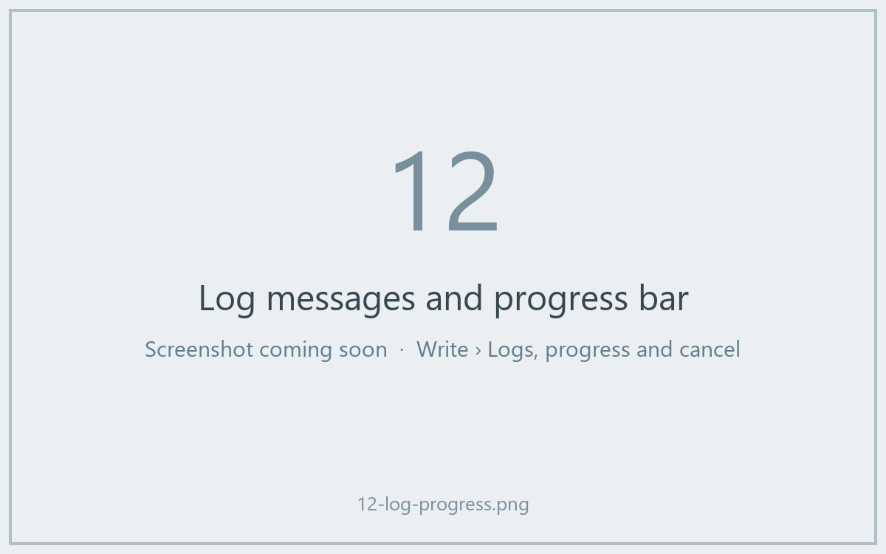

# Logs, progress and cancel

## The idea in plain words

When the kitchen is busy, a good waiter tells you how it is going: "your
soup is on the stove", "almost ready". And if you change your mind, you can
call it off, but the cook decides when it is safe to stop stirring.

In Wavu, `ctx` is that line between kitchen and table:

- `ctx.log("…")` sends a message to Fiji's **Log** window.
- `ctx.progress(0.5)` moves Fiji's **progress bar** to half-way.
- `ctx.cancelled()` tells you whether the user pressed **Esc**.



## Logging

```python
ctx.log(f"Segmenting a {img.shape} image")
```

The line appears in Fiji's Log immediately, while your code is still running.
A plain `print(...)` inside `run` does the same. Log *before* anything slow,
so the user knows Fiji is not frozen.

## Progress

Give a number from `0.0` (nothing done) to `1.0` (finished):

```python
for i, plane in enumerate(planes):
    ...                                   # work on one plane
    ctx.progress((i + 1) / len(planes))
```

Fiji's progress bar fills up, and the status bar at the bottom of the main
Fiji window shows the script name and a percentage, such as
*Wavu: script 40%*.



## Cancel: why your code has to help

Click on a Fiji window and press **Esc**. The Log says
*Cancelling script…*. But Python cannot be interrupted safely from outside in
the middle of a calculation, so Wavu only **raises a flag**. Your code
checks the flag at sensible moments and stops politely. This is called
**cooperative cancel**.

The template does it inside its loop:

```python
for i, plane in enumerate(planes):
    if ctx.cancelled():
        ctx.log("Cancelled")
        return {}
    ...
```

A shorter way: `ctx.check_cancelled()` stops the run on the spot if Esc was
pressed (it raises a special `wavu.Cancelled` error that Wavu handles
quietly).

```python
ctx.check_cancelled()       # between two slow steps
masks = model.eval(img)
ctx.check_cancelled()
```

!!! warning "Esc during one long call"
    If your script spends five minutes inside a single call, such as one big
    `model.eval(...)`, Esc only takes effect *after* that call returns.
    Splitting the work (plane by plane, tile by tile) makes cancel feel
    instant.

## A pattern to copy

```python
def run(ctx, inputs, params):
    img = inputs["image"]
    ctx.log("Step 1/3: smoothing")
    smooth = smooth_image(img)
    ctx.progress(0.3)
    ctx.check_cancelled()

    ctx.log("Step 2/3: segmenting")
    labels = segment(smooth)
    ctx.progress(0.8)
    ctx.check_cancelled()

    ctx.log("Step 3/3: measuring")
    table = measure(labels, img)
    ctx.progress(1.0)
    return {"labels": labels, "cells": table}
```

(`smooth_image`, `segment` and `measure` stand for your own functions.)

## In one sentence

Use `ctx.log` to talk, `ctx.progress` to show how far you are, and check
`ctx.cancelled()` between steps so Esc can stop your script.

[Next: real images :material-arrow-right:](real-images.md){ .md-button }
