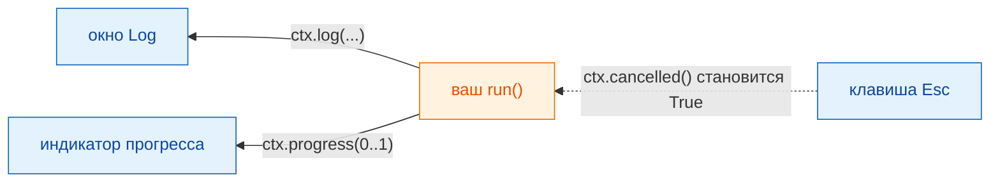

# Log, прогресс и отмена

## Идея простыми словами

Когда на кухне много работы, хороший официант рассказывает, как идут дела:
«ваш суп на плите», «почти готово». А если вы передумали, заказ можно
отменить, но повар сам решает, когда безопасно перестать помешивать.

В Wavu `ctx` — это та самая связь между кухней и столом:

- `ctx.log("…")` отправляет сообщение в окно **Log** Fiji.
- `ctx.progress(0.5)` двигает **индикатор прогресса** Fiji до середины.
- `ctx.cancelled()` сообщает, нажал ли пользователь **Esc**.



## Сообщения в Log

```python
ctx.log(f"Segmenting a {img.shape} image")
```

Строка сразу появляется в Log Fiji, пока ваш код ещё работает. Обычный
`print(...)` внутри `run` делает то же самое. Пишите в Log *перед* любым
медленным шагом, чтобы пользователь знал, что Fiji не завис.

## Прогресс

Передайте число от `0.0` (ничего не сделано) до `1.0` (готово):

```python
for i, plane in enumerate(planes):
    ...                                   # обработать одну плоскость
    ctx.progress((i + 1) / len(planes))
```

Индикатор прогресса Fiji заполняется, а строка состояния внизу главного окна
Fiji показывает имя скрипта и процент, например *Wavu: script 40%*.

## Отмена: почему ваш код должен помочь { #cancel-why-your-code-has-to-help }

Щёлкните по окну Fiji и нажмите **Esc**. В Log появится
*Cancelling script…*. Но Python нельзя безопасно прервать снаружи посреди
вычисления, поэтому Wavu только **поднимает флажок**. Ваш код проверяет
флажок в удобные моменты и вежливо останавливается. Это называется
**кооперативной отменой**.

Шаблон делает это внутри своего цикла:

```python
for i, plane in enumerate(planes):
    if ctx.cancelled():
        ctx.log("Cancelled")
        return {}
    ...
```

Короче: `ctx.check_cancelled()` сразу останавливает запуск, если нажата Esc
(он выбрасывает особую ошибку `wavu.Cancelled`, которую Wavu тихо
обрабатывает).

```python
ctx.check_cancelled()       # между двумя медленными шагами
masks = model.eval(img)
ctx.check_cancelled()
```

!!! warning "Esc во время одного долгого вызова"
    Если скрипт пять минут проводит внутри одного вызова, например одного
    большого `model.eval(...)`, Esc сработает только *после* того, как этот
    вызов завершится. Если разбить работу на части (по плоскостям, по
    фрагментам), отмена будет срабатывать мгновенно.

## Шаблон для копирования

```python
def run(ctx, inputs, params):
    img = inputs["image"]
    ctx.log("Step 1/3: smoothing")
    smooth = smooth_image(img)
    ctx.progress(0.3)
    ctx.check_cancelled()

    ctx.log("Step 2/3: segmenting")
    labels = segment(smooth)
    ctx.progress(0.8)
    ctx.check_cancelled()

    ctx.log("Step 3/3: measuring")
    table = measure(labels, img)
    ctx.progress(1.0)
    return {"labels": labels, "cells": table}
```

(`smooth_image`, `segment` и `measure` — это ваши собственные функции.)

## Одним предложением

Используйте `ctx.log`, чтобы сообщать, `ctx.progress`, чтобы показывать,
сколько сделано, и проверяйте `ctx.cancelled()` между шагами, чтобы Esc
могла остановить скрипт.

[Далее: настоящие изображения :material-arrow-right:](real-images.md){ .md-button }
