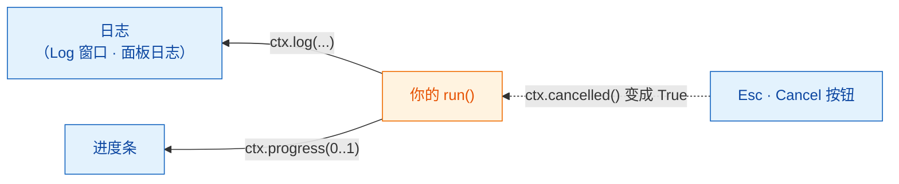

# 日志、进度和取消

## 用大白话说

厨房忙的时候，好的服务员会告诉你进展：“汤已经在灶上了”“马上就好”。
如果你改主意了，也可以叫停，但什么时候能安全地停下搅拌，由厨师说了算。

在 Wavu 里，`ctx` 就是 worker（厨房）和餐桌之间的那根线：

- `ctx.log("…")` 往**日志**发一条消息。
- `ctx.progress(0.5)` 把**进度条**推到一半。
- `ctx.cancelled()` 告诉你用户有没有要求**停下**。

你的代码在 Fiji 和 napari 里完全一样；只是显示的位置不同：

| | Fiji | napari |
|---|---|---|
| `ctx.log` 和 `print` | **Log** 窗口 | Wavu 面板里的日志框 |
| `ctx.progress` | Fiji 的进度条，外加状态栏里的 *Wavu: script 40%* | Wavu 面板里的进度条 |
| 用户怎么取消 | 按 **Esc** | 在面板里按 **Cancel** |
| 你的代码出错 | 一个错误窗口，详情在 Log 里 | 面板日志里的 `Error: …`，外加一条通知 |



## 写日志

```python
ctx.log(f"Segmenting a {img.shape} image")
```

这一行会立刻出现在日志里，哪怕你的代码还在运行。
在 `run` 里用普通的 `print(...)` 也一样。在任何慢步骤*之前*先写一条日志，
用户就知道程序没有卡死。

## 进度

给一个从 `0.0`（还没开始）到 `1.0`（完成）的数：

```python
for i, plane in enumerate(planes):
    ...                                   # 处理一个平面
    ctx.progress((i + 1) / len(planes))
```

进度条会逐渐填满。在 Fiji 里，主窗口底部的状态栏还会显示脚本名和百分比，比如
*Wavu: script 40%*。

## 取消：为什么需要你的代码配合 { #cancel-why-your-code-has-to-help }

在 Fiji 里，先点一下任意一个 Fiji 窗口，再按 **Esc**；Log 会显示
*Cancelling script…*。在 napari 里，在 Wavu 面板里按 **Cancel**；日志会显示
*Cancelling...*，等脚本真正停下后再显示 *Cancelled.*。但 Python 没法在计算中途被外部安全地打断，所以 Wavu
只会**举起一面小旗**。你的代码在合适的时候检查这面旗，然后体面地停下来。
这叫做**协作式取消**（cooperative cancel）。

模板就在循环里这样做：

```python
for i, plane in enumerate(planes):
    if ctx.cancelled():
        ctx.log("Cancelled")
        return {}
    ...
```

更简短的写法：如果用户已经取消，`ctx.check_cancelled()` 会当场结束运行
（它会抛出一个特殊的 `wavu.Cancelled` 错误，Wavu 会悄悄处理掉）。

```python
ctx.check_cancelled()       # 在两个慢步骤之间
masks = model.eval(img)
ctx.check_cancelled()
```

!!! warning "在一次很长的调用中取消"
    如果你的脚本在单次调用里花了五分钟，比如一个很大的
    `model.eval(...)`，Esc 或 **Cancel** 都要等这次调用*返回之后*才生效。
    把工作拆开（逐个平面、逐个分块处理），取消就会显得很及时。

## 可以照抄的模式

```python
def run(ctx, inputs, params):
    img = inputs["image"]
    ctx.log("Step 1/3: smoothing")
    smooth = smooth_image(img)
    ctx.progress(0.3)
    ctx.check_cancelled()

    ctx.log("Step 2/3: segmenting")
    labels = segment(smooth)
    ctx.progress(0.8)
    ctx.check_cancelled()

    ctx.log("Step 3/3: measuring")
    table = measure(labels, img)
    ctx.progress(1.0)
    return {"labels": labels, "cells": table}
```

（`smooth_image`、`segment` 和 `measure` 代表你自己的函数。）

## 一句话总结

用 `ctx.log` 说话，用 `ctx.progress` 显示进展，并在步骤之间检查
`ctx.cancelled()`，让 Esc（Fiji）或 **Cancel**（napari）能停下你的脚本。

[下一步：真实图像 :material-arrow-right:](real-images.md){ .md-button }
