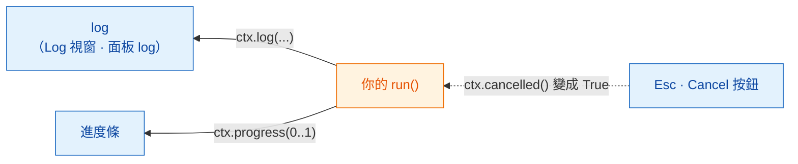

# Log、進度與取消

## 用白話說

廚房忙的時候，好的服務生會告訴你進度：「湯在爐子上了」、「快好了」。
如果你改變主意，也可以叫停，但什麼時候能安全地停下攪拌，由廚師決定。

在 Wavu 裡，`ctx` 就是 worker（廚房）和餐桌之間的那條線：

- `ctx.log("…")` 把一則訊息送到 **log**。
- `ctx.progress(0.5)` 把**進度條**移到一半。
- `ctx.cancelled()` 告訴你使用者有沒有要求**停止**。

你的程式碼在 Fiji 和 napari 裡都一樣；只有東西出現的地方不同：

| | Fiji | napari |
|---|---|---|
| `ctx.log` 和 `print` | **Log** 視窗 | Wavu 面板裡的 log 框 |
| `ctx.progress` | Fiji 的進度條，加上狀態列裡的 *Wavu: script 40%* | Wavu 面板裡的進度條 |
| 使用者怎麼取消 | 按 **Esc** | 在面板裡按 **Cancel** |
| 你的程式碼出錯時 | 一個錯誤視窗，詳細內容在 Log 裡 | 面板 log 裡的 `Error: …`，加上一則通知 |



## 寫 Log

```python
ctx.log(f"Segmenting a {img.shape} image")
```

這一行會立刻出現在 log 裡，即使你的程式碼還在執行。
在 `run` 裡用一般的 `print(...)` 效果也一樣。在任何耗時的步驟*之前*先寫 Log，
使用者才知道沒有東西當掉。

## 進度

給一個從 `0.0`（還沒開始）到 `1.0`（完成）的數字：

```python
for i, plane in enumerate(planes):
    ...                                   # 處理一個平面
    ctx.progress((i + 1) / len(planes))
```

進度條會慢慢填滿。在 Fiji 裡，主視窗底部的狀態列還會顯示腳本名稱和百分比，例如
*Wavu: script 40%*。

## 取消：為什麼需要你的程式碼配合 { #cancel-why-your-code-has-to-help }

在 Fiji 裡，在任一個 Fiji 視窗上按一下，再按 **Esc**；Log 會顯示
*Cancelling script…*。在 napari 裡，在 Wavu 面板按 **Cancel**；log 會顯示
*Cancelling...*，等你的腳本停下來後再顯示 *Cancelled.*。但 Python 在計算途中無法從外部被安全地打斷，所以 Wavu
只會**舉起一面旗子**。你的程式碼在適當的時機檢查這面旗子，然後禮貌地停下來。
這叫做**合作式取消**（cooperative cancel）。

範本在迴圈裡就是這樣做的：

```python
for i, plane in enumerate(planes):
    if ctx.cancelled():
        ctx.log("Cancelled")
        return {}
    ...
```

更短的寫法：如果使用者已經取消，`ctx.check_cancelled()` 會當場停止執行
（它會丟出一個特殊的 `wavu.Cancelled` 錯誤，Wavu 會安靜地處理掉）。

```python
ctx.check_cancelled()       # 在兩個耗時步驟之間
masks = model.eval(img)
ctx.check_cancelled()
```

!!! warning "在一個很長的呼叫中取消"
    如果你的腳本在單一呼叫裡花了五分鐘，例如一個很大的
    `model.eval(...)`，Esc 或 **Cancel** 只會在那個呼叫*結束之後*才生效。
    把工作拆開（一個平面一個平面、一塊一塊地處理），取消就會感覺很即時。

## 可以照抄的寫法

```python
def run(ctx, inputs, params):
    img = inputs["image"]
    ctx.log("Step 1/3: smoothing")
    smooth = smooth_image(img)
    ctx.progress(0.3)
    ctx.check_cancelled()

    ctx.log("Step 2/3: segmenting")
    labels = segment(smooth)
    ctx.progress(0.8)
    ctx.check_cancelled()

    ctx.log("Step 3/3: measuring")
    table = measure(labels, img)
    ctx.progress(1.0)
    return {"labels": labels, "cells": table}
```

（`smooth_image`、`segment` 和 `measure` 代表你自己的函式。）

## 一句話總結

用 `ctx.log` 說話，用 `ctx.progress` 顯示做到哪裡，並在步驟之間檢查
`ctx.cancelled()`，讓 Esc（Fiji）或 **Cancel**（napari）能停下你的腳本。

[下一步：真實的影像 :material-arrow-right:](real-images.md){ .md-button }
