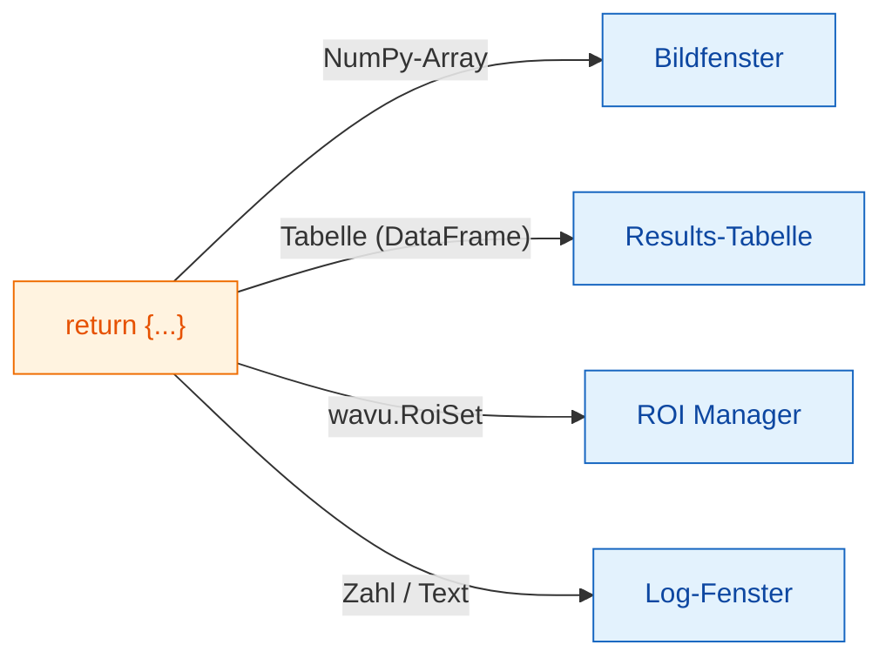

# Was Sie zurückgeben können

## Die Idee in einfachen Worten

Am Ende von `run` geben Sie **ein Dictionary** zurück: eine Reihe
beschrifteter Teller. Der **Schlüssel** ist der Name auf dem Teller, der
**Wert** ist das Essen. Fiji sieht sich jeden Wert an und serviert ihn an
der richtigen Stelle: Bilder in Bildfenster, Tabellen in eine
Results-Tabelle, Umrisse in den ROI Manager, und einzelne Zahlen oder Wörter
ins Log.



## Die Teller-Karte

| Sie geben zurück | Fiji zeigt |
|---|---|
| ein NumPy-Array (2-D oder mehr) | ein **neues Bild**. Ja/Nein-Masken werden 8-Bit 0/255, ganze Zahlen bis 65535 werden 16-Bit, alles andere 32-Bit. |
| ein Array, dessen Name `label` enthält | dasselbe, mit der bunten Farbtabelle (LUT) **glasbey** |
| `wavu.Image(array, pixel_um=0.65, axes="ZYX")` | ein Bild **mit Pixelgröße und Achsen** |
| ein pandas-`DataFrame` oder eine Liste von Dicts | eine **Results-Tabelle** |
| `wavu.RoiSet(path_to_zip)` | die Umrisse im **ROI Manager** |
| eine Zahl, Text, `True`/`False` | eine Zeile `name = value` im **Log** |
| einen Dateipfad (`pathlib.Path`) | den Pfad, ausgegeben im **Log** |

Jeder Bild- oder Tabellentitel beginnt mit dem Namen des Eingabebilds: Wenn
Sie `{"labels": ...}` für *blobs.gif* zurückgeben, heißt das Fenster
*blobs-labels*.

## Ein Beispiel mit drei Arten von Ergebnissen

(Braucht `scikit-image` und `pandas` in `pixi.toml`.)

```python
def run(ctx, inputs, params):
    from skimage import filters, measure
    import pandas as pd

    img = inputs["image"]
    labels = measure.label(img > filters.threshold_otsu(img))
    table = pd.DataFrame(measure.regionprops_table(
        labels, img, properties=("label", "area", "mean_intensity")))
    return {
        "labels": labels,           # Bild, glasbey-Farben
        "cells": table,             # Results-Tabelle
        "count": int(labels.max())  # Log: count = ...
    }
```

## Umrisse für den ROI Manager

Fijis ROI Manager liest ImageJ-*RoiSet*-ZIP-Dateien. Schreiben Sie eine in
`ctx.tmpdir`, einen temporären Arbeitsordner, den Wavu jedem Durchlauf mitgibt, und geben
Sie sie verpackt in `wavu.RoiSet` zurück. Das Schreiben übernimmt das Paket
[roifile](https://pypi.org/project/roifile/) (fügen Sie `roifile` zu
`pixi.toml` hinzu):

```python
from pathlib import Path
import roifile
import wavu

rois = [roifile.ImagejRoi.frompoints(outline) for outline in outlines]  # (x, y)-Punkte
zip_path = Path(ctx.tmpdir) / "RoiSet.zip"
roifile.roiwrite(zip_path, rois)
return {"labels": labels, "outlines": wavu.RoiSet(zip_path)}
```

Das Cellpose-Beispiel im Wavu-Repository
([`examples/cellpose_nuclei`](https://github.com/Oxford-Zeiss-Centre-of-Excellence/Wavu/tree/main/examples/cellpose_nuclei))
macht genau das mit den Umrissen von Cellpose.

## Gut zu wissen

- **Die Kalibrierung gibt es gratis.** Ein Ausgabebild mit derselben Breite
  und Höhe wie das Eingabebild bekommt dessen Pixelgröße, außer Sie geben mit
  `wavu.Image(..., pixel_um=...)` Ihre eigene an.
- **Mehr als 65535 Objekte?** Dann kommt das Label-Bild als 32-Bit statt
  16-Bit zurück.
- **Nichts zurückgeben** (oder `return {}`) ist in Ordnung: Fiji zeigt dann
  einfach nichts an.
- **Löst Ihr Code einen Fehler aus**, zeigt Fiji die Meldung in einem
  Fehlerfenster und alle Details im Log. Siehe
  [Fehlerbehebung](../help/troubleshooting.md#an-error-appears-in-the-log).

## In einem Satz

Geben Sie ein Dictionary zurück, und Fiji legt Arrays in Bildfenster,
Tabellen in eine Results-Tabelle, `wavu.RoiSet` in den ROI Manager und
einfache Werte ins Log.

[Weiter: Log, Fortschritt und Abbrechen :material-arrow-right:](logs-progress-cancel.md){ .md-button }
