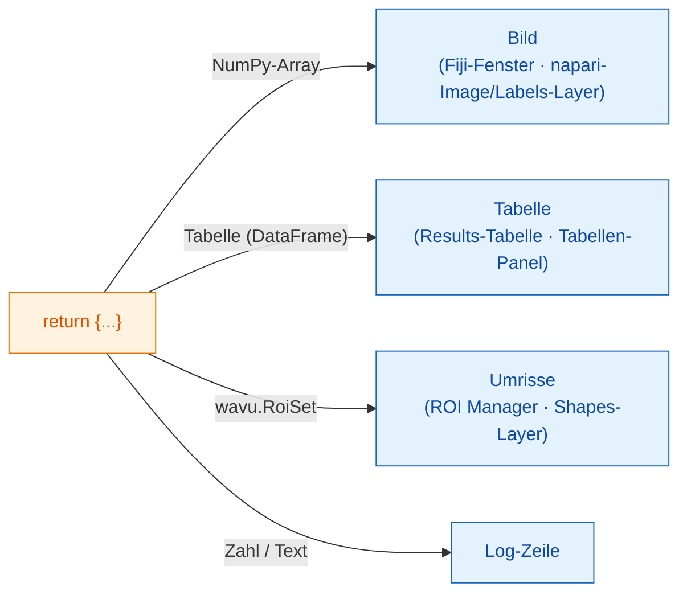

# Was Sie zurückgeben können

## Die Idee in einfachen Worten

Am Ende von `run` geben Sie **ein Dictionary** zurück: eine Reihe
beschrifteter Teller. Der **Schlüssel** ist der Name auf dem Teller, der
**Wert** ist das Essen. Der Kellner, Fiji oder napari, sieht sich jeden Wert
an und serviert ihn dort, wo dieser Betrachter solche Dinge aufbewahrt:
Bilder als Bilder, Segmentierungen als Labels, Tabellen als Tabellen, Umrisse
als Regionen, und einzelne Zahlen oder Wörter ins Log. Ihr Skript ändert sich
zwischen den Betrachtern nicht; nur das Servieren ist anders.



## Die Teller-Karte

=== "Fiji"

    | Sie geben zurück | Fiji zeigt |
    |---|---|
    | ein NumPy-Array (2-D oder mehr) | ein **neues Bildfenster** |
    | ein Array, dessen Name `label` enthält | dasselbe, mit der bunten Farbtabelle (LUT) **glasbey** |
    | `wavu.Image(array, pixel_um=0.65, axes="ZYX")` | ein Bild **mit Pixelgröße und Achsen** |
    | ein pandas-`DataFrame` oder eine Liste von Dicts | eine **Results-Tabelle** |
    | `wavu.RoiSet(path_to_zip)` | die Umrisse im **ROI Manager** |
    | eine Zahl, Text, `True`/`False` | eine Zeile `name = value` im **Log** |
    | einen Dateipfad (`pathlib.Path`) | den Pfad, ausgegeben im **Log** |

    Jeder Bild- oder Tabellentitel beginnt mit dem Namen des Eingabebilds:
    Wenn Sie `{"labels": ...}` für *blobs.gif* zurückgeben, heißt das
    Fenster *blobs-labels*.

=== "napari"

    | Sie geben zurück | napari zeigt |
    |---|---|
    | ein NumPy-Array (2-D oder mehr) | einen **Image**-Layer, benannt nach dem Schlüssel |
    | ein Ganzzahl-Array, dessen Schlüssel `label`, `mask`, `seg` oder `instance` enthält (Groß-/Kleinschreibung egal) | einen **Labels**-Layer |
    | `wavu.Image(arr, extra={"napari": "labels"})` | einen **Labels**-Layer, unabhängig vom Namen |
    | `wavu.Image(arr, extra={"napari": "image"})` | einen **Image**-Layer, auch wenn der Name `labels` sagt |
    | `wavu.Image(arr, axes="CYX", channel_names=["DNA", "Actin"])` | einen Image-Layer pro Kanal (naparis `channel_axis`): `name [DNA]`, `name [Actin]` |
    | ein RGB-Bild (`axes` endet auf `S`, letzte Größe 3 oder 4) | einen RGB-Image-Layer |
    | `wavu.RoiSet(path_to_zip)` | einen **Shapes**-Layer mit gelben Polygonen |
    | ein pandas-`DataFrame` oder eine Liste von Dicts | ein rechts angedocktes **Tabellen-Panel**, benannt nach dem Schlüssel, plus eine Log-Zeile `name: table with N rows` |
    | eine Zahl, Text, `True`/`False` | eine Zeile `name = value` im **Log** des Panels |
    | einen Dateipfad (`pathlib.Path`) | eine Log-Zeile `name: path` |

    Die Regel „wie Labels benannt“ ist dieselbe Idee, die Fiji für seine
    glasbey-Farbtabelle nutzt, daher sehen die meisten Skripte ohne jede
    Änderung in beiden Betrachtern richtig aus. Passt der Name nicht, setzen
    Sie den Hinweis mit `extra`.

**Bildtypen** sind in beiden Betrachtern gleich: Ja/Nein-Masken werden 8-Bit
0/255, ganze Zahlen bis 65535 werden 16-Bit, alles andere 32-Bit-Float. Ein
Labelbild mit mehr als 65535 Objekten (oder Werten unter 0) kommt daher als
32-Bit-Float zurück; napari öffnet es dann als Image-Layer.

## Ein Beispiel mit drei Arten von Ergebnissen

(Braucht `scikit-image` und `pandas` in `pixi.toml`.)

```python
def run(ctx, inputs, params):
    from skimage import filters, measure
    import pandas as pd

    img = inputs["image"]
    labels = measure.label(img > filters.threshold_otsu(img))
    table = pd.DataFrame(measure.regionprops_table(
        labels, img, properties=("label", "area", "mean_intensity")))
    return {
        "labels": labels,           # glasbey-Bild / Labels-Layer
        "cells": table,             # Results-Tabelle / Tabellen-Panel
        "count": int(labels.max())  # Log: count = ...
    }
```

## Umrisse für den ROI Manager und Shapes

Umrisse reisen als ImageJ-*RoiSet*-ZIP-Datei. Schreiben Sie eine in
`ctx.tmpdir`, einen temporären Arbeitsordner, den Wavu jedem Durchlauf
mitgibt, und geben Sie sie verpackt in `wavu.RoiSet` zurück. Das Schreiben
übernimmt das Paket [roifile](https://pypi.org/project/roifile/) (fügen Sie
`roifile` zu `pixi.toml` hinzu):

```python
from pathlib import Path
import roifile
import wavu

rois = [roifile.ImagejRoi.frompoints(outline) for outline in outlines]  # (x, y)-Punkte
zip_path = Path(ctx.tmpdir) / "RoiSet.zip"
roifile.roiwrite(zip_path, rois)
return {"labels": labels, "outlines": wavu.RoiSet(zip_path)}
```

Fiji öffnet die ZIP-Datei im ROI Manager. napari liest sie ebenfalls mit
roifile (die napari-Umgebung von Wavu enthält es; fehlte es, würde Ihnen das
Log stattdessen sagen, wo die ZIP-Datei liegt). Das Cellpose-Beispiel im
Wavu-Repository
([`examples/cellpose_nuclei`](https://github.com/Oxford-Zeiss-Centre-of-Excellence/Wavu/tree/main/examples/cellpose_nuclei))
macht genau das mit den Umrissen von Cellpose.

## Die Pixelgröße kommt mit

Ein Ausgabebild bekommt die Pixelgröße der Eingabe, außer Sie geben mit
`wavu.Image(..., pixel_um=...)` Ihre eigene an.

- **Fiji** kopiert die Kalibrierung auf jede Ausgabe mit derselben Breite
  und Höhe wie die Eingabe.
- **napari** schickt `pixel_um`, wenn die letzten beiden **scale**-Werte des
  Eingabe-Layers gleich (und nicht 1) sind und seine Einheiten Mikrometer
  oder Pixel sind. Jede Bildausgabe ohne eigene Pixelgröße bekommt dieselbe
  Skalierung und liegt so genau über ihrer Eingabe; `pixel_um=0.65` setzt die
  letzten beiden scale-Werte auf `0.65`.

## Gut zu wissen

- **Was napari hineinschickt.** In einem `image`-Feld lassen sich nur
  **Image**- und **Labels**-Layer auswählen. Das Panel schickt die Daten des
  Layers (bei einem Multiscale-Layer die volle Auflösung; verzögert geladene
  dask-Daten werden zuerst in den Speicher geladen), den Layer-Namen als
  Titel und bei RGB-Layern `axes="YXS"`, damit Ihr Skript weiß, dass die
  letzte Achse die Farbe ist.
- **Nichts zurückgeben** (oder `return {}`) ist in Ordnung: Es erscheint
  einfach nichts Neues.
- **Löst Ihr Code einen Fehler aus**, zeigt Fiji die Meldung in einem
  Fehlerfenster und alle Details im Log; napari schreibt `Error: …` mit dem
  vollständigen Traceback ins Log des Panels und zeigt eine kurze
  Benachrichtigung. Siehe
  [Fehlerbehebung](../help/troubleshooting.md#an-error-appears-in-the-log).

## In einem Satz

Geben Sie ein Dictionary zurück, und der Betrachter serviert es: Arrays als
Bildfenster oder Image/Labels-Layer, Tabellen als Results-Tabelle oder
Tabellen-Panel, `wavu.RoiSet` im ROI Manager oder als Shapes, und einfache
Werte ins Log, wobei die Pixelgröße der Eingabe übernommen wird.

[Weiter: Log, Fortschritt und Abbrechen :material-arrow-right:](logs-progress-cancel.md){ .md-button }
