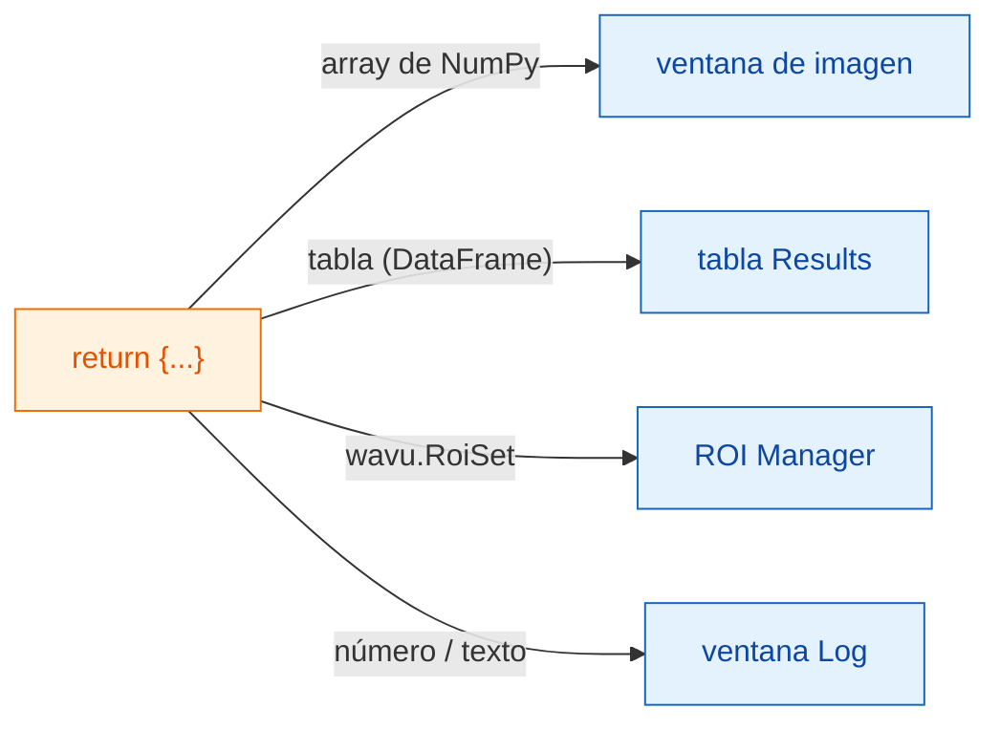
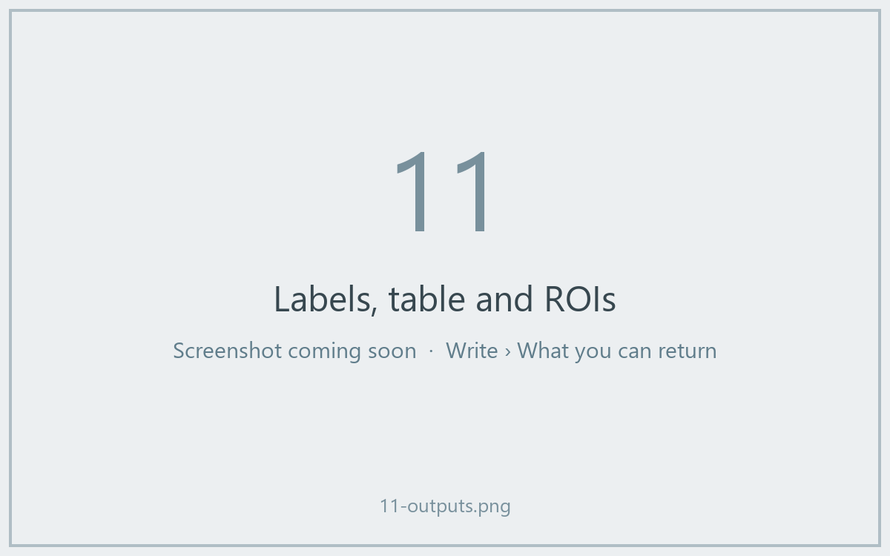

# Qué puedes devolver

## La idea en palabras sencillas

Al final de `run` entregas **un diccionario**: un conjunto de platos con
etiqueta. La **clave** es el nombre escrito en el plato y el **valor** es la
comida. Fiji mira cada valor y lo sirve en el sitio adecuado: las imágenes van
a ventanas de imagen, las tablas a una tabla Results, los contornos al ROI
Manager, y los números o palabras sueltos al Log.



## La carta de platos

| Tú devuelves | Fiji muestra |
|---|---|
| un array de NumPy (2-D o más) | una **imagen nueva**. Las máscaras de sí/no pasan a 8 bits 0/255, los enteros hasta 65535 a 16 bits, todo lo demás a 32 bits. |
| un array cuyo nombre contiene `label` | lo mismo, con la tabla de colores (LUT) **glasbey**, muy colorida |
| `wavu.Image(array, pixel_um=0.65, axes="ZYX")` | una imagen **con tamaño de píxel y ejes** definidos |
| un `DataFrame` de pandas, o una lista de diccionarios | una **tabla Results** |
| `wavu.RoiSet(path_to_zip)` | los contornos en el **ROI Manager** |
| un número, texto, `True`/`False` | una línea `name = value` en el **Log** |
| una ruta de archivo (`pathlib.Path`) | la ruta, escrita en el **Log** |

El título de cada imagen o tabla empieza por el nombre de la imagen de
entrada, así que devolver `{"labels": ...}` desde *blobs.gif* da una ventana
llamada *blobs-labels*.

## Un ejemplo con tres tipos de resultados

(Necesita `scikit-image` y `pandas` en `pixi.toml`.)

```python
def run(ctx, inputs, params):
    from skimage import filters, measure
    import pandas as pd

    img = inputs["image"]
    labels = measure.label(img > filters.threshold_otsu(img))
    table = pd.DataFrame(measure.regionprops_table(
        labels, img, properties=("label", "area", "mean_intensity")))
    return {
        "labels": labels,           # imagen, colores glasbey
        "cells": table,             # tabla Results
        "count": int(labels.max())  # Log: count = ...
    }
```



## Contornos para el ROI Manager

El ROI Manager de Fiji lee archivos zip *RoiSet* de ImageJ. Escribe uno en
`ctx.tmpdir`, una carpeta temporal que Wavu da a cada ejecución, y devuélvelo
envuelto en `wavu.RoiSet`. El paquete [roifile](https://pypi.org/project/roifile/)
se encarga de escribirlo (añade `roifile` a `pixi.toml`):

```python
from pathlib import Path
import roifile
import wavu

rois = [roifile.ImagejRoi.frompoints(outline) for outline in outlines]  # puntos (x, y)
zip_path = Path(ctx.tmpdir) / "RoiSet.zip"
roifile.roiwrite(zip_path, rois)
return {"labels": labels, "outlines": wavu.RoiSet(zip_path)}
```

El ejemplo de Cellpose del repositorio de Wavu
([`examples/cellpose_nuclei`](https://github.com/Oxford-Zeiss-Centre-of-Excellence/Wavu/tree/main/examples/cellpose_nuclei))
hace exactamente esto con los contornos de Cellpose.

## Conviene saber

- **La calibración viene gratis.** Una imagen de salida con el mismo ancho y
  alto que la entrada recibe el tamaño de píxel de la entrada, salvo que
  indiques el tuyo con `wavu.Image(..., pixel_um=...)`.
- **¿Más de 65535 objetos?** La imagen de etiquetas vuelve en 32 bits en vez
  de 16.
- **No devolver nada** (o `return {}`) está bien: Fiji simplemente no muestra
  nada.
- **Si tu código lanza un error**, Fiji muestra el mensaje en una ventana de
  error y todos los detalles en el Log. Consulta
  [Solución de problemas](../help/troubleshooting.md#an-error-appears-in-the-log).

## En una frase

Devuelve un diccionario, y Fiji pone los arrays en ventanas de imagen, las
tablas en una tabla Results, `wavu.RoiSet` en el ROI Manager y los valores
simples en el Log.

[Siguiente: Log, progreso y cancelar :material-arrow-right:](logs-progress-cancel.md){ .md-button }
