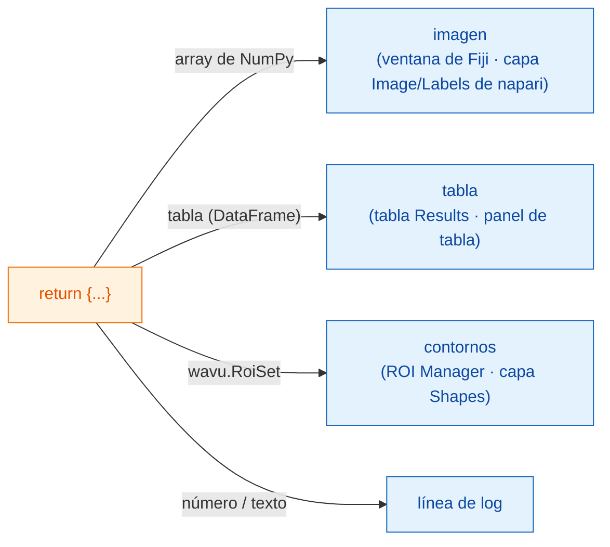

# Qué puedes devolver

## La idea en palabras sencillas

Al final de `run` entregas **un diccionario**: un conjunto de platos con
etiqueta. La **clave** es el nombre escrito en el plato y el **valor** es la
comida. El camarero, Fiji o napari, mira cada valor y lo sirve donde ese
visor guarda ese tipo de cosa: las imágenes como imágenes, las segmentaciones
como etiquetas, las tablas como tablas, los contornos como regiones, y los
números o palabras sueltos en el log. Tu script no cambia de un visor a otro;
solo cambia cómo se sirve.



## La carta de platos

=== "Fiji"

    | Tú devuelves | Fiji muestra |
    |---|---|
    | un array de NumPy (2-D o más) | una ventana de **imagen nueva** |
    | un array cuyo nombre contiene `label` | lo mismo, con la tabla de colores (LUT) **glasbey**, muy colorida |
    | `wavu.Image(array, pixel_um=0.65, axes="ZYX")` | una imagen **con tamaño de píxel y ejes** definidos |
    | un `DataFrame` de pandas, o una lista de diccionarios | una **tabla Results** |
    | `wavu.RoiSet(path_to_zip)` | los contornos en el **ROI Manager** |
    | un número, texto, `True`/`False` | una línea `name = value` en el **Log** |
    | una ruta de archivo (`pathlib.Path`) | la ruta, escrita en el **Log** |

    El título de cada imagen o tabla empieza por el nombre de la imagen de
    entrada, así que devolver `{"labels": ...}` desde *blobs.gif* da una
    ventana llamada *blobs-labels*.

=== "napari"

    | Tú devuelves | napari muestra |
    |---|---|
    | un array de NumPy (2-D o más) | una capa **Image** con el nombre de la clave |
    | un array de enteros cuya clave contiene `label`, `mask`, `seg` o `instance` (en mayúsculas o minúsculas) | una capa **Labels** |
    | `wavu.Image(arr, extra={"napari": "labels"})` | una capa **Labels**, sea cual sea el nombre |
    | `wavu.Image(arr, extra={"napari": "image"})` | una capa **Image**, aunque el nombre diga `labels` |
    | `wavu.Image(arr, axes="CYX", channel_names=["DNA", "Actin"])` | una capa Image por canal (el `channel_axis` de napari): `name [DNA]`, `name [Actin]` |
    | una imagen RGB (`axes` terminado en `S`, último tamaño 3 o 4) | una sola capa Image RGB |
    | `wavu.RoiSet(path_to_zip)` | una capa **Shapes** de polígonos amarillos |
    | un `DataFrame` de pandas, o una lista de diccionarios | un **panel de tabla** acoplado a la derecha, con el nombre de la clave, más una línea de log `name: table with N rows` |
    | un número, texto, `True`/`False` | una línea `name = value` en el **log** del panel |
    | una ruta de archivo (`pathlib.Path`) | una línea de log `name: path` |

    La regla de "nombre de etiquetas" es la misma idea que usa Fiji para su
    tabla de colores glasbey, así que la mayoría de los scripts se ven bien
    en los dos visores sin cambiar nada. Cuando el nombre no encaja, pon la
    pista con `extra`.

**Los tipos de imagen** son los mismos en los dos visores: las máscaras de
sí/no pasan a 8 bits 0/255, los enteros hasta 65535 a 16 bits, todo lo demás
a 32 bits en coma flotante. Por eso una imagen de etiquetas con más de 65535
objetos (o con valores por debajo de 0) vuelve en 32 bits en coma flotante;
napari la abre entonces como capa Image.

## Un ejemplo con tres tipos de resultados

(Necesita `scikit-image` y `pandas` en `pixi.toml`.)

```python
def run(ctx, inputs, params):
    from skimage import filters, measure
    import pandas as pd

    img = inputs["image"]
    labels = measure.label(img > filters.threshold_otsu(img))
    table = pd.DataFrame(measure.regionprops_table(
        labels, img, properties=("label", "area", "mean_intensity")))
    return {
        "labels": labels,           # imagen glasbey / capa Labels
        "cells": table,             # tabla Results / panel de tabla
        "count": int(labels.max())  # log: count = ...
    }
```

## Contornos para el ROI Manager y Shapes

Los contornos viajan como un archivo zip *RoiSet* de ImageJ. Escribe uno en
`ctx.tmpdir`, una carpeta temporal que Wavu da a cada ejecución, y devuélvelo
envuelto en `wavu.RoiSet`. El paquete [roifile](https://pypi.org/project/roifile/)
se encarga de escribirlo (añade `roifile` a `pixi.toml`):

```python
from pathlib import Path
import roifile
import wavu

rois = [roifile.ImagejRoi.frompoints(outline) for outline in outlines]  # puntos (x, y)
zip_path = Path(ctx.tmpdir) / "RoiSet.zip"
roifile.roiwrite(zip_path, rois)
return {"labels": labels, "outlines": wavu.RoiSet(zip_path)}
```

Fiji abre el zip en el ROI Manager. napari también lo lee con roifile (el
entorno napari de Wavu lo incluye; si faltara, el log te diría en su lugar
dónde está el zip). El ejemplo de Cellpose del repositorio de Wavu
([`examples/cellpose_nuclei`](https://github.com/Oxford-Zeiss-Centre-of-Excellence/Wavu/tree/main/examples/cellpose_nuclei))
hace exactamente esto con los contornos de Cellpose.

## El tamaño de píxel viaja con la imagen

Una imagen de salida recibe el tamaño de píxel de la entrada, salvo que
indiques el tuyo con `wavu.Image(..., pixel_um=...)`.

- **Fiji** copia la calibración a toda salida con el mismo ancho y alto que
  la entrada.
- **napari** envía `pixel_um` cuando los dos últimos valores de **scale** de
  la capa de entrada son iguales (y distintos de 1) y sus unidades son
  micrómetros o píxeles. Toda salida de imagen sin tamaño de píxel propio
  recibe la misma escala, así que cae exactamente encima de su entrada;
  `pixel_um=0.65` pone los dos últimos valores de escala a `0.65`.

## Conviene saber

- **Lo que envía napari.** Solo se pueden elegir capas **Image** y
  **Labels** en un campo `image`. El panel envía los datos de la capa (para
  una capa multiescala, el nivel de resolución completa; los datos dask
  diferidos se cargan antes en memoria), el nombre de la capa como título y,
  para capas RGB, `axes="YXS"`, para que tu script sepa que el último eje es
  el color.
- **No devolver nada** (o `return {}`) está bien: no aparece nada nuevo.
- **Si tu código lanza un error**, Fiji muestra el mensaje en una ventana de
  error y todos los detalles en el Log; napari escribe `Error: …` con la
  traza completa en el log del panel y muestra una notificación breve.
  Consulta
  [Solución de problemas](../help/troubleshooting.md#an-error-appears-in-the-log).

## En una frase

Devuelve un diccionario, y el visor lo sirve: los arrays como ventanas de
imagen o capas Image/Labels, las tablas como tabla Results o panel de tabla,
`wavu.RoiSet` en el ROI Manager o como Shapes, y los valores simples en el
log, conservando el tamaño de píxel de la entrada.

[Siguiente: Log, progreso y cancelar :material-arrow-right:](logs-progress-cancel.md){ .md-button }
