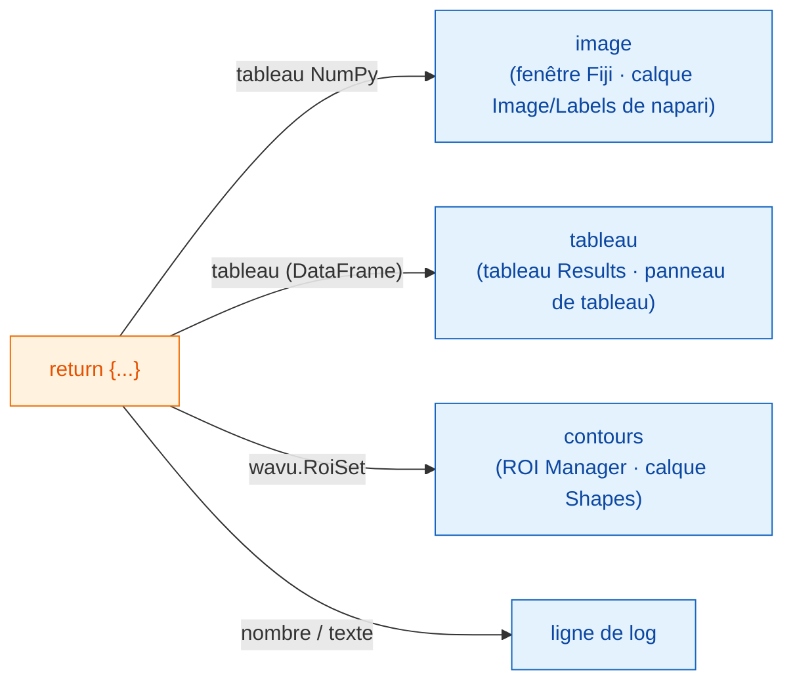

# Ce que vous pouvez renvoyer

## L'idée en mots simples

À la fin de `run`, vous rendez **un dictionnaire** : un ensemble d'assiettes
étiquetées. La **clé** est le nom sur l'assiette et la **valeur** est le
plat. Le serveur, Fiji ou napari, regarde chaque valeur et la sert là où ce
visualiseur range ce genre de choses : les images comme images, les
segmentations comme étiquettes (labels), les tableaux comme tableaux, les
contours comme régions, et les nombres ou mots isolés dans le log. Votre
script ne change pas d'un visualiseur à l'autre ; seul le service change.



## La carte des assiettes

=== "Fiji"

    | Vous renvoyez | Fiji affiche |
    |---|---|
    | un tableau NumPy (2-D ou plus) | une fenêtre de **nouvelle image** |
    | un tableau dont le nom contient `label` | la même chose, avec la table de couleurs (LUT) **glasbey**, bien colorée |
    | `wavu.Image(array, pixel_um=0.65, axes="ZYX")` | une image **avec taille de pixel et axes** renseignés |
    | un `DataFrame` pandas, ou une liste de dicts | un **tableau Results** |
    | `wavu.RoiSet(path_to_zip)` | les contours dans le **ROI Manager** |
    | un nombre, du texte, `True`/`False` | une ligne `name = value` dans le **Log** |
    | un chemin de fichier (`pathlib.Path`) | le chemin, écrit dans le **Log** |

    Le titre de chaque image ou tableau commence par le nom de l'image
    d'entrée : renvoyer `{"labels": ...}` depuis *blobs.gif* donne une
    fenêtre nommée *blobs-labels*.

=== "napari"

    | Vous renvoyez | napari affiche |
    |---|---|
    | un tableau NumPy (2-D ou plus) | un calque **Image** nommé d'après la clé |
    | un tableau d'entiers dont la clé contient `label`, `mask`, `seg` ou `instance` (majuscules ou minuscules) | un calque **Labels** |
    | `wavu.Image(arr, extra={"napari": "labels"})` | un calque **Labels**, quel que soit le nom |
    | `wavu.Image(arr, extra={"napari": "image"})` | un calque **Image**, même si le nom dit `labels` |
    | `wavu.Image(arr, axes="CYX", channel_names=["DNA", "Actin"])` | un calque Image par canal (le `channel_axis` de napari) : `name [DNA]`, `name [Actin]` |
    | une image RGB (`axes` se terminant par `S`, dernière taille 3 ou 4) | un seul calque Image RGB |
    | `wavu.RoiSet(path_to_zip)` | un calque **Shapes** de polygones jaunes |
    | un `DataFrame` pandas, ou une liste de dicts | un **panneau de tableau** ancré à droite, nommé d'après la clé, plus une ligne de log `name: table with N rows` |
    | un nombre, du texte, `True`/`False` | une ligne `name = value` dans le **log** du panneau |
    | un chemin de fichier (`pathlib.Path`) | une ligne de log `name: path` |

    La règle « nommé comme des labels » est la même idée que celle de Fiji
    pour sa table de couleurs glasbey : la plupart des scripts s'affichent
    donc correctement dans les deux visualiseurs sans aucune modification.
    Quand le nom ne convient pas, donnez l'indication avec `extra`.

**Les types d'image** sont les mêmes dans les deux visualiseurs : les
masques oui/non deviennent du 8 bits 0/255, les nombres entiers jusqu'à
65535 du 16 bits, tout le reste du 32 bits flottant. Une image d'étiquettes
avec plus de 65535 objets (ou des valeurs inférieures à 0) revient donc en
32 bits flottant ; napari l'ouvre alors comme calque Image.

## Un exemple avec trois sortes de résultats

(Il faut `scikit-image` et `pandas` dans `pixi.toml`.)

```python
def run(ctx, inputs, params):
    from skimage import filters, measure
    import pandas as pd

    img = inputs["image"]
    labels = measure.label(img > filters.threshold_otsu(img))
    table = pd.DataFrame(measure.regionprops_table(
        labels, img, properties=("label", "area", "mean_intensity")))
    return {
        "labels": labels,           # image glasbey / calque Labels
        "cells": table,             # tableau Results / panneau de tableau
        "count": int(labels.max())  # log : count = ...
    }
```

## Des contours pour le ROI Manager et Shapes

Les contours voyagent sous forme de fichier zip *RoiSet* d'ImageJ.
Écrivez-en un dans `ctx.tmpdir`, un dossier de brouillon que Wavu donne à
chaque exécution, et renvoyez-le enveloppé dans `wavu.RoiSet`. Le paquet
[roifile](https://pypi.org/project/roifile/) se charge de l'écriture
(ajoutez `roifile` à `pixi.toml`) :

```python
from pathlib import Path
import roifile
import wavu

rois = [roifile.ImagejRoi.frompoints(outline) for outline in outlines]  # points (x, y)
zip_path = Path(ctx.tmpdir) / "RoiSet.zip"
roifile.roiwrite(zip_path, rois)
return {"labels": labels, "outlines": wavu.RoiSet(zip_path)}
```

Fiji ouvre le zip dans le ROI Manager. napari le lit aussi avec roifile
(l'environnement napari de Wavu l'inclut ; s'il manquait, le log vous
indiquerait plutôt où se trouve le zip). L'exemple Cellpose du dépôt Wavu
([`examples/cellpose_nuclei`](https://github.com/Oxford-Zeiss-Centre-of-Excellence/Wavu/tree/main/examples/cellpose_nuclei))
fait exactement cela avec les contours de Cellpose.

## La taille de pixel suit

Une image de sortie reçoit la taille de pixel de l'entrée, sauf si vous
donnez la vôtre avec `wavu.Image(..., pixel_um=...)`.

- **Fiji** copie la calibration sur chaque sortie de même largeur et
  hauteur que l'entrée.
- **napari** envoie `pixel_um` quand les deux dernières valeurs de
  **scale** (échelle) du calque d'entrée sont égales (et différentes de 1)
  et que ses unités sont des micromètres ou des pixels. Chaque image de
  sortie sans taille de pixel propre reçoit la même échelle, et tombe donc
  exactement sur son entrée ; `pixel_um=0.65` met les deux dernières
  valeurs d'échelle à `0.65`.

## Bon à savoir

- **Ce que napari envoie.** Seuls les calques **Image** et **Labels**
  peuvent être choisis dans un champ `image`. Le panneau envoie les données
  du calque (pour un calque multi-échelle, le niveau en pleine résolution ;
  les données dask paresseuses sont d'abord chargées en mémoire), le nom du
  calque comme titre, et pour les calques RGB `axes="YXS"`, afin que votre
  script sache que le dernier axe est la couleur.
- **Ne rien renvoyer** (ou `return {}`) ne pose pas de problème : rien de
  nouveau n'apparaît.
- **Si votre code lève une erreur**, Fiji affiche le message dans une
  fenêtre d'erreur et tous les détails dans le Log ; napari écrit
  `Error: …` avec la trace d'erreur complète dans le log du panneau et
  affiche une courte notification. Voir
  [Dépannage](../help/troubleshooting.md#an-error-appears-in-the-log).

## En une phrase

Renvoyez un dictionnaire, et le visualiseur le sert : les tableaux NumPy
comme fenêtres d'image ou calques Image/Labels, les tableaux de données
comme tableau Results ou panneau de tableau, `wavu.RoiSet` dans le ROI
Manager ou comme Shapes, et les valeurs simples dans le log, avec la taille
de pixel de l'entrée reprise.

[Suite : Log, progression et annulation :material-arrow-right:](logs-progress-cancel.md){ .md-button }
