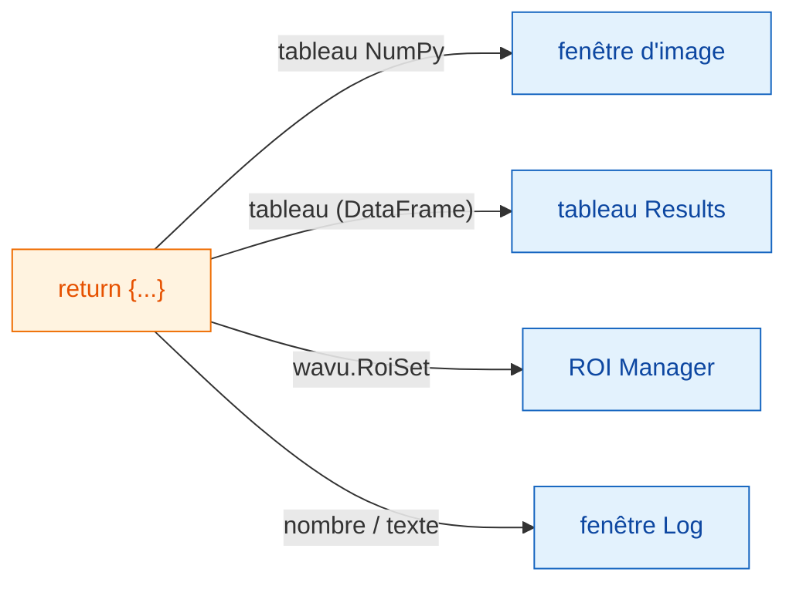
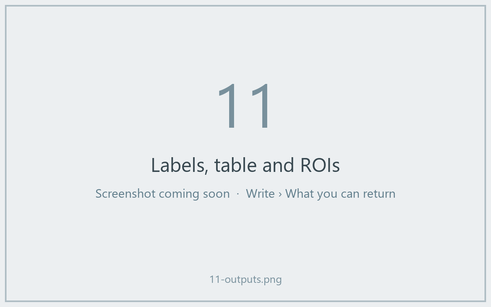

# Ce que vous pouvez renvoyer

## L'idée en mots simples

À la fin de `run`, vous rendez **un dictionnaire** : un ensemble d'assiettes
étiquetées. La **clé** est le nom sur l'assiette et la **valeur** est le
plat. Fiji regarde chaque valeur et la sert au bon endroit : les images vont
dans des fenêtres d'image, les tableaux dans un tableau Results, les contours
dans le ROI Manager, et les nombres ou mots isolés dans le Log.



## La carte des assiettes

| Vous renvoyez | Fiji affiche |
|---|---|
| un tableau NumPy (2-D ou plus) | une **nouvelle image**. Les masques oui/non deviennent du 8 bits 0/255, les nombres entiers jusqu'à 65535 du 16 bits, tout le reste du 32 bits. |
| un tableau dont le nom contient `label` | la même chose, avec la table de couleurs (LUT) **glasbey**, bien colorée |
| `wavu.Image(array, pixel_um=0.65, axes="ZYX")` | une image **avec taille de pixel et axes** renseignés |
| un `DataFrame` pandas, ou une liste de dicts | un **tableau Results** |
| `wavu.RoiSet(path_to_zip)` | les contours dans le **ROI Manager** |
| un nombre, du texte, `True`/`False` | une ligne `name = value` dans le **Log** |
| un chemin de fichier (`pathlib.Path`) | le chemin, écrit dans le **Log** |

Le titre de chaque image ou tableau commence par le nom de l'image d'entrée :
renvoyer `{"labels": ...}` depuis *blobs.gif* donne une fenêtre nommée
*blobs-labels*.

## Un exemple avec trois sortes de résultats

(Il faut `scikit-image` et `pandas` dans `pixi.toml`.)

```python
def run(ctx, inputs, params):
    from skimage import filters, measure
    import pandas as pd

    img = inputs["image"]
    labels = measure.label(img > filters.threshold_otsu(img))
    table = pd.DataFrame(measure.regionprops_table(
        labels, img, properties=("label", "area", "mean_intensity")))
    return {
        "labels": labels,           # image, couleurs glasbey
        "cells": table,             # tableau Results
        "count": int(labels.max())  # Log : count = ...
    }
```



## Des contours pour le ROI Manager

Le ROI Manager de Fiji lit les fichiers zip *RoiSet* d'ImageJ. Écrivez-en un
dans `ctx.tmpdir`, un dossier de brouillon que Wavu donne à chaque exécution,
et renvoyez-le enveloppé dans `wavu.RoiSet`. Le paquet
[roifile](https://pypi.org/project/roifile/) se charge de l'écriture
(ajoutez `roifile` à `pixi.toml`) :

```python
from pathlib import Path
import roifile
import wavu

rois = [roifile.ImagejRoi.frompoints(outline) for outline in outlines]  # points (x, y)
zip_path = Path(ctx.tmpdir) / "RoiSet.zip"
roifile.roiwrite(zip_path, rois)
return {"labels": labels, "outlines": wavu.RoiSet(zip_path)}
```

L'exemple Cellpose du dépôt Wavu
([`examples/cellpose_nuclei`](https://github.com/Oxford-Zeiss-Centre-of-Excellence/Wavu/tree/main/examples/cellpose_nuclei))
fait exactement cela avec les contours de Cellpose.

## Bon à savoir

- **La calibration est offerte.** Une image de sortie de même largeur et
  hauteur que l'entrée reçoit la taille de pixel de l'entrée, sauf si vous
  donnez la vôtre avec `wavu.Image(..., pixel_um=...)`.
- **Plus de 65535 objets ?** L'image de labels revient en 32 bits au lieu de
  16 bits.
- **Ne rien renvoyer** (ou `return {}`) ne pose pas de problème : Fiji
  n'affiche simplement rien.
- **Si votre code lève une erreur**, Fiji affiche le message dans une
  fenêtre d'erreur et tous les détails dans le Log. Voir
  [Dépannage](../help/troubleshooting.md#an-error-appears-in-the-log).

## En une phrase

Renvoyez un dictionnaire, et Fiji met les tableaux NumPy dans des fenêtres
d'image, les tableaux de données dans un tableau Results, `wavu.RoiSet` dans
le ROI Manager et les valeurs simples dans le Log.

[Suite : Log, progression et annulation :material-arrow-right:](logs-progress-cancel.md){ .md-button }
