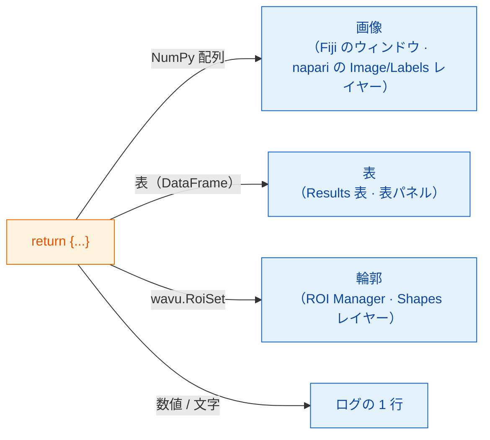

# 返せるもの

## やさしく言うと

`run` の最後に **辞書** を返します。名札の付いたお皿のセットだと思って
ください。**キー** がお皿の名札、**値** が料理です。ウェイター（Fiji または
napari）は各値を見て、そのビューアーでふさわしい場所に出します。画像は画像
として、セグメンテーションはラベルとして、表は表として、輪郭は領域として、
1 つの数値や文字はログに出します。ビューアーが変わってもスクリプトは
変わりません。変わるのは出し方だけです。



## お皿のメニュー

=== "Fiji"

    | 返すもの | Fiji での表示 |
    |---|---|
    | NumPy 配列（2 次元以上） | **新しい画像** ウィンドウ |
    | 名前に `label` を含む配列 | 同じですが、カラフルな **glasbey** ルックアップテーブル付き |
    | `wavu.Image(array, pixel_um=0.65, axes="ZYX")` | **ピクセルサイズと軸** が設定された画像 |
    | pandas の `DataFrame`、または辞書のリスト | **Results 表** |
    | `wavu.RoiSet(path_to_zip)` | **ROI Manager** の輪郭 |
    | 数値、文字、`True`/`False` | **Log** に `name = value` という 1 行 |
    | ファイルパス（`pathlib.Path`） | パスを **Log** に表示 |

    画像や表のタイトルは入力画像の名前で始まります。たとえば *blobs.gif*
    から `{"labels": ...}` を返すと、*blobs-labels* というウィンドウに
    なります。

=== "napari"

    | 返すもの | napari での表示 |
    |---|---|
    | NumPy 配列（2 次元以上） | キーの名前が付いた **Image** レイヤー |
    | キーに `label`、`mask`、`seg`、`instance` のどれかを含む整数の配列（大文字・小文字は問わない） | **Labels** レイヤー |
    | `wavu.Image(arr, extra={"napari": "labels"})` | 名前に関係なく **Labels** レイヤー |
    | `wavu.Image(arr, extra={"napari": "image"})` | 名前が `labels` でも **Image** レイヤー |
    | `wavu.Image(arr, axes="CYX", channel_names=["DNA", "Actin"])` | チャンネルごとに Image レイヤー 1 つ（napari の `channel_axis`）：`name [DNA]`、`name [Actin]` |
    | RGB 画像（`axes` が `S` で終わり、最後の大きさが 3 か 4） | RGB の Image レイヤー 1 つ |
    | `wavu.RoiSet(path_to_zip)` | 黄色い多角形の **Shapes** レイヤー |
    | pandas の `DataFrame`、または辞書のリスト | 右側にドッキングする、キーの名前が付いた **表パネル**。加えてログに `name: table with N rows` という 1 行 |
    | 数値、文字、`True`/`False` | パネルの **ログ** に `name = value` という 1 行 |
    | ファイルパス（`pathlib.Path`） | ログに `name: path` という 1 行 |

    「ラベルらしい名前」のルールは、Fiji が glasbey ルックアップテーブルに
    使うのと同じ考え方です。だから、ほとんどのスクリプトは何も変えずに
    どちらのビューアーでも正しく見えます。名前が合わないときは `extra` で
    ヒントを指定します。

**画像の型** はどちらのビューアーでも同じです。はい/いいえのマスクは 8-bit
の 0/255、65535 までの整数は 16-bit、それ以外はすべて 32-bit 浮動小数点に
なります。そのため、物体が 65535 個を超える（または 0 より小さい値がある）
ラベル画像は 32-bit 浮動小数点で戻ってきます。napari はそれを Image
レイヤーとして開きます。

## 3 種類の結果を返す例

（`pixi.toml` に `scikit-image` と `pandas` が必要です。）

```python
def run(ctx, inputs, params):
    from skimage import filters, measure
    import pandas as pd

    img = inputs["image"]
    labels = measure.label(img > filters.threshold_otsu(img))
    table = pd.DataFrame(measure.regionprops_table(
        labels, img, properties=("label", "area", "mean_intensity")))
    return {
        "labels": labels,           # glasbey の画像 / Labels レイヤー
        "cells": table,             # Results 表 / 表パネル
        "count": int(labels.max())  # ログ: count = ...
    }
```

## ROI Manager と Shapes 用の輪郭

輪郭は ImageJ の *RoiSet* zip ファイルとして運ばれます。Wavu が実行ごとに
用意する作業用フォルダー `ctx.tmpdir` に書き出し、`wavu.RoiSet` で包んで
返します。書き出しには [roifile](https://pypi.org/project/roifile/)
パッケージを使います（`pixi.toml` に `roifile` を足します）。

```python
from pathlib import Path
import roifile
import wavu

rois = [roifile.ImagejRoi.frompoints(outline) for outline in outlines]  # (x, y) の点
zip_path = Path(ctx.tmpdir) / "RoiSet.zip"
roifile.roiwrite(zip_path, rois)
return {"labels": labels, "outlines": wavu.RoiSet(zip_path)}
```

Fiji はこの zip を ROI Manager で開きます。napari も roifile で読みます
（Wavu の napari 環境に入っています。もし入っていなければ、代わりにログが
zip の場所を教えてくれます）。Wavu リポジトリの Cellpose の例
（[`examples/cellpose_nuclei`](https://github.com/Oxford-Zeiss-Centre-of-Excellence/Wavu/tree/main/examples/cellpose_nuclei)）
は、Cellpose の輪郭でまさにこれをやっています。

## ピクセルサイズも一緒に

出力画像には入力のピクセルサイズが付きます。自分で指定したいときは
`wavu.Image(..., pixel_um=...)` を使います。

- **Fiji** は、入力と同じ幅と高さのすべての出力にキャリブレーションを
  コピーします。
- **napari** は、入力レイヤーの最後の 2 つの **scale** の値が等しく
  （1 ではなく）、単位がマイクロメートルかピクセルのときに `pixel_um` を
  送ります。自分のピクセルサイズを持たない画像出力にはすべて同じ scale が
  付くので、入力のちょうど上に重なります。`pixel_um=0.65` は最後の 2 つの
  scale の値を `0.65` にします。

## 知っておくと良いこと

- **napari が送るもの。** `image` 欄で選べるのは **Image** と **Labels**
  レイヤーだけです。パネルはレイヤーのデータ（マルチスケールのレイヤーなら
  最高解像度のレベル。遅延読み込みの dask データは先にメモリーに読み込み
  ます）、タイトルとしてレイヤー名、RGB レイヤーなら `axes="YXS"` を
  送ります。これでスクリプトは最後の軸が色だと分かります。
- **何も返さない**（または `return {}`）のも大丈夫です。新しいものが
  何も現れないだけです。
- **コードがエラーを出したら**、Fiji はエラーウィンドウにメッセージを、
  Log に詳しい内容を表示します。napari はパネルのログに `Error: …` と
  トレースバック全体を書き、短い通知を表示します。
  [トラブルシューティング](../help/troubleshooting.md#an-error-appears-in-the-log)
  を見てください。

## ひとことで言うと

辞書を返せば、ビューアーが出してくれます。配列は画像ウィンドウか
Image/Labels レイヤーに、表は Results 表か表パネルに、`wavu.RoiSet` は
ROI Manager か Shapes に、単純な値はログに出て、入力のピクセルサイズも
引き継がれます。

[次へ：ログ、進捗、キャンセル :material-arrow-right:](logs-progress-cancel.md){ .md-button }
