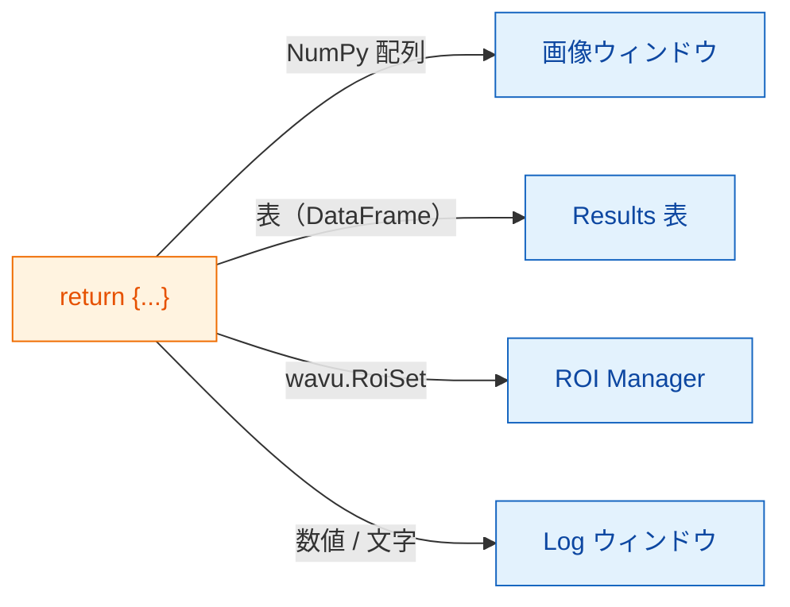

# 返せるもの

## やさしく言うと

`run` の最後に **辞書** を返します。名札の付いたお皿のセットだと思って
ください。**キー** がお皿の名札、**値** が料理です。Fiji は各値を見て、
ふさわしい場所に出します。画像は画像ウィンドウへ、表は Results 表へ、
輪郭は ROI Manager へ、1 つの数値や文字は Log へ行きます。



## お皿のメニュー

| 返すもの | Fiji での表示 |
|---|---|
| NumPy 配列（2 次元以上） | **新しい画像**。はい/いいえのマスクは 8-bit の 0/255、65535 までの整数は 16-bit、それ以外は 32-bit になります。 |
| 名前に `label` を含む配列 | 同じですが、カラフルな **glasbey** ルックアップテーブル付き |
| `wavu.Image(array, pixel_um=0.65, axes="ZYX")` | **ピクセルサイズと軸** が設定された画像 |
| pandas の `DataFrame`、または辞書のリスト | **Results 表** |
| `wavu.RoiSet(path_to_zip)` | **ROI Manager** の輪郭 |
| 数値、文字、`True`/`False` | **Log** に `name = value` という 1 行 |
| ファイルパス（`pathlib.Path`） | パスを **Log** に表示 |

画像や表のタイトルは入力画像の名前で始まります。たとえば *blobs.gif* から
`{"labels": ...}` を返すと、*blobs-labels* というウィンドウになります。

## 3 種類の結果を返す例

（`pixi.toml` に `scikit-image` と `pandas` が必要です。）

```python
def run(ctx, inputs, params):
    from skimage import filters, measure
    import pandas as pd

    img = inputs["image"]
    labels = measure.label(img > filters.threshold_otsu(img))
    table = pd.DataFrame(measure.regionprops_table(
        labels, img, properties=("label", "area", "mean_intensity")))
    return {
        "labels": labels,           # 画像、glasbey の色
        "cells": table,             # Results 表
        "count": int(labels.max())  # Log: count = ...
    }
```

## ROI Manager 用の輪郭

Fiji の ROI Manager は ImageJ の *RoiSet* zip ファイルを読みます。Wavu が
実行ごとに用意する作業用フォルダー `ctx.tmpdir` に書き出し、`wavu.RoiSet`
で包んで返します。書き出しには
[roifile](https://pypi.org/project/roifile/) パッケージを使います
（`pixi.toml` に `roifile` を足します）。

```python
from pathlib import Path
import roifile
import wavu

rois = [roifile.ImagejRoi.frompoints(outline) for outline in outlines]  # (x, y) の点
zip_path = Path(ctx.tmpdir) / "RoiSet.zip"
roifile.roiwrite(zip_path, rois)
return {"labels": labels, "outlines": wavu.RoiSet(zip_path)}
```

Wavu リポジトリの Cellpose の例
（[`examples/cellpose_nuclei`](https://github.com/Oxford-Zeiss-Centre-of-Excellence/Wavu/tree/main/examples/cellpose_nuclei)）
は、Cellpose の輪郭でまさにこれをやっています。

## 知っておくと良いこと

- **キャリブレーションは自動です。** 入力と同じ幅と高さの出力画像には、
  入力のピクセルサイズが付きます。自分で指定したいときは
  `wavu.Image(..., pixel_um=...)` を使います。
- **物体が 65535 個を超える？** ラベル画像は 16-bit ではなく 32-bit で
  戻ってきます。
- **何も返さない**（または `return {}`）のも大丈夫です。Fiji は何も
  表示しないだけです。
- **コードがエラーを出したら**、Fiji はエラーウィンドウにメッセージを、
  Log に詳しい内容を表示します。
  [トラブルシューティング](../help/troubleshooting.md#an-error-appears-in-the-log)
  を見てください。

## ひとことで言うと

辞書を返せば、Fiji は配列を画像ウィンドウに、表を Results 表に、
`wavu.RoiSet` を ROI Manager に、単純な値を Log に出してくれます。

[次へ：ログ、進捗、キャンセル :material-arrow-right:](logs-progress-cancel.md){ .md-button }
