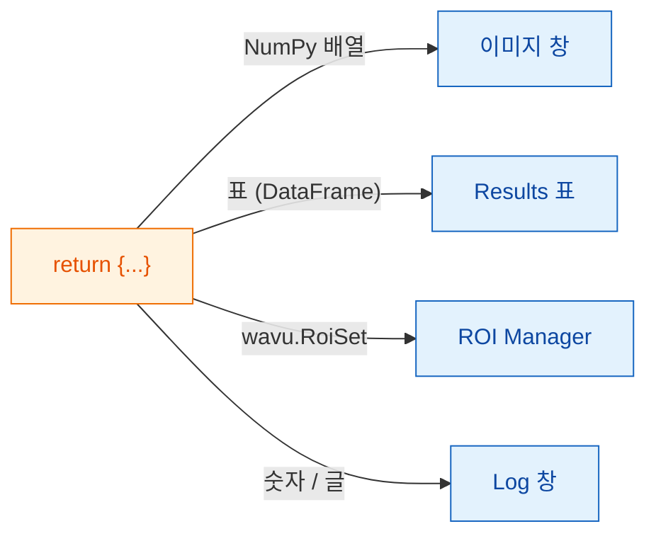

# 돌려줄 수 있는 것

## 쉬운 말로 설명하면

`run`이 끝날 때 **딕셔너리**를 돌려줘요. 이름표가 붙은 접시들이라고
생각하세요. **키**는 접시의 이름표이고 **값**은 음식이에요. Fiji는 값을
하나씩 보고 알맞은 자리에 내놓아요. 그림은 이미지 창으로, 표는 Results
표로, 윤곽선은 ROI Manager로, 숫자나 글 하나는 Log로 가요.



## 접시 메뉴

| 돌려주는 것 | Fiji가 보여 주는 것 |
|---|---|
| NumPy 배열(2차원 이상) | **새 이미지**. 예/아니요 마스크는 8-bit 0/255, 65535까지의 정수는 16-bit, 나머지는 32-bit가 돼요. |
| 이름에 `label`이 들어간 배열 | 위와 같지만 알록달록한 **glasbey** 룩업 테이블로 |
| `wavu.Image(array, pixel_um=0.65, axes="ZYX")` | **픽셀 크기와 축**이 설정된 이미지 |
| pandas `DataFrame`, 또는 dict의 리스트 | **Results 표** |
| `wavu.RoiSet(path_to_zip)` | **ROI Manager** 안의 윤곽선 |
| 숫자, 글, `True`/`False` | **Log**에 `name = value` 한 줄 |
| 파일 경로(`pathlib.Path`) | **Log**에 출력된 경로 |

이미지나 표의 제목은 입력 이미지의 이름으로 시작해요. 그래서 *blobs.gif*에서
`{"labels": ...}`를 돌려주면 *blobs-labels*라는 창이 생겨요.

## 세 종류의 결과를 돌려주는 예

(`pixi.toml`에 `scikit-image`와 `pandas`가 필요해요.)

```python
def run(ctx, inputs, params):
    from skimage import filters, measure
    import pandas as pd

    img = inputs["image"]
    labels = measure.label(img > filters.threshold_otsu(img))
    table = pd.DataFrame(measure.regionprops_table(
        labels, img, properties=("label", "area", "mean_intensity")))
    return {
        "labels": labels,           # 이미지, glasbey 색
        "cells": table,             # Results 표
        "count": int(labels.max())  # Log: count = ...
    }
```

## ROI Manager용 윤곽선

Fiji의 ROI Manager는 ImageJ *RoiSet* zip 파일을 읽어요. Wavu가 실행마다 주는
임시 폴더인 `ctx.tmpdir`에 하나 써서 `wavu.RoiSet`으로 감싸 돌려주세요.
쓰는 일은 [roifile](https://pypi.org/project/roifile/) 패키지가 해 줘요
(`pixi.toml`에 `roifile`을 추가하세요).

```python
from pathlib import Path
import roifile
import wavu

rois = [roifile.ImagejRoi.frompoints(outline) for outline in outlines]  # (x, y) 점들
zip_path = Path(ctx.tmpdir) / "RoiSet.zip"
roifile.roiwrite(zip_path, rois)
return {"labels": labels, "outlines": wavu.RoiSet(zip_path)}
```

Wavu 저장소의 Cellpose 예제
([`examples/cellpose_nuclei`](https://github.com/Oxford-Zeiss-Centre-of-Excellence/Wavu/tree/main/examples/cellpose_nuclei))가
Cellpose의 윤곽선으로 바로 이렇게 해요.

## 알아 두면 좋은 점

- **보정(calibration)은 저절로 따라와요.** 입력과 너비, 높이가 같은 출력
  이미지는 입력의 픽셀 크기를 물려받아요. 직접 정하려면
  `wavu.Image(..., pixel_um=...)`을 쓰세요.
- **물체가 65535개보다 많나요?** 라벨 이미지가 16-bit 대신 32-bit로 돌아와요.
- **아무것도 돌려주지 않아도**(또는 `return {}`) 괜찮아요. Fiji가 아무것도
  보여 주지 않을 뿐이에요.
- **코드에서 오류가 나면** Fiji가 오류 창에 메시지를, Log에 자세한 내용을
  보여 줘요. [문제 해결](../help/troubleshooting.md#an-error-appears-in-the-log)을
  보세요.

## 한 문장으로

딕셔너리를 돌려주면 Fiji가 배열은 이미지 창에, 표는 Results 표에,
`wavu.RoiSet`은 ROI Manager에, 단순한 값은 Log에 넣어 줘요.

[다음: 로그, 진행 상황, 취소 :material-arrow-right:](logs-progress-cancel.md){ .md-button }
