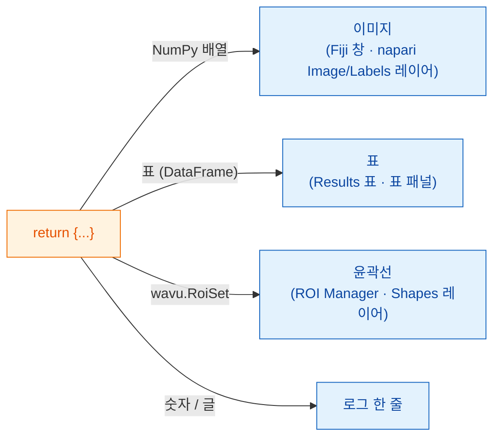

# 돌려줄 수 있는 것

## 쉬운 말로 설명하면

`run`이 끝날 때 **딕셔너리**를 돌려줘요. 이름표가 붙은 접시들이라고
생각하세요. **키**는 접시의 이름표이고 **값**은 음식이에요. 웨이터, 곧
Fiji나 napari는 값을 하나씩 보고 그 뷰어가 그런 것을 두는 자리에 내놓아요.
그림은 이미지로, 분할 결과는 라벨로, 표는 표로, 윤곽선은 영역으로, 숫자나
글 하나는 로그로 가요. 스크립트는 뷰어에 따라 바뀌지 않아요. 내놓는 방식만
달라요.



## 접시 메뉴

=== "Fiji"

    | 돌려주는 것 | Fiji가 보여 주는 것 |
    |---|---|
    | NumPy 배열(2차원 이상) | **새 이미지** 창 |
    | 이름에 `label`이 들어간 배열 | 위와 같지만 알록달록한 **glasbey** 룩업 테이블로 |
    | `wavu.Image(array, pixel_um=0.65, axes="ZYX")` | **픽셀 크기와 축**이 설정된 이미지 |
    | pandas `DataFrame`, 또는 dict의 리스트 | **Results 표** |
    | `wavu.RoiSet(path_to_zip)` | **ROI Manager** 안의 윤곽선 |
    | 숫자, 글, `True`/`False` | **Log**에 `name = value` 한 줄 |
    | 파일 경로(`pathlib.Path`) | **Log**에 출력된 경로 |

    이미지나 표의 제목은 입력 이미지의 이름으로 시작해요. 그래서
    *blobs.gif*에서 `{"labels": ...}`를 돌려주면 *blobs-labels*라는 창이
    생겨요.

=== "napari"

    | 돌려주는 것 | napari가 보여 주는 것 |
    |---|---|
    | NumPy 배열(2차원 이상) | 키 이름을 딴 **Image** 레이어 |
    | 키에 `label`, `mask`, `seg`, `instance`(대소문자 무관)가 들어간 정수 배열 | **Labels** 레이어 |
    | `wavu.Image(arr, extra={"napari": "labels"})` | 이름과 상관없이 **Labels** 레이어 |
    | `wavu.Image(arr, extra={"napari": "image"})` | 이름에 `labels`가 있어도 **Image** 레이어 |
    | `wavu.Image(arr, axes="CYX", channel_names=["DNA", "Actin"])` | 채널마다 Image 레이어 하나(napari의 `channel_axis`): `name [DNA]`, `name [Actin]` |
    | RGB 이미지(`axes`가 `S`로 끝나고 마지막 크기가 3 또는 4) | RGB Image 레이어 하나 |
    | `wavu.RoiSet(path_to_zip)` | 노란 다각형으로 된 **Shapes** 레이어 |
    | pandas `DataFrame`, 또는 dict의 리스트 | 오른쪽에 붙는, 키 이름을 딴 **표 패널**과 로그 한 줄 `name: table with N rows` |
    | 숫자, 글, `True`/`False` | 패널 **로그**에 `name = value` 한 줄 |
    | 파일 경로(`pathlib.Path`) | 로그 한 줄 `name: path` |

    "라벨 같은 이름" 규칙은 Fiji가 glasbey 룩업 테이블에 쓰는 것과 같은
    생각이에요. 그래서 대부분의 스크립트는 아무것도 바꾸지 않아도 두 뷰어에서
    모두 제대로 보여요. 이름이 맞지 않으면 `extra`로 힌트를 주세요.

**이미지 타입**은 두 뷰어에서 같아요. 예/아니요 마스크는 8-bit 0/255,
65535까지의 정수는 16-bit, 나머지는 모두 32-bit float가 돼요. 그래서 물체가
65535개보다 많은(또는 0보다 작은 값이 있는) 라벨 이미지는 32-bit float로
돌아오고, napari는 그것을 Image 레이어로 열어요.

## 세 종류의 결과를 돌려주는 예

(`pixi.toml`에 `scikit-image`와 `pandas`가 필요해요.)

```python
def run(ctx, inputs, params):
    from skimage import filters, measure
    import pandas as pd

    img = inputs["image"]
    labels = measure.label(img > filters.threshold_otsu(img))
    table = pd.DataFrame(measure.regionprops_table(
        labels, img, properties=("label", "area", "mean_intensity")))
    return {
        "labels": labels,           # glasbey 이미지 / Labels 레이어
        "cells": table,             # Results 표 / 표 패널
        "count": int(labels.max())  # 로그: count = ...
    }
```

## ROI Manager와 Shapes용 윤곽선

윤곽선은 ImageJ *RoiSet* zip 파일로 오가요. Wavu가 실행마다 주는 임시
폴더인 `ctx.tmpdir`에 하나 써서 `wavu.RoiSet`으로 감싸 돌려주세요. 쓰는 일은
[roifile](https://pypi.org/project/roifile/) 패키지가 해 줘요
(`pixi.toml`에 `roifile`을 추가하세요).

```python
from pathlib import Path
import roifile
import wavu

rois = [roifile.ImagejRoi.frompoints(outline) for outline in outlines]  # (x, y) 점들
zip_path = Path(ctx.tmpdir) / "RoiSet.zip"
roifile.roiwrite(zip_path, rois)
return {"labels": labels, "outlines": wavu.RoiSet(zip_path)}
```

Fiji는 이 zip을 ROI Manager에서 열어요. napari도 roifile로 읽어요(Wavu의
napari 환경에 들어 있어요. 없다면 대신 로그가 zip의 위치를 알려 줘요). Wavu
저장소의 Cellpose 예제
([`examples/cellpose_nuclei`](https://github.com/Oxford-Zeiss-Centre-of-Excellence/Wavu/tree/main/examples/cellpose_nuclei))가
Cellpose의 윤곽선으로 바로 이렇게 해요.

## 픽셀 크기도 따라와요

출력 이미지는 입력의 픽셀 크기를 물려받아요. 직접 정하려면
`wavu.Image(..., pixel_um=...)`을 쓰세요.

- **Fiji**는 입력과 너비, 높이가 같은 모든 출력에 보정(calibration)을
  복사해요.
- **napari**는 입력 레이어의 마지막 두 **scale** 값이 같고(1이 아니고)
  단위가 마이크로미터나 픽셀이면 `pixel_um`을 보내요. 자기 픽셀 크기가 없는
  이미지 출력은 모두 같은 scale을 받아서 입력 위에 정확히 겹쳐요.
  `pixel_um=0.65`는 마지막 두 scale 값을 `0.65`로 정해요.

## 알아 두면 좋은 점

- **napari가 보내는 것.** `image` 입력란에서는 **Image**와 **Labels**
  레이어만 고를 수 있어요. 패널은 레이어의 데이터(멀티스케일 레이어는 최고
  해상도 단계, 지연 로딩되는 dask 데이터는 먼저 메모리로 읽어요), 제목으로
  레이어 이름, RGB 레이어라면 `axes="YXS"`를 보내요. 그래서 스크립트는 마지막
  축이 색이라는 것을 알 수 있어요.
- **아무것도 돌려주지 않아도**(또는 `return {}`) 괜찮아요. 새로 나타나는
  것이 없을 뿐이에요.
- **코드에서 오류가 나면** Fiji는 오류 창에 메시지를, Log에 자세한 내용을
  보여 줘요. napari는 패널 로그에 `Error: …`와 전체 traceback을 쓰고 짧은
  알림을 띄워요. [문제 해결](../help/troubleshooting.md#an-error-appears-in-the-log)을
  보세요.

## 한 문장으로

딕셔너리를 돌려주면 뷰어가 내놓아 줘요. 배열은 이미지 창이나 Image/Labels
레이어로, 표는 Results 표나 표 패널로, `wavu.RoiSet`은 ROI Manager나
Shapes로, 단순한 값은 로그로 가고, 입력의 픽셀 크기도 함께 따라와요.

[다음: 로그, 진행 상황, 취소 :material-arrow-right:](logs-progress-cancel.md){ .md-button }
