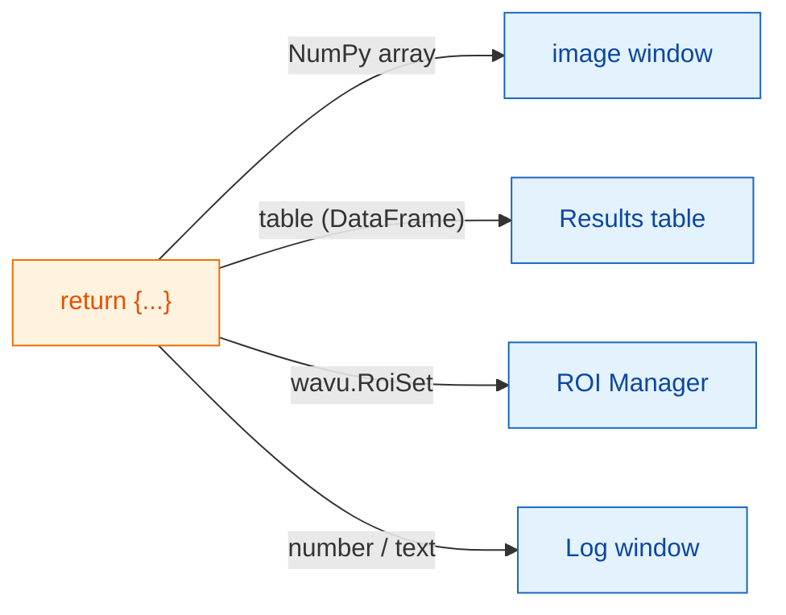
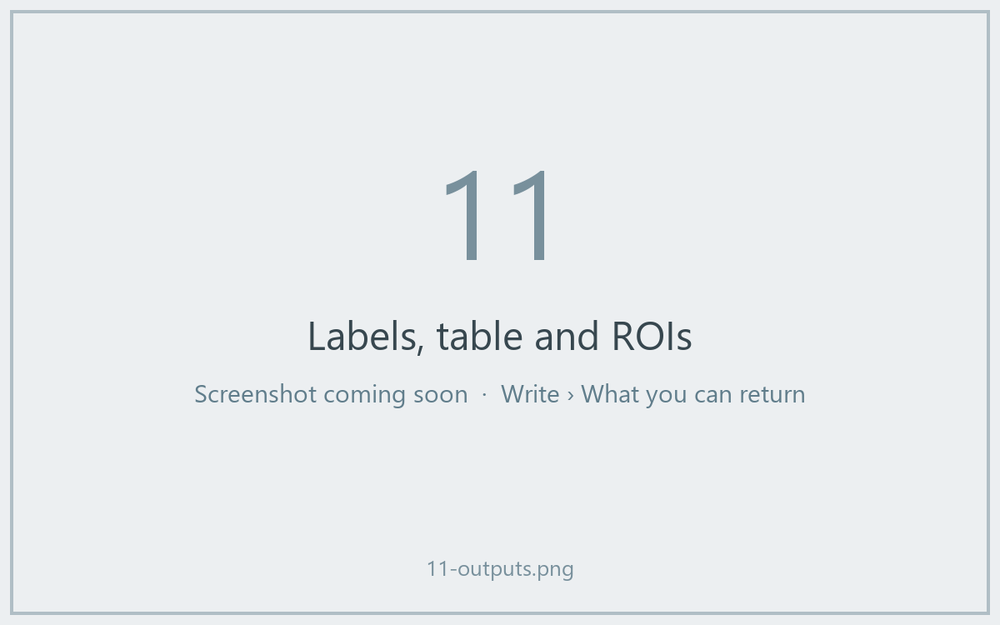

# What you can return

## The idea in plain words

At the end of `run` you hand back **a dictionary**: a set of labelled
plates. The **key** is the name on the plate and the **value** is the food.
Fiji looks at each value and serves it in the right place: pictures go to
image windows, tables to a Results table, outlines to the ROI Manager, and
single numbers or words to the Log.



## The menu of plates

| You return | Fiji shows |
|---|---|
| a NumPy array (2-D or more) | a **new image**. Yes/no masks become 8-bit 0/255, whole numbers up to 65535 become 16-bit, everything else 32-bit. |
| an array whose name contains `label` | the same, with the colourful **glasbey** look-up table |
| `wavu.Image(array, pixel_um=0.65, axes="ZYX")` | an image **with pixel size and axes** set |
| a pandas `DataFrame`, or a list of dicts | a **Results table** |
| `wavu.RoiSet(path_to_zip)` | the outlines in the **ROI Manager** |
| a number, text, `True`/`False` | a line `name = value` in the **Log** |
| a file path (`pathlib.Path`) | the path, printed in the **Log** |

Each image or table title starts with the input image's name, so returning
`{"labels": ...}` from *blobs.gif* gives a window called *blobs-labels*.

## An example with three kinds of results

(Needs `scikit-image` and `pandas` in `pixi.toml`.)

```python
def run(ctx, inputs, params):
    from skimage import filters, measure
    import pandas as pd

    img = inputs["image"]
    labels = measure.label(img > filters.threshold_otsu(img))
    table = pd.DataFrame(measure.regionprops_table(
        labels, img, properties=("label", "area", "mean_intensity")))
    return {
        "labels": labels,           # image, glasbey colours
        "cells": table,             # Results table
        "count": int(labels.max())  # Log: count = ...
    }
```



## Outlines for the ROI Manager

Fiji's ROI Manager reads ImageJ *RoiSet* zip files. Write one into
`ctx.tmpdir`, a scratch folder Wavu gives every run, and return it wrapped in
`wavu.RoiSet`. The [roifile](https://pypi.org/project/roifile/) package does
the writing (add `roifile` to `pixi.toml`):

```python
from pathlib import Path
import roifile
import wavu

rois = [roifile.ImagejRoi.frompoints(outline) for outline in outlines]  # (x, y) points
zip_path = Path(ctx.tmpdir) / "RoiSet.zip"
roifile.roiwrite(zip_path, rois)
return {"labels": labels, "outlines": wavu.RoiSet(zip_path)}
```

The Cellpose example in the Wavu repository
([`examples/cellpose_nuclei`](https://github.com/Oxford-Zeiss-Centre-of-Excellence/Wavu/tree/main/examples/cellpose_nuclei))
does exactly this with Cellpose's outlines.

## Good to know

- **Calibration comes for free.** An output image with the same width and
  height as the input gets the input's pixel size, unless you give your own
  with `wavu.Image(..., pixel_um=...)`.
- **More than 65535 objects?** The label image comes back as 32-bit instead
  of 16-bit.
- **Returning nothing** (or `return {}`) is fine: Fiji just shows nothing.
- **If your code raises an error**, Fiji shows the message in an error
  window and the full details in the Log. See
  [Troubleshooting](../help/troubleshooting.md#an-error-appears-in-the-log).

## In one sentence

Return a dictionary, and Fiji puts arrays in image windows, tables in a
Results table, `wavu.RoiSet` in the ROI Manager and plain values in the Log.

[Next: logs, progress and cancel :material-arrow-right:](logs-progress-cancel.md){ .md-button }
