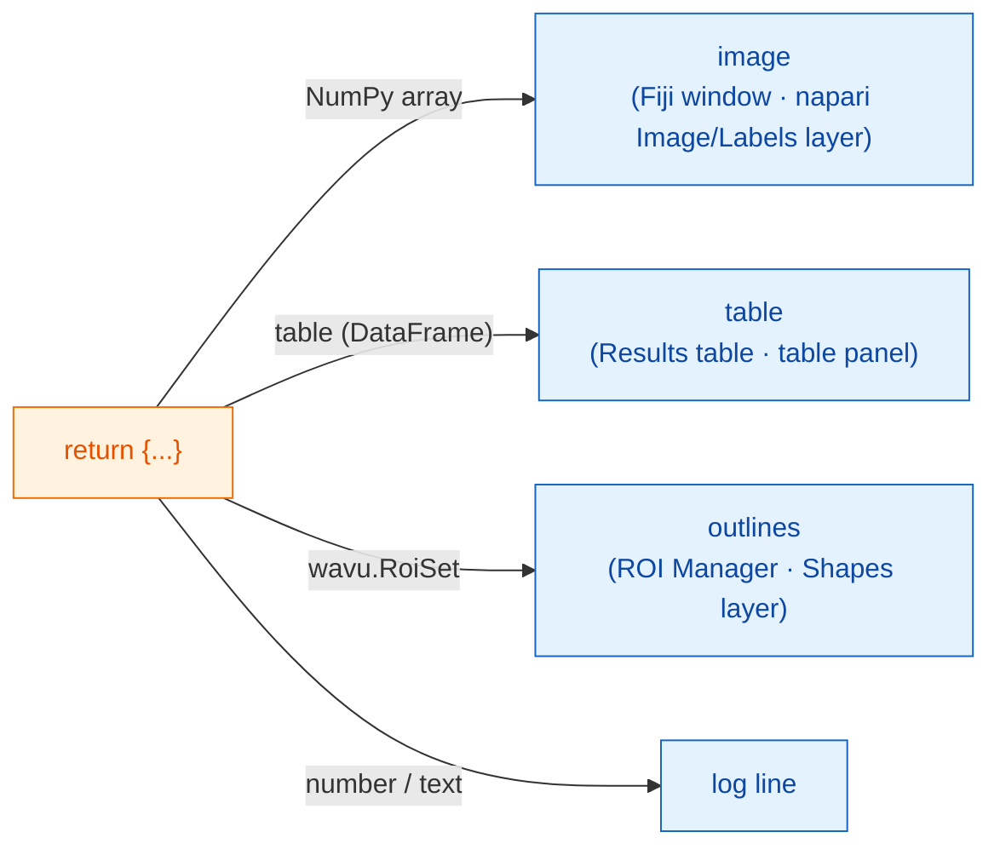

# What you can return

## The idea in plain words

At the end of `run` you hand back **a dictionary**: a set of labelled
plates. The **key** is the name on the plate and the **value** is the food.
The waiter, Fiji or napari, looks at each value and serves it where that
viewer keeps such things: pictures as images, segmentations as labels,
tables as tables, outlines as regions, and single numbers or words in the
log. Your script does not change between viewers; only the serving does.



## The menu of plates

=== "Fiji"

    | You return | Fiji shows |
    |---|---|
    | a NumPy array (2-D or more) | a **new image** window |
    | an array whose name contains `label` | the same, with the colourful **glasbey** look-up table |
    | `wavu.Image(array, pixel_um=0.65, axes="ZYX")` | an image **with pixel size and axes** set |
    | a pandas `DataFrame`, or a list of dicts | a **Results table** |
    | `wavu.RoiSet(path_to_zip)` | the outlines in the **ROI Manager** |
    | a number, text, `True`/`False` | a line `name = value` in the **Log** |
    | a file path (`pathlib.Path`) | the path, printed in the **Log** |

    Each image or table title starts with the input image's name, so
    returning `{"labels": ...}` from *blobs.gif* gives a window called
    *blobs-labels*.

=== "napari"

    | You return | napari shows |
    |---|---|
    | a NumPy array (2-D or more) | an **Image** layer named after the key |
    | an integer array whose key contains `label`, `mask`, `seg` or `instance` (any case) | a **Labels** layer |
    | `wavu.Image(arr, extra={"napari": "labels"})` | a **Labels** layer, whatever the name |
    | `wavu.Image(arr, extra={"napari": "image"})` | an **Image** layer, even if the name says `labels` |
    | `wavu.Image(arr, axes="CYX", channel_names=["DNA", "Actin"])` | one Image layer per channel (napari's `channel_axis`): `name [DNA]`, `name [Actin]` |
    | an RGB image (`axes` ending in `S`, last size 3 or 4) | one RGB Image layer |
    | `wavu.RoiSet(path_to_zip)` | a **Shapes** layer of yellow polygons |
    | a pandas `DataFrame`, or a list of dicts | a **table panel** docked on the right, named after the key, plus a log line `name: table with N rows` |
    | a number, text, `True`/`False` | a line `name = value` in the panel's **log** |
    | a file path (`pathlib.Path`) | a log line `name: path` |

    The "named like labels" rule is the same idea Fiji uses for its glasbey
    look-up table, so most scripts look right in both viewers without any
    change. When the name does not fit, set the hint with `extra`.

**Image types** are the same in both viewers: yes/no masks become 8-bit
0/255, whole numbers up to 65535 become 16-bit, everything else 32-bit
float. A label image with more than 65535 objects (or values below 0)
therefore comes back as 32-bit float; napari then opens it as an Image
layer.

## An example with three kinds of results

(Needs `scikit-image` and `pandas` in `pixi.toml`.)

```python
def run(ctx, inputs, params):
    from skimage import filters, measure
    import pandas as pd

    img = inputs["image"]
    labels = measure.label(img > filters.threshold_otsu(img))
    table = pd.DataFrame(measure.regionprops_table(
        labels, img, properties=("label", "area", "mean_intensity")))
    return {
        "labels": labels,           # glasbey image / Labels layer
        "cells": table,             # Results table / table panel
        "count": int(labels.max())  # log: count = ...
    }
```

## Outlines for the ROI Manager and Shapes

Outlines travel as an ImageJ *RoiSet* zip file. Write one into
`ctx.tmpdir`, a scratch folder Wavu gives every run, and return it wrapped in
`wavu.RoiSet`. The [roifile](https://pypi.org/project/roifile/) package does
the writing (add `roifile` to `pixi.toml`):

```python
from pathlib import Path
import roifile
import wavu

rois = [roifile.ImagejRoi.frompoints(outline) for outline in outlines]  # (x, y) points
zip_path = Path(ctx.tmpdir) / "RoiSet.zip"
roifile.roiwrite(zip_path, rois)
return {"labels": labels, "outlines": wavu.RoiSet(zip_path)}
```

Fiji opens the zip in the ROI Manager. napari reads it with roifile too
(Wavu's napari environment includes it; if it were missing, the log would
tell you where the zip is instead). The Cellpose example in the Wavu
repository
([`examples/cellpose_nuclei`](https://github.com/Oxford-Zeiss-Centre-of-Excellence/Wavu/tree/main/examples/cellpose_nuclei))
does exactly this with Cellpose's outlines.

## Pixel size comes along

An output image gets the input's pixel size, unless you give your own with
`wavu.Image(..., pixel_um=...)`.

- **Fiji** copies the calibration to every output with the same width and
  height as the input.
- **napari** sends `pixel_um` when the input layer's last two **scale**
  values are equal (and not 1) and its units are micrometres or pixels.
  Every image output without its own pixel size gets the same scale, so it
  lands exactly on top of its input; `pixel_um=0.65` sets the last two
  scale values to `0.65`.

## Good to know

- **What napari sends in.** Only **Image** and **Labels** layers can be
  picked in an `image` field. The panel sends the layer's data (for a
  multiscale layer, the full-resolution level; lazy dask data is loaded
  into memory first), the layer name as the title, and for RGB layers
  `axes="YXS"`, so your script knows the last axis is colour.
- **Returning nothing** (or `return {}`) is fine: nothing new appears.
- **If your code raises an error**, Fiji shows the message in an error
  window and the full details in the Log; napari writes `Error: …` with the
  full traceback in the panel's log and shows a short notification. See
  [Troubleshooting](../help/troubleshooting.md#an-error-appears-in-the-log).

## In one sentence

Return a dictionary, and the viewer serves it: arrays as image windows or
Image/Labels layers, tables as a Results table or table panel,
`wavu.RoiSet` in the ROI Manager or as Shapes, and plain values in the log,
with the input's pixel size carried over.

[Next: logs, progress and cancel :material-arrow-right:](logs-progress-cancel.md){ .md-button }
