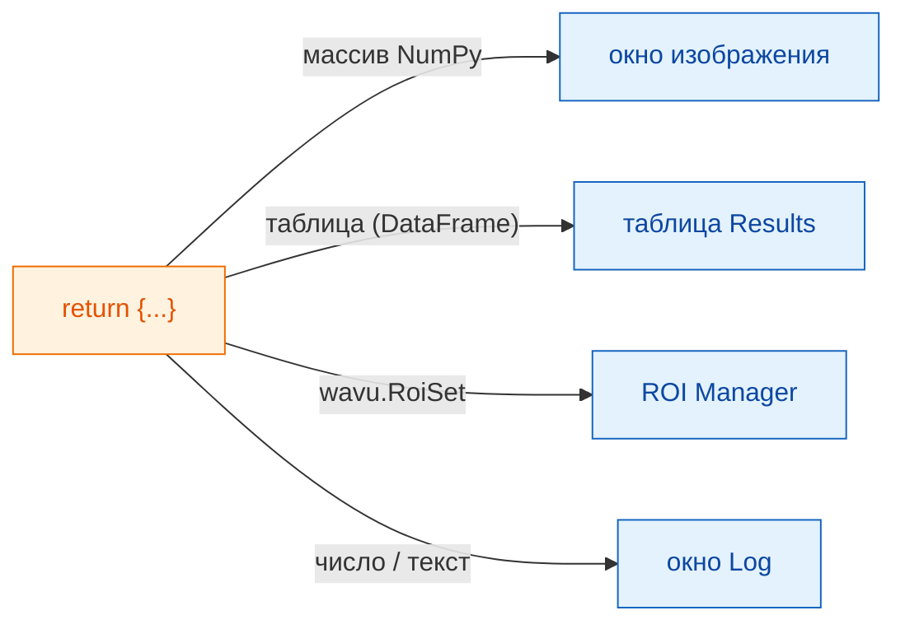
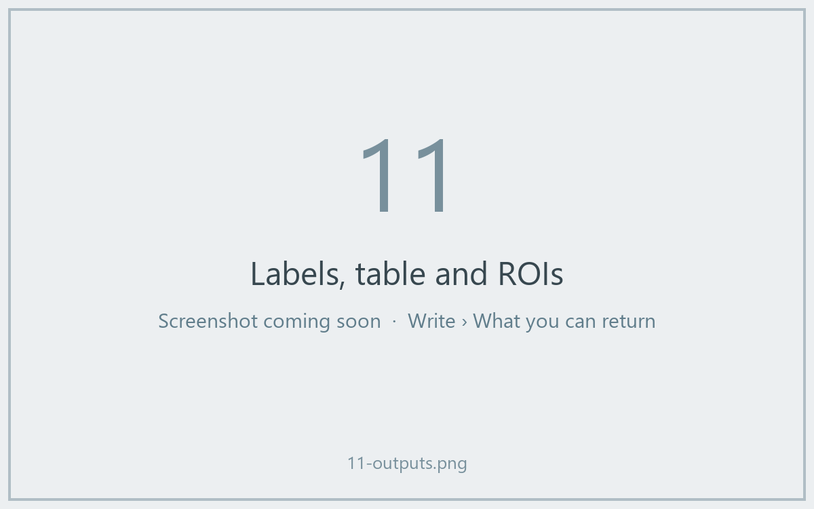

# Что можно вернуть

## Идея простыми словами

В конце `run` вы возвращаете **словарь** — набор подписанных тарелок.
**Ключ** — это надпись на тарелке, **значение** — сама еда. Fiji смотрит на
каждое значение и подаёт его куда нужно: картинки — в окна изображений,
таблицы — в таблицу Results, контуры — в ROI Manager, а отдельные числа или
слова — в Log.



## Меню тарелок

| Вы возвращаете | Fiji показывает |
|---|---|
| массив NumPy (2-D и больше) | **новое изображение**. Маски да/нет становятся 8-битными 0/255, целые числа до 65535 — 16-битными, всё остальное — 32-битным. |
| массив, в имени которого есть `label` | то же самое, с яркой таблицей цветов **glasbey** |
| `wavu.Image(array, pixel_um=0.65, axes="ZYX")` | изображение **с заданными размером пикселя и осями** |
| pandas `DataFrame` или список словарей | **таблицу Results** |
| `wavu.RoiSet(path_to_zip)` | контуры в **ROI Manager** |
| число, текст, `True`/`False` | строку `name = value` в **Log** |
| путь к файлу (`pathlib.Path`) | путь, напечатанный в **Log** |

Название каждого изображения или таблицы начинается с имени входного
изображения, поэтому `{"labels": ...}` для *blobs.gif* даёт окно
*blobs-labels*.

## Пример с тремя видами результатов

(Нужны `scikit-image` и `pandas` в `pixi.toml`.)

```python
def run(ctx, inputs, params):
    from skimage import filters, measure
    import pandas as pd

    img = inputs["image"]
    labels = measure.label(img > filters.threshold_otsu(img))
    table = pd.DataFrame(measure.regionprops_table(
        labels, img, properties=("label", "area", "mean_intensity")))
    return {
        "labels": labels,           # изображение, цвета glasbey
        "cells": table,             # таблица Results
        "count": int(labels.max())  # Log: count = ...
    }
```



## Контуры для ROI Manager

ROI Manager в Fiji читает zip-файлы ImageJ *RoiSet*. Запишите такой файл в
`ctx.tmpdir` — временную папку, которую Wavu выдаёт каждому запуску, — и
верните его, обернув в `wavu.RoiSet`. Запись делает пакет
[roifile](https://pypi.org/project/roifile/) (добавьте `roifile` в
`pixi.toml`):

```python
from pathlib import Path
import roifile
import wavu

rois = [roifile.ImagejRoi.frompoints(outline) for outline in outlines]  # точки (x, y)
zip_path = Path(ctx.tmpdir) / "RoiSet.zip"
roifile.roiwrite(zip_path, rois)
return {"labels": labels, "outlines": wavu.RoiSet(zip_path)}
```

Пример Cellpose в репозитории Wavu
([`examples/cellpose_nuclei`](https://github.com/Oxford-Zeiss-Centre-of-Excellence/Wavu/tree/main/examples/cellpose_nuclei))
делает ровно это с контурами Cellpose.

## Полезно знать

- **Калибровка — бесплатно.** Выходное изображение той же ширины и высоты,
  что и входное, получает размер пикселя входного, если вы не задали свой
  через `wavu.Image(..., pixel_um=...)`.
- **Больше 65535 объектов?** Изображение меток вернётся 32-битным, а не
  16-битным.
- **Ничего не возвращать** (или `return {}`) — нормально: Fiji просто ничего
  не покажет.
- **Если ваш код выбросит ошибку**, Fiji покажет сообщение в окне ошибки, а
  все подробности — в Log. См.
  [Решение проблем](../help/troubleshooting.md#an-error-appears-in-the-log).

## Одним предложением

Верните словарь, и Fiji поместит массивы в окна изображений, таблицы — в
таблицу Results, `wavu.RoiSet` — в ROI Manager, а простые значения — в Log.

[Далее: Log, прогресс и отмена :material-arrow-right:](logs-progress-cancel.md){ .md-button }
