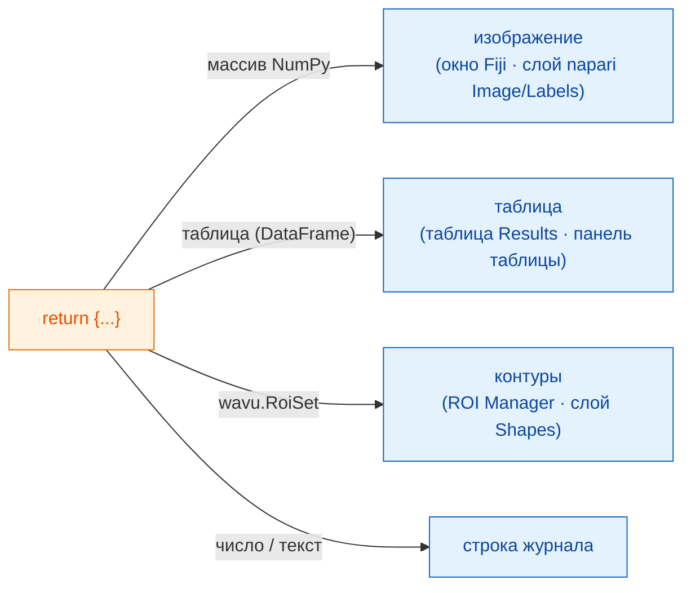

# Что можно вернуть

## Идея простыми словами

В конце `run` вы возвращаете **словарь** — набор подписанных тарелок.
**Ключ** — это надпись на тарелке, **значение** — сама еда. Официант, Fiji
или napari, смотрит на каждое значение и подаёт его туда, где этот
просмотрщик хранит такие вещи: картинки — как изображения, сегментации —
как метки, таблицы — как таблицы, контуры — как области, а отдельные числа
или слова — в журнал. Ваш скрипт не меняется от просмотрщика к
просмотрщику; меняется только подача.



## Меню тарелок

=== "Fiji"

    | Вы возвращаете | Fiji показывает |
    |---|---|
    | массив NumPy (2-D и больше) | окно **нового изображения** |
    | массив, в имени которого есть `label` | то же самое, с яркой таблицей цветов **glasbey** |
    | `wavu.Image(array, pixel_um=0.65, axes="ZYX")` | изображение **с заданными размером пикселя и осями** |
    | pandas `DataFrame` или список словарей | **таблицу Results** |
    | `wavu.RoiSet(path_to_zip)` | контуры в **ROI Manager** |
    | число, текст, `True`/`False` | строку `name = value` в **Log** |
    | путь к файлу (`pathlib.Path`) | путь, напечатанный в **Log** |

    Название каждого изображения или таблицы начинается с имени входного
    изображения, поэтому `{"labels": ...}` для *blobs.gif* даёт окно
    *blobs-labels*.

=== "napari"

    | Вы возвращаете | napari показывает |
    |---|---|
    | массив NumPy (2-D и больше) | слой **Image** с именем ключа |
    | целочисленный массив, ключ которого содержит `label`, `mask`, `seg` или `instance` (в любом регистре) | слой **Labels** |
    | `wavu.Image(arr, extra={"napari": "labels"})` | слой **Labels**, независимо от имени |
    | `wavu.Image(arr, extra={"napari": "image"})` | слой **Image**, даже если в имени есть `labels` |
    | `wavu.Image(arr, axes="CYX", channel_names=["DNA", "Actin"])` | по слою Image на канал (`channel_axis` в napari): `name [DNA]`, `name [Actin]` |
    | RGB-изображение (`axes` оканчивается на `S`, последний размер 3 или 4) | один RGB-слой Image |
    | `wavu.RoiSet(path_to_zip)` | слой **Shapes** из жёлтых многоугольников |
    | pandas `DataFrame` или список словарей | **панель таблицы** справа с именем ключа, плюс строка журнала `name: table with N rows` |
    | число, текст, `True`/`False` | строку `name = value` в **журнале** панели |
    | путь к файлу (`pathlib.Path`) | строку журнала `name: path` |

    Правило «назван как метки» — та же идея, по которой Fiji применяет свою
    таблицу цветов glasbey, поэтому большинство скриптов выглядят правильно
    в обоих просмотрщиках без изменений. Если имя не подходит, задайте
    подсказку через `extra`.

**Типы изображений** одинаковы в обоих просмотрщиках: маски да/нет
становятся 8-битными 0/255, целые числа до 65535 — 16-битными, всё
остальное — 32-битным float. Поэтому изображение меток с более чем 65535
объектами (или со значениями ниже 0) возвращается как 32-битный float, и
napari открывает его как слой Image.

## Пример с тремя видами результатов

(Нужны `scikit-image` и `pandas` в `pixi.toml`.)

```python
def run(ctx, inputs, params):
    from skimage import filters, measure
    import pandas as pd

    img = inputs["image"]
    labels = measure.label(img > filters.threshold_otsu(img))
    table = pd.DataFrame(measure.regionprops_table(
        labels, img, properties=("label", "area", "mean_intensity")))
    return {
        "labels": labels,           # изображение glasbey / слой Labels
        "cells": table,             # таблица Results / панель таблицы
        "count": int(labels.max())  # журнал: count = ...
    }
```

## Контуры для ROI Manager и Shapes

Контуры передаются как zip-файл ImageJ *RoiSet*. Запишите такой файл в
`ctx.tmpdir` — временную папку, которую Wavu выдаёт каждому запуску, — и
верните его, обернув в `wavu.RoiSet`. Запись делает пакет
[roifile](https://pypi.org/project/roifile/) (добавьте `roifile` в
`pixi.toml`):

```python
from pathlib import Path
import roifile
import wavu

rois = [roifile.ImagejRoi.frompoints(outline) for outline in outlines]  # точки (x, y)
zip_path = Path(ctx.tmpdir) / "RoiSet.zip"
roifile.roiwrite(zip_path, rois)
return {"labels": labels, "outlines": wavu.RoiSet(zip_path)}
```

Fiji открывает zip в ROI Manager. napari тоже читает его с помощью roifile
(он входит в окружение napari из Wavu; если бы его не было, журнал сообщил
бы, где лежит zip). Пример Cellpose в репозитории Wavu
([`examples/cellpose_nuclei`](https://github.com/Oxford-Zeiss-Centre-of-Excellence/Wavu/tree/main/examples/cellpose_nuclei))
делает ровно это с контурами Cellpose.

## Размер пикселя передаётся вместе с изображением

Выходное изображение получает размер пикселя входного, если вы не задали
свой через `wavu.Image(..., pixel_um=...)`.

- **Fiji** копирует калибровку на каждый результат той же ширины и высоты,
  что и входное изображение.
- **napari** отправляет `pixel_um`, если два последних значения **scale**
  входного слоя равны (и не равны 1), а единицы — микрометры или пиксели.
  Каждое выходное изображение без собственного размера пикселя получает тот
  же масштаб и ложится точно поверх входного; `pixel_um=0.65` задаёт два
  последних значения scale равными `0.65`.

## Полезно знать

- **Что napari отправляет на вход.** В поле `image` можно выбрать только
  слои **Image** и **Labels**. Панель отправляет данные слоя (для
  многомасштабного слоя — уровень полного разрешения; ленивые данные dask
  сначала загружаются в память), имя слоя как заголовок, а для RGB-слоёв
  `axes="YXS"`, чтобы скрипт знал, что последняя ось — цвет.
- **Ничего не возвращать** (или `return {}`) — нормально: ничего нового не
  появится.
- **Если ваш код выбросит ошибку**, Fiji покажет сообщение в окне ошибки, а
  все подробности — в Log; napari напишет в журнал панели `Error: …` с
  полной трассировкой и покажет короткое уведомление. См.
  [Решение проблем](../help/troubleshooting.md#an-error-appears-in-the-log).

## Одним предложением

Верните словарь, и просмотрщик всё подаст: массивы — как окна изображений
или слои Image/Labels, таблицы — как таблицу Results или панель таблицы,
`wavu.RoiSet` — в ROI Manager или как Shapes, а простые значения — в журнал,
сохранив размер пикселя входного изображения.

[Далее: Log, прогресс и отмена :material-arrow-right:](logs-progress-cancel.md){ .md-button }
