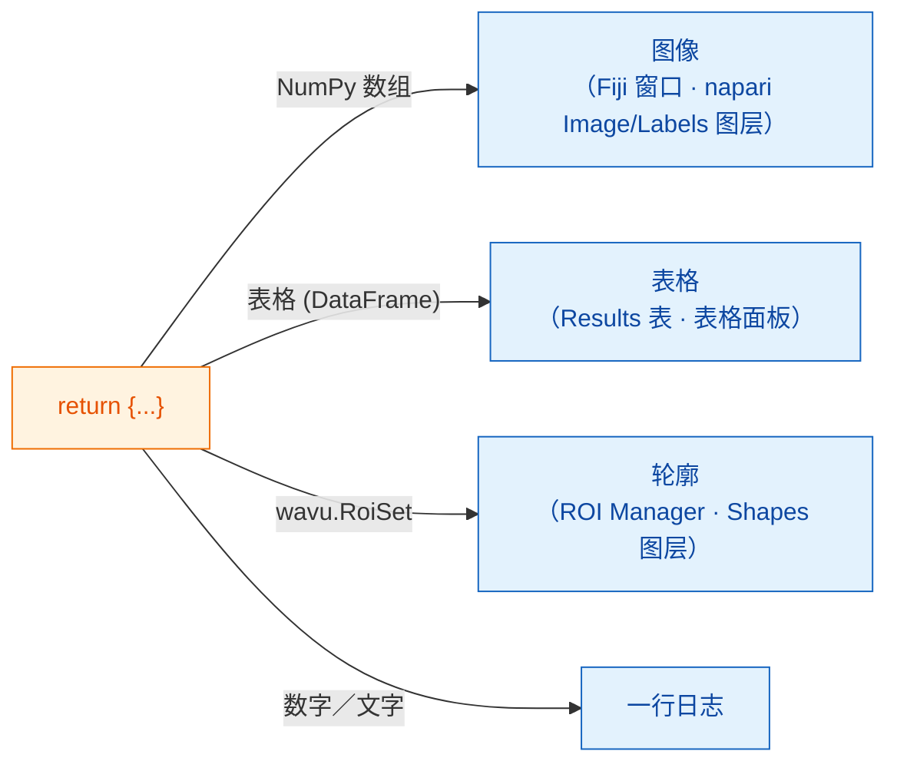

# 可以返回什么

## 用大白话说

在 `run` 的最后，你交回**一个字典**：一组贴了标签的餐盘。**键**（key）是盘子上的
名字，**值**（value）是盘里的菜。服务员（Fiji 或 napari）会看每个值，把它端到
自己存放这类东西的地方：图片成为图像，分割结果成为标签，表格成为表格，轮廓成为
区域，单个数字或文字则写进日志（log）。不管用 Fiji 还是 napari，你的脚本都
不用改；变的只是上菜的方式。



## 餐盘菜单

=== "Fiji"

    | 你返回 | Fiji 显示 |
    |---|---|
    | 一个 NumPy 数组（二维及以上） | 一个**新图像**窗口 |
    | 名字里带 `label` 的数组 | 同上，再配上五颜六色的 **glasbey** 查找表（LUT） |
    | `wavu.Image(array, pixel_um=0.65, axes="ZYX")` | 一张**设好像素大小和轴**的图像 |
    | pandas `DataFrame`，或由 dict 组成的 list | 一张 **Results 表** |
    | `wavu.RoiSet(path_to_zip)` | **ROI Manager** 里的轮廓 |
    | 数字、文字、`True`/`False` | **Log** 里的一行 `name = value` |
    | 文件路径（`pathlib.Path`） | 打印在 **Log** 里的路径 |

    每个图像或表格的标题都以输入图像的名字开头，所以从 *blobs.gif* 返回
    `{"labels": ...}`，会得到一个叫 *blobs-labels* 的窗口。

=== "napari"

    | 你返回 | napari 显示 |
    |---|---|
    | 一个 NumPy 数组（二维及以上） | 一个以键命名的 **Image** 图层 |
    | 整数数组，且键里带 `label`、`mask`、`seg` 或 `instance`（不分大小写） | 一个 **Labels** 图层 |
    | `wavu.Image(arr, extra={"napari": "labels"})` | 一个 **Labels** 图层，不管名字是什么 |
    | `wavu.Image(arr, extra={"napari": "image"})` | 一个 **Image** 图层，哪怕名字里写着 `labels` |
    | `wavu.Image(arr, axes="CYX", channel_names=["DNA", "Actin"])` | 每个通道一个 Image 图层（napari 的 `channel_axis`）：`name [DNA]`、`name [Actin]` |
    | RGB 图像（`axes` 以 `S` 结尾，最后一维大小为 3 或 4） | 一个 RGB Image 图层 |
    | `wavu.RoiSet(path_to_zip)` | 一个由黄色多边形组成的 **Shapes** 图层 |
    | pandas `DataFrame`，或由 dict 组成的 list | 停靠在右侧、以键命名的**表格面板**，外加一行日志 `name: table with N rows` |
    | 数字、文字、`True`/`False` | 面板 **log** 里的一行 `name = value` |
    | 文件路径（`pathlib.Path`） | 一行日志 `name: path` |

    “名字像 labels”这条规则，和 Fiji 决定套用 glasbey 查找表的思路一样，
    所以大多数脚本不用改，在 Fiji 和 napari 里看起来都没问题。名字不合适时，
    就用 `extra` 给出提示。

**图像类型**在 Fiji 和 napari 里都一样：是／否掩膜变成 8 位 0/255，不超过
65535 的整数变成 16 位，其余都是 32 位浮点。所以，对象超过 65535 个（或有
小于 0 的值）的标签图像，会以 32 位浮点返回；napari 会把它当作 Image 图层打开。

## 一个有三种结果的例子

（`pixi.toml` 里需要有 `scikit-image` 和 `pandas`。）

```python
def run(ctx, inputs, params):
    from skimage import filters, measure
    import pandas as pd

    img = inputs["image"]
    labels = measure.label(img > filters.threshold_otsu(img))
    table = pd.DataFrame(measure.regionprops_table(
        labels, img, properties=("label", "area", "mean_intensity")))
    return {
        "labels": labels,           # glasbey 图像／Labels 图层
        "cells": table,             # Results 表／表格面板
        "count": int(labels.max())  # 日志：count = ...
    }
```

## 给 ROI Manager 和 Shapes 的轮廓

轮廓以 ImageJ 的 *RoiSet* zip 文件传递。把它写进 `ctx.tmpdir`（Wavu 给每次运行
的临时文件夹），再用 `wavu.RoiSet` 包起来返回。写文件交给
[roifile](https://pypi.org/project/roifile/) 包（把 `roifile` 加进
`pixi.toml`）：

```python
from pathlib import Path
import roifile
import wavu

rois = [roifile.ImagejRoi.frompoints(outline) for outline in outlines]  # (x, y) 坐标点
zip_path = Path(ctx.tmpdir) / "RoiSet.zip"
roifile.roiwrite(zip_path, rois)
return {"labels": labels, "outlines": wavu.RoiSet(zip_path)}
```

Fiji 会在 ROI Manager 里打开这个 zip。napari 也用 roifile 读取它（Wavu 的
napari 环境已经包含 roifile；万一没有，日志会改为告诉你 zip 在哪里）。Wavu
仓库里的 Cellpose 示例
（[`examples/cellpose_nuclei`](https://github.com/Oxford-Zeiss-Centre-of-Excellence/Wavu/tree/main/examples/cellpose_nuclei)）
就是用 Cellpose 的轮廓这样做的。

## 像素大小会跟着过来

输出图像会沿用输入的像素大小，除非你用 `wavu.Image(..., pixel_um=...)` 自己指定。

- **Fiji** 会把标定信息复制到每个宽高与输入相同的输出上。
- **napari** 在输入图层最后两个 **scale** 值相等（且不为 1）、单位是微米或像素
  时，会传出 `pixel_um`。每个没有自己像素大小的图像输出都会拿到同样的 scale，
  因此正好叠在输入上面；`pixel_um=0.65` 则把最后两个 scale 值设为 `0.65`。

## 值得知道

- **napari 传进来的是什么。** `image` 字段只能选 **Image** 和 **Labels** 图层。
  面板会传出图层的数据（多尺度图层取全分辨率那一层；惰性加载的 dask 数据会先
  读进内存）、以图层名作为标题，RGB 图层还会带上 `axes="YXS"`，让你的脚本知道
  最后一轴是颜色。
- **什么都不返回**（或 `return {}`）也没关系：只是不会出现新东西。
- **如果你的代码抛出错误**，Fiji 会在错误窗口显示消息，完整细节写在 Log；
  napari 则在面板的日志里写下 `Error: …` 和完整的 traceback，并弹出一条简短通知。
  见[故障排除](../help/troubleshooting.md#an-error-appears-in-the-log)。

## 一句话总结

返回一个字典，Fiji 或 napari 就会替你上菜：数组成为图像窗口或 Image/Labels
图层，表格成为 Results 表或表格面板，`wavu.RoiSet` 进 ROI Manager 或成为
Shapes，简单的值写进日志，而且输入的像素大小会一并带过来。

[下一步：日志、进度和取消 :material-arrow-right:](logs-progress-cancel.md){ .md-button }
