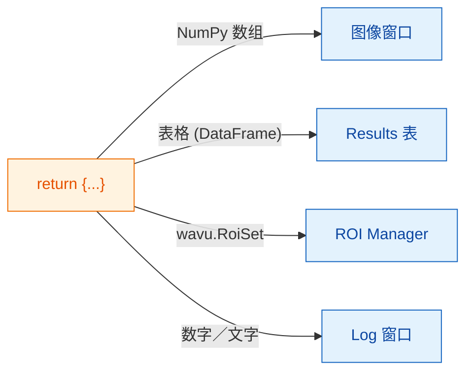

# 可以返回什么

## 用大白话说

在 `run` 的最后，你交回**一个字典**：一组贴了标签的餐盘。**键**是盘子上的名字，
**值**是盘里的菜。Fiji 会看每个值，把它端到合适的地方：图片进图像窗口，
表格进 Results 表，轮廓进 ROI Manager，单个数字或文字写进 Log。



## 餐盘菜单

| 你返回 | Fiji 显示 |
|---|---|
| 一个 NumPy 数组（二维及以上） | 一张**新图像**。是／否掩膜变成 8 位 0/255，不超过 65535 的整数变成 16 位，其余变成 32 位。 |
| 名字里带 `label` 的数组 | 同上，再配上五颜六色的 **glasbey** 查找表（LUT） |
| `wavu.Image(array, pixel_um=0.65, axes="ZYX")` | 一张**设置好像素尺寸和轴**的图像 |
| 一个 pandas `DataFrame`，或由字典组成的列表 | 一张 **Results 表** |
| `wavu.RoiSet(path_to_zip)` | **ROI Manager** 里的轮廓 |
| 数字、文字、`True`/`False` | **Log** 里的一行 `name = value` |
| 文件路径（`pathlib.Path`） | 打印在 **Log** 里的路径 |

每个图像或表格的标题都以输入图像的名字开头，所以对 *blobs.gif* 返回
`{"labels": ...}`，会得到一个名为 *blobs-labels* 的窗口。

## 一次返回三种结果的例子

（`pixi.toml` 里需要有 `scikit-image` 和 `pandas`。）

```python
def run(ctx, inputs, params):
    from skimage import filters, measure
    import pandas as pd

    img = inputs["image"]
    labels = measure.label(img > filters.threshold_otsu(img))
    table = pd.DataFrame(measure.regionprops_table(
        labels, img, properties=("label", "area", "mean_intensity")))
    return {
        "labels": labels,           # 图像，glasbey 配色
        "cells": table,             # Results 表
        "count": int(labels.max())  # Log：count = ...
    }
```

## 给 ROI Manager 的轮廓

Fiji 的 ROI Manager 读取 ImageJ 的 *RoiSet* zip 文件。把它写到
`ctx.tmpdir`（Wavu 每次运行都会提供的临时文件夹）里，再用
`wavu.RoiSet` 包起来返回。写文件的活交给 [roifile](https://pypi.org/project/roifile/)
包（把 `roifile` 加进 `pixi.toml`）：

```python
from pathlib import Path
import roifile
import wavu

rois = [roifile.ImagejRoi.frompoints(outline) for outline in outlines]  # (x, y) 点
zip_path = Path(ctx.tmpdir) / "RoiSet.zip"
roifile.roiwrite(zip_path, rois)
return {"labels": labels, "outlines": wavu.RoiSet(zip_path)}
```

Wavu 仓库里的 Cellpose 示例
（[`examples/cellpose_nuclei`](https://github.com/Oxford-Zeiss-Centre-of-Excellence/Wavu/tree/main/examples/cellpose_nuclei)）
正是用 Cellpose 的轮廓这样做的。

## 值得知道

- **标定信息自动带上。** 输出图像的宽高和输入相同时，会沿用输入的像素尺寸，
  除非你用 `wavu.Image(..., pixel_um=...)` 自己指定。
- **对象超过 65535 个？** 标签图像会以 32 位而不是 16 位返回。
- **什么都不返回**（或 `return {}`）也没问题：Fiji 就什么都不显示。
- **如果你的代码抛出错误**，Fiji 会在错误窗口里显示消息，完整细节写在 Log 里。参见
  [故障排除](../help/troubleshooting.md#an-error-appears-in-the-log)。

## 一句话总结

返回一个字典，Fiji 就会把数组放进图像窗口、表格放进 Results 表、
`wavu.RoiSet` 放进 ROI Manager，简单的值写进 Log。

[下一步：日志、进度和取消 :material-arrow-right:](logs-progress-cancel.md){ .md-button }
