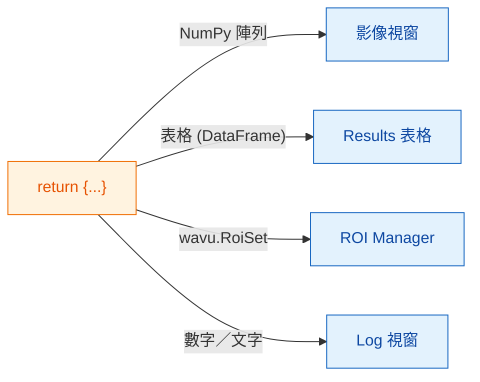
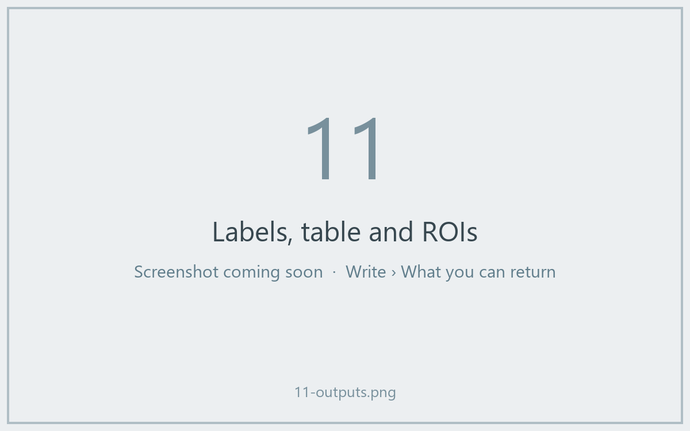

# 可以回傳什麼

## 用白話說

在 `run` 的最後，你交回**一個字典**：一組貼了標籤的餐盤。**鍵**是盤子上的名字，
**值**是盤子裡的菜。Fiji 會看每個值，把它端到對的地方：圖片放進影像視窗，
表格放進 Results 表格，輪廓放進 ROI Manager，單一的數字或文字則寫進 Log。



## 餐盤菜單

| 你回傳 | Fiji 顯示 |
|---|---|
| 一個 NumPy 陣列（2 維或以上） | 一張**新影像**。是／否遮罩會變成 8-bit 0/255，不超過 65535 的整數變成 16-bit，其他都變成 32-bit。 |
| 名稱裡含有 `label` 的陣列 | 同上，再加上色彩繽紛的 **glasbey** 查找表（LUT） |
| `wavu.Image(array, pixel_um=0.65, axes="ZYX")` | 一張**設好像素大小和軸**的影像 |
| 一個 pandas `DataFrame`，或一個由字典組成的串列 | 一個 **Results 表格** |
| `wavu.RoiSet(path_to_zip)` | **ROI Manager** 裡的輪廓 |
| 數字、文字、`True`/`False` | **Log** 裡的一行 `name = value` |
| 檔案路徑（`pathlib.Path`） | 印在 **Log** 裡的路徑 |

每個影像或表格的標題都以輸入影像的名稱開頭，所以從 *blobs.gif* 回傳
`{"labels": ...}` 會得到一個名為 *blobs-labels* 的視窗。

## 一次回傳三種結果的範例

（`pixi.toml` 裡需要有 `scikit-image` 和 `pandas`。）

```python
def run(ctx, inputs, params):
    from skimage import filters, measure
    import pandas as pd

    img = inputs["image"]
    labels = measure.label(img > filters.threshold_otsu(img))
    table = pd.DataFrame(measure.regionprops_table(
        labels, img, properties=("label", "area", "mean_intensity")))
    return {
        "labels": labels,           # 影像，glasbey 配色
        "cells": table,             # Results 表格
        "count": int(labels.max())  # Log：count = ...
    }
```



## 給 ROI Manager 的輪廓

Fiji 的 ROI Manager 讀的是 ImageJ 的 *RoiSet* zip 檔。把它寫進
`ctx.tmpdir`（Wavu 每次執行都會給你的一個暫存資料夾），再用
`wavu.RoiSet` 包起來回傳。寫檔的工作交給 [roifile](https://pypi.org/project/roifile/)
套件（把 `roifile` 加進 `pixi.toml`）：

```python
from pathlib import Path
import roifile
import wavu

rois = [roifile.ImagejRoi.frompoints(outline) for outline in outlines]  # (x, y) 點
zip_path = Path(ctx.tmpdir) / "RoiSet.zip"
roifile.roiwrite(zip_path, rois)
return {"labels": labels, "outlines": wavu.RoiSet(zip_path)}
```

Wavu 儲存庫裡的 Cellpose 範例
（[`examples/cellpose_nuclei`](https://github.com/Oxford-Zeiss-Centre-of-Excellence/Wavu/tree/main/examples/cellpose_nuclei)）
就是用 Cellpose 的輪廓這樣做的。

## 小提醒

- **校正資訊自動帶上。** 輸出影像的寬高和輸入一樣時，會沿用輸入的像素大小，
  除非你用 `wavu.Image(..., pixel_um=...)` 自己指定。
- **物件超過 65535 個？** 標籤影像會以 32-bit 而不是 16-bit 傳回。
- **什麼都不回傳**（或 `return {}`）也沒關係：Fiji 就什麼都不顯示。
- **如果你的程式碼丟出錯誤**，Fiji 會在錯誤視窗裡顯示訊息，完整細節則寫在 Log 裡。請看
  [疑難排解](../help/troubleshooting.md#an-error-appears-in-the-log)。

## 一句話總結

回傳一個字典，Fiji 就會把陣列放進影像視窗、表格放進 Results 表格、
`wavu.RoiSet` 放進 ROI Manager，簡單的值則寫進 Log。

[下一步：Log、進度與取消 :material-arrow-right:](logs-progress-cancel.md){ .md-button }
