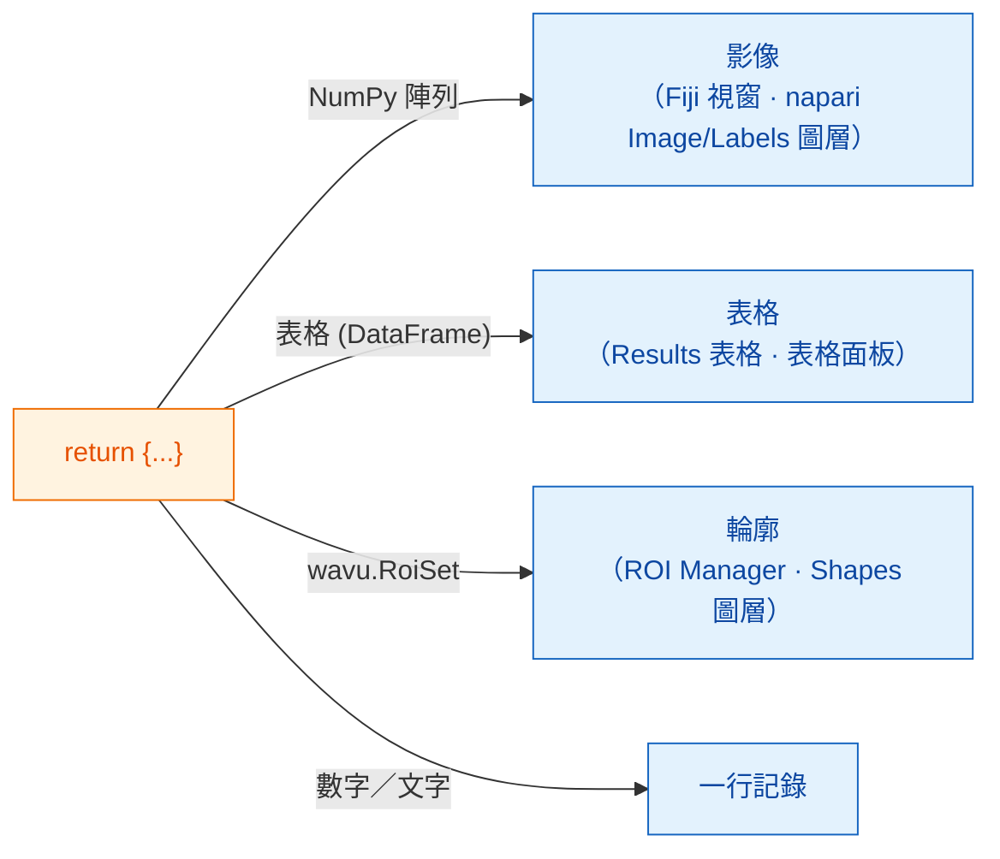

# 可以回傳什麼

## 用白話說

在 `run` 的最後，你交回**一個字典**：一組貼了標籤的餐盤。**鍵**（key）是盤子上的
名字，**值**（value）是盤裡的菜。服務生（Fiji 或 napari）會看每個值，把它端到
自己存放這類東西的地方：圖片成為影像，分割結果成為標籤，表格成為表格，輪廓成為
區域，單一的數字或文字則寫進記錄（log）。不管用 Fiji 還是 napari，你的腳本都
不用改；改變的只有上菜的方式。



## 餐盤菜單

=== "Fiji"

    | 你回傳 | Fiji 顯示 |
    |---|---|
    | 一個 NumPy 陣列（二維或更多維） | 一個**新的影像**視窗 |
    | 名稱含有 `label` 的陣列 | 同上，再套上色彩繽紛的 **glasbey** 查色表（LUT） |
    | `wavu.Image(array, pixel_um=0.65, axes="ZYX")` | 一張**設定好像素大小和軸**的影像 |
    | pandas `DataFrame`，或由 dict 組成的 list | 一個 **Results 表格** |
    | `wavu.RoiSet(path_to_zip)` | **ROI Manager** 裡的輪廓 |
    | 數字、文字、`True`/`False` | **Log** 裡的一行 `name = value` |
    | 檔案路徑（`pathlib.Path`） | 印在 **Log** 裡的路徑 |

    每個影像或表格的標題都以輸入影像的名稱開頭，所以從 *blobs.gif* 回傳
    `{"labels": ...}`，會得到一個叫 *blobs-labels* 的視窗。

=== "napari"

    | 你回傳 | napari 顯示 |
    |---|---|
    | 一個 NumPy 陣列（二維或更多維） | 一個以鍵命名的 **Image** 圖層 |
    | 整數陣列，且鍵含有 `label`、`mask`、`seg` 或 `instance`（不分大小寫） | 一個 **Labels** 圖層 |
    | `wavu.Image(arr, extra={"napari": "labels"})` | 一個 **Labels** 圖層，不管名稱是什麼 |
    | `wavu.Image(arr, extra={"napari": "image"})` | 一個 **Image** 圖層，即使名稱寫著 `labels` |
    | `wavu.Image(arr, axes="CYX", channel_names=["DNA", "Actin"])` | 每個通道一個 Image 圖層（napari 的 `channel_axis`）：`name [DNA]`、`name [Actin]` |
    | RGB 影像（`axes` 以 `S` 結尾，最後一維大小為 3 或 4） | 一個 RGB Image 圖層 |
    | `wavu.RoiSet(path_to_zip)` | 一個由黃色多邊形組成的 **Shapes** 圖層 |
    | pandas `DataFrame`，或由 dict 組成的 list | 停靠在右側、以鍵命名的**表格面板**，外加一行記錄 `name: table with N rows` |
    | 數字、文字、`True`/`False` | 面板 **log** 裡的一行 `name = value` |
    | 檔案路徑（`pathlib.Path`） | 一行記錄 `name: path` |

    「名稱像 labels」這條規則，和 Fiji 決定套用 glasbey 查色表的想法相同，
    所以大多數腳本不用改，在 Fiji 和 napari 裡看起來都對。名稱不合適時，
    就用 `extra` 指定提示。

**影像型別**在 Fiji 和 napari 裡都一樣：是／否遮罩變成 8 位元 0/255，不超過
65535 的整數變成 16 位元，其他一律是 32 位元浮點數。因此，物件超過 65535 個
（或有小於 0 的值）的標籤影像，會以 32 位元浮點數傳回；napari 會把它開成
Image 圖層。

## 一個有三種結果的例子

（`pixi.toml` 裡需要有 `scikit-image` 和 `pandas`。）

```python
def run(ctx, inputs, params):
    from skimage import filters, measure
    import pandas as pd

    img = inputs["image"]
    labels = measure.label(img > filters.threshold_otsu(img))
    table = pd.DataFrame(measure.regionprops_table(
        labels, img, properties=("label", "area", "mean_intensity")))
    return {
        "labels": labels,           # glasbey 影像／Labels 圖層
        "cells": table,             # Results 表格／表格面板
        "count": int(labels.max())  # 記錄：count = ...
    }
```

## 給 ROI Manager 和 Shapes 的輪廓

輪廓以 ImageJ 的 *RoiSet* zip 檔傳遞。把它寫進 `ctx.tmpdir`（Wavu 給每次執行
的暫存資料夾），再用 `wavu.RoiSet` 包起來回傳。寫檔交給
[roifile](https://pypi.org/project/roifile/) 套件（把 `roifile` 加進
`pixi.toml`）：

```python
from pathlib import Path
import roifile
import wavu

rois = [roifile.ImagejRoi.frompoints(outline) for outline in outlines]  # (x, y) 座標點
zip_path = Path(ctx.tmpdir) / "RoiSet.zip"
roifile.roiwrite(zip_path, rois)
return {"labels": labels, "outlines": wavu.RoiSet(zip_path)}
```

Fiji 會在 ROI Manager 裡打開這個 zip。napari 也用 roifile 讀取它（Wavu 的
napari 環境已經包含 roifile；萬一沒有，記錄會改為告訴你 zip 在哪裡）。Wavu
儲存庫裡的 Cellpose 範例
（[`examples/cellpose_nuclei`](https://github.com/Oxford-Zeiss-Centre-of-Excellence/Wavu/tree/main/examples/cellpose_nuclei)）
就是用 Cellpose 的輪廓這樣做的。

## 像素大小會跟著過來

輸出影像會沿用輸入的像素大小，除非你用 `wavu.Image(..., pixel_um=...)` 自己指定。

- **Fiji** 會把校正資訊複製到每個寬高與輸入相同的輸出上。
- **napari** 在輸入圖層最後兩個 **scale** 值相等（且不是 1）、單位是微米或像素
  時，會送出 `pixel_um`。每個沒有自己像素大小的影像輸出都會拿到同樣的 scale，
  因此會剛好疊在輸入上面；`pixel_um=0.65` 則把最後兩個 scale 值設成 `0.65`。

## 值得知道

- **napari 送進來的是什麼。** `image` 欄位只能選 **Image** 和 **Labels** 圖層。
  面板會送出圖層的資料（多解析度圖層取最高解析度那一層；延遲載入的 dask 資料
  會先讀進記憶體）、以圖層名稱作為標題，RGB 圖層還會帶上 `axes="YXS"`，讓你的
  腳本知道最後一軸是顏色。
- **什麼都不回傳**（或 `return {}`）也沒關係：只是不會出現新東西。
- **如果你的程式碼拋出錯誤**，Fiji 會在錯誤視窗顯示訊息，完整細節寫在 Log；
  napari 則在面板的記錄裡寫下 `Error: …` 和完整的 traceback，並顯示一則簡短通知。
  請看[疑難排解](../help/troubleshooting.md#an-error-appears-in-the-log)。

## 一句話總結

回傳一個字典，Fiji 或 napari 就會替你上菜：陣列成為影像視窗或 Image/Labels
圖層，表格成為 Results 表格或表格面板，`wavu.RoiSet` 進 ROI Manager 或成為
Shapes，簡單的值寫進記錄，而且輸入的像素大小會一併帶過來。

[下一步：Log、進度與取消 :material-arrow-right:](logs-progress-cancel.md){ .md-button }
