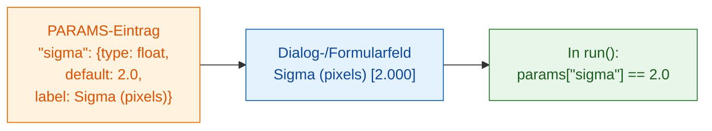

# PARAMS = Ihr Dialog

## Die Idee in einfachen Worten

`PARAMS` ist die **Speisekarte**, die Ihr Kellner dem Gast reicht. Sie
listen auf, was man wählen kann, und der Viewer zeichnet die Felder für Sie:
Fiji als Dialog, napari als Formular im Wavu-Panel. Keine Buttons oder
Fenster zu programmieren, und dasselbe `PARAMS` funktioniert in beiden. Jeder Eintrag hat einen **Namen**
(den Ihr Code benutzt), einen **Typ** (welche Art von Feld), einen
**Standardwert** (was am Anfang eingetragen ist) und optional eine
**Beschriftung** (den Text, den der Benutzer liest).



## Alle Feldtypen in einem Beispiel

```python
"""Field types demo -- one of each."""

PARAMS = {
    "image":  {"type": "image", "label": "Nuclei image"},
    "sigma":  {"type": "float", "default": 2.0, "label": "Sigma (pixels)"},
    "n":      {"type": "int",   "default": 3},
    "name":   {"type": "str",   "default": "cells"},
    "fast":   {"type": "bool",  "default": True},
    "method": {"type": "choice", "choices": ["otsu", "li"], "default": "otsu"},
}
```

Jeder Viewer macht daraus seine eigenen Felder; Ihr Code bekommt dieselben
Werte:

| `type` | Feld in Fiji | Feld in napari | Was `run` bekommt |
|---|---|---|---|
| `float` | Zahlenfeld (3 Nachkommastellen) | Zahlenfeld mit Nachkommastellen | eine Dezimalzahl, z. B. `2.0`, in `params` |
| `int` | Zahlenfeld (ohne Nachkommastellen) | Feld für ganze Zahlen | eine ganze Zahl, z. B. `3`, in `params` |
| `str` | Textfeld | Textfeld | Text, z. B. `"cells"`, in `params` |
| `bool` | Kontrollkästchen | Kontrollkästchen | `True` oder `False`, in `params` |
| `choice` | Auswahlliste | Auswahlliste | den gewählten Text, z. B. `"otsu"`, in `params` |
| `image` | Auswahlliste der **geöffneten Bilder** | Auswahlliste der **Image- und Labels-Layer** | ein NumPy-Array in **`inputs`** (nicht `params`) |

Die Layer-Auswahlliste von napari aktualisiert sich von selbst, wenn Sie
einen Layer hinzufügen oder entfernen.

## Das Kleingedruckte

- **`default` ist Pflicht** für jeden Typ außer `image`. Bei `choice` darf
  es fehlen; dann wird der erste Eintrag genommen.
- **`choices`** ist Pflicht für `choice`: eine Liste der Optionen.
- **`label` ist optional.** Ohne Beschriftung zeigen beide Viewer den Namen mit
  großem Anfangsbuchstaben und mit Leerzeichen statt `_`: Aus `min_area`
  wird *Min area*.
- **Namen** müssen gültige Python-Namen sein: Buchstaben, Ziffern und `_`,
  nicht mit einer Ziffer am Anfang.
- **Die Werte werden geprüft**, bevor Ihr Code läuft. Ein falscher Typ oder eine
  unbekannte Option wird mit einer Meldung abgelehnt, also bekommt `run`
  immer saubere Werte vom angegebenen Typ.
- Die **erste Zeile des Docstrings** oben in `script.py` wird oben im Dialog
  von Fiji und im napari-Panel angezeigt.
- Der Dialog von Fiji fügt ein zusätzliches Kästchen hinzu, **Debug in VS Code**, zum
  [Debuggen](../help/debug-in-vscode.md). Lassen Sie es normalerweise aus.

!!! info "Ein `image`-Feld braucht ein geöffnetes Bild"
    Hat Ihr Skript ein `image`-Feld und ist nichts geöffnet, hält Wavu mit
    einer Meldung an: in Fiji *"… needs an image -- open one first"*, in
    napari *"…: open an image layer first"*. Öffnen Sie ein Bild und starten
    Sie neu.

## Zwei Bilder? Zwei Felder

Sie möchten ein Zellkernbild *und* ein Zytoplasmabild? Fügen Sie zwei
`image`-Einträge hinzu. Jeder wird zu einer eigenen Auswahlliste, und jeder
kommt unter seinem eigenen Namen in `inputs` an:

```python
PARAMS = {
    "nuclei": {"type": "image", "label": "Nuclei"},
    "cyto":   {"type": "image", "label": "Cytoplasm"},
}

def run(ctx, inputs, params):
    nuc, cyto = inputs["nuclei"], inputs["cyto"]
    ...
```

## In einem Satz

Schreiben Sie pro Einstellung eine `PARAMS`-Zeile mit Typ und Standardwert,
und Fiji oder napari baut die Felder und reicht Ihnen die geprüften Werte in `params`
(Bilder in `inputs`).

[Weiter: was Sie zurückgeben können :material-arrow-right:](outputs.md){ .md-button }
