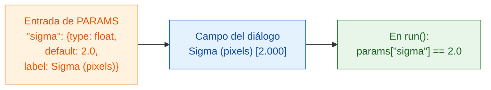

# PARAMS = tu diálogo

## La idea en palabras sencillas

`PARAMS` es la **carta** que tu camarero le da al cliente. Tú enumeras lo que
se puede elegir, y Fiji dibuja el diálogo por ti: no hay que programar
botones ni ventanas. Cada entrada tiene un **nombre** (lo que usa tu código),
un **tipo** (qué clase de campo es), un **valor por defecto** (lo que aparece
rellenado al principio) y una **etiqueta** opcional (el texto que lee el
usuario).



## Todos los tipos de campo en un ejemplo

```python
"""Field types demo -- one of each."""

PARAMS = {
    "image":  {"type": "image", "label": "Nuclei image"},
    "sigma":  {"type": "float", "default": 2.0, "label": "Sigma (pixels)"},
    "n":      {"type": "int",   "default": 3},
    "name":   {"type": "str",   "default": "cells"},
    "fast":   {"type": "bool",  "default": True},
    "method": {"type": "choice", "choices": ["otsu", "li"], "default": "otsu"},
}
```

Fiji lo convierte en este diálogo:

| `type` | Campo en Fiji | Lo que recibe `run` |
|---|---|---|
| `float` | casilla numérica (3 decimales) | un número decimal, p. ej. `2.0`, en `params` |
| `int` | casilla numérica (sin decimales) | un número entero, p. ej. `3`, en `params` |
| `str` | casilla de texto | texto, p. ej. `"cells"`, en `params` |
| `bool` | casilla de verificación | `True` o `False`, en `params` |
| `choice` | desplegable | el texto elegido, p. ej. `"otsu"`, en `params` |
| `image` | desplegable con las **imágenes abiertas** | un array de NumPy en **`inputs`** (no en `params`) |

## La letra pequeña

- **`default` es obligatorio** para todos los tipos excepto `image`. En
  `choice` se puede omitir; entonces se usa el primer elemento.
- **`choices`** es obligatorio en `choice`: una lista de las opciones.
- **`label` es opcional.** Sin él, Fiji muestra el nombre con la primera
  letra en mayúscula y los `_` convertidos en espacios: `min_area` se
  convierte en *Min area*.
- Los **nombres** deben ser nombres válidos de Python: letras, dígitos y `_`,
  sin empezar por un dígito.
- **Fiji comprueba los valores** antes de que se ejecute tu código. Un tipo
  incorrecto o una opción desconocida se rechaza con un mensaje, así que
  `run` siempre recibe valores limpios del tipo declarado.
- La **primera línea del docstring** al principio de `script.py` se muestra
  en la parte superior del diálogo.
- El diálogo añade una casilla extra, **Debug in VS Code**, para
  [depurar](../help/debug-in-vscode.md). Normalmente déjala desmarcada.

!!! info "Un campo `image` necesita una imagen abierta"
    Si tu script tiene un campo `image` y no hay ninguna imagen abierta en
    Fiji, Wavu se detiene con *"… needs an image -- open one first"*. Abre una
    y vuelve a ejecutar.

## ¿Dos imágenes? Dos campos

¿Quieres una imagen de núcleos *y* otra de citoplasma? Añade dos entradas
`image`. Cada una se convierte en su propio desplegable, y cada una llega a
`inputs` con su propio nombre:

```python
PARAMS = {
    "nuclei": {"type": "image", "label": "Nuclei"},
    "cyto":   {"type": "image", "label": "Cytoplasm"},
}

def run(ctx, inputs, params):
    nuc, cyto = inputs["nuclei"], inputs["cyto"]
    ...
```

## En una frase

Escribe una línea de `PARAMS` por cada ajuste, con un tipo y un valor por
defecto, y Fiji construye el diálogo y te entrega los valores ya comprobados
en `params` (las imágenes, en `inputs`).

[Siguiente: qué puedes devolver :material-arrow-right:](outputs.md){ .md-button }
