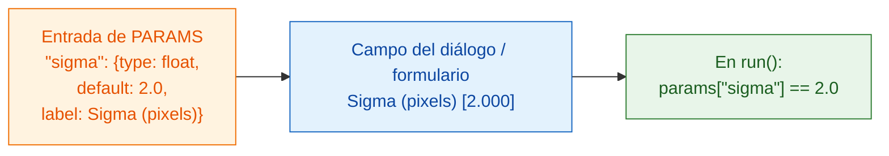

# PARAMS = tu diálogo

## La idea en palabras sencillas

`PARAMS` es la **carta** que tu camarero le da al cliente. Tú enumeras lo que
se puede elegir, y el visor dibuja los campos por ti: Fiji como un diálogo,
napari como un formulario en el panel de Wavu. No hay que programar botones
ni ventanas, y el mismo `PARAMS` funciona en los dos. Cada entrada tiene un
**nombre** (lo que usa tu código), un **tipo** (qué clase de campo es), un
**valor por defecto** (lo que aparece rellenado al principio) y una
**etiqueta** opcional (el texto que lee el usuario).



## Todos los tipos de campo en un ejemplo

```python
"""Field types demo -- one of each."""

PARAMS = {
    "image":  {"type": "image", "label": "Nuclei image"},
    "sigma":  {"type": "float", "default": 2.0, "label": "Sigma (pixels)"},
    "n":      {"type": "int",   "default": 3},
    "name":   {"type": "str",   "default": "cells"},
    "fast":   {"type": "bool",  "default": True},
    "method": {"type": "choice", "choices": ["otsu", "li"], "default": "otsu"},
}
```

Cada visor lo convierte en sus propios campos; tu código recibe los mismos
valores:

| `type` | Campo en Fiji | Campo en napari | Lo que recibe `run` |
|---|---|---|---|
| `float` | casilla numérica (3 decimales) | casilla numérica con decimales | un número decimal, p. ej. `2.0`, en `params` |
| `int` | casilla numérica (sin decimales) | casilla de número entero | un número entero, p. ej. `3`, en `params` |
| `str` | casilla de texto | casilla de texto | texto, p. ej. `"cells"`, en `params` |
| `bool` | casilla de verificación | casilla de verificación | `True` o `False`, en `params` |
| `choice` | desplegable | desplegable | el texto elegido, p. ej. `"otsu"`, en `params` |
| `image` | desplegable con las **imágenes abiertas** | desplegable con las **capas Image y Labels** | un array de NumPy en **`inputs`** (no en `params`) |

El desplegable de capas de napari se actualiza solo cuando añades o quitas
una capa.

## La letra pequeña

- **`default` es obligatorio** para todos los tipos excepto `image`. En
  `choice` se puede omitir; entonces se usa el primer elemento.
- **`choices`** es obligatorio en `choice`: una lista de las opciones.
- **`label` es opcional.** Sin él, los dos visores muestran el nombre con la
  primera letra en mayúscula y los `_` convertidos en espacios: `min_area` se
  convierte en *Min area*.
- Los **nombres** deben ser nombres válidos de Python: letras, dígitos y `_`,
  sin empezar por un dígito.
- **Los valores se comprueban** antes de que se ejecute tu código. Un tipo
  incorrecto o una opción desconocida se rechaza con un mensaje, así que
  `run` siempre recibe valores limpios del tipo declarado.
- La **primera línea del docstring** al principio de `script.py` se muestra
  en la parte superior del diálogo de Fiji y en el panel de napari.
- El diálogo de Fiji añade una casilla extra, **Debug in VS Code**, para
  [depurar](../help/debug-in-vscode.md). Normalmente déjala desmarcada.

!!! info "Un campo `image` necesita una imagen abierta"
    Si tu script tiene un campo `image` y no hay nada abierto, Wavu se
    detiene con un mensaje: en Fiji *"… needs an image -- open one first"*,
    en napari *"…: open an image layer first"*. Abre una y vuelve a ejecutar.

## ¿Dos imágenes? Dos campos

¿Quieres una imagen de núcleos *y* otra de citoplasma? Añade dos entradas
`image`. Cada una se convierte en su propio desplegable, y cada una llega a
`inputs` con su propio nombre:

```python
PARAMS = {
    "nuclei": {"type": "image", "label": "Nuclei"},
    "cyto":   {"type": "image", "label": "Cytoplasm"},
}

def run(ctx, inputs, params):
    nuc, cyto = inputs["nuclei"], inputs["cyto"]
    ...
```

## Tablas, ROI, trayectorias y archivos: desde un script

El diálogo solo ofrece imágenes. Todo lo demás (una tabla Results, los
contornos del ROI Manager, las trayectorias de TrackMate o de napari, las
capas Points o Shapes de napari, una carpeta OME-Zarr) llega a tu script
cuando lo **llama otro script**, como en un [pipeline](../workflows/index.md).
Esas entradas **no necesitan ninguna línea en `PARAMS`**: el script las lee
de `inputs` por su nombre. Indica en el docstring qué nombres espera.

| pasas | el script recibe en `inputs` |
|---|---|
| una imagen (`ImagePlus`, array de NumPy) | array de NumPy |
| una tabla (`ResultsTable`, una tabla de macro, un DataFrame de pandas, una lista de dicts) | DataFrame de pandas (enviado como CSV) |
| un `.zip` de ROI de ImageJ (guardado desde el ROI Manager, o escrito desde Shapes de napari) | `wavu.RoiSet` (léelo con `roifile`) |
| cualquier otra ruta (`.csv`, `.tif`, una carpeta OME-Zarr) | el archivo cargado, o un `pathlib.Path` para carpetas |

Las trayectorias viajan como tabla: una fila por punto, con un id de
trayectoria, el frame y la posición.

=== "Groovy (Fiji)"

    ```groovy
    def rm = wavu.roiManager()                               // el ROI Manager que ves
    def zip = new File(IJ.getDirectory("temp"), "rois.zip")
    rm.deselect(); rm.runCommand("Save", zip.path)           // todas las ROI -> un zip
    Map r = wavu.run(folder, "script", [min_area: 30],
                     [image: imp, rois: zip, spots: ResultsTable.getResultsTable()])
    ```

=== "ImageJ macro"

    Una macro pasa las tablas por el título de su ventana con `tables=`.
    Para las ROI, guarda el zip y pasa su ruta como campo de texto
    (`"type": "str"`) del script; esa ruta no debe tener espacios:

    ```javascript
    zip = replace(getDirectory("temp"), "\\", "/") + "rois.zip";
    roiManager("Save", zip);
    run("Run Script (Macro)", "folder=[D:/scripts/measure] script=script " +
        "params=[rois_zip=" + zip + "] tables=[spots=Results]");
    ```

    Luego el script lee `params["rois_zip"]` con `roifile.roiread(...)`.

=== "Python (napari)"

    ```python
    import pandas as pd
    import roifile

    pts, trk, shp = viewer.layers["spots"], viewer.layers["tracks"], viewer.layers["cells"]
    points = pd.concat([pd.DataFrame(pts.data, columns=["frame", "y", "x"]), pts.features], axis=1)
    tracks = pd.DataFrame(trk.data, columns=["track_id", "frame", "y", "x"])
    roifile.roiwrite("rois.zip", [roifile.ImagejRoi.frompoints(s[:, -2:][:, ::-1])   # (y, x) -> (x, y)
                                  for s in shp.data])

    with Worker.start("D:/scripts/measure") as w:
        res = w.run("script", {"min_area": 30},
                    {"image": viewer.layers["nuclei"].data, "points": points,
                     "tracks": tracks, "rois": "rois.zip"})
    ```

En el script:

```python
"""Measure inside ROIs. Inputs: image, rois (ROI zip), tracks (table)."""
import roifile

def run(ctx, inputs, params):
    img = inputs["image"]
    tracks = inputs["tracks"]                               # DataFrame
    rois = roifile.roiread(inputs["rois"].path)             # contornos; .coordinates() es (x, y)
    ...
```

## En una frase

Escribe una línea de `PARAMS` por cada ajuste, con un tipo y un valor por
defecto, y Fiji o napari construyen los campos y te entregan los valores ya
comprobados en `params` (las imágenes, en `inputs`, y también tablas, ROI y
archivos cuando otro script llama al tuyo).

[Siguiente: qué puedes devolver :material-arrow-right:](outputs.md){ .md-button }
