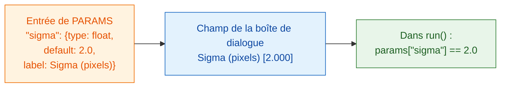

# PARAMS = votre boîte de dialogue

## L'idée en mots simples

`PARAMS`, c'est la **carte** que votre serveur tend au client. Vous listez
ce qu'on peut choisir, et Fiji dessine la boîte de dialogue pour vous : pas
de boutons ni de fenêtres à programmer. Chaque entrée a un **nom** (ce
qu'utilise votre code), un **type** (quel genre de champ), une valeur par
**défaut** (ce qui est rempli au départ) et un **libellé** facultatif (le
texte que l'utilisateur lit).



## Tous les types de champ dans un seul exemple

```python
"""Field types demo -- one of each."""

PARAMS = {
    "image":  {"type": "image", "label": "Nuclei image"},
    "sigma":  {"type": "float", "default": 2.0, "label": "Sigma (pixels)"},
    "n":      {"type": "int",   "default": 3},
    "name":   {"type": "str",   "default": "cells"},
    "fast":   {"type": "bool",  "default": True},
    "method": {"type": "choice", "choices": ["otsu", "li"], "default": "otsu"},
}
```

Fiji en fait cette boîte de dialogue :

| `type` | Champ dans Fiji | Ce que `run` reçoit |
|---|---|---|
| `float` | case numérique (3 décimales) | un nombre décimal, p. ex. `2.0`, dans `params` |
| `int` | case numérique (sans décimales) | un nombre entier, p. ex. `3`, dans `params` |
| `str` | case de texte | du texte, p. ex. `"cells"`, dans `params` |
| `bool` | case à cocher | `True` ou `False`, dans `params` |
| `choice` | liste déroulante | le texte choisi, p. ex. `"otsu"`, dans `params` |
| `image` | liste déroulante des **images ouvertes** | un tableau NumPy dans **`inputs`** (pas `params`) |

## Les petits caractères

- **`default` est obligatoire** pour tous les types sauf `image`. Pour
  `choice`, on peut l'omettre ; le premier élément est alors utilisé.
- **`choices`** est obligatoire pour `choice` : une liste des options.
- **`label` est facultatif.** Sans lui, Fiji affiche le nom avec une
  majuscule au début et les `_` remplacés par des espaces : `min_area`
  devient *Min area*.
- Les **noms** doivent être des noms Python valides : lettres, chiffres et
  `_`, sans commencer par un chiffre.
- **Fiji vérifie les valeurs** avant que votre code ne tourne. Un mauvais
  type ou une option inconnue est refusé avec un message : `run` reçoit donc
  toujours des valeurs propres, du type déclaré.
- La **première ligne de la docstring** en haut de `script.py` s'affiche en
  haut de la boîte de dialogue.
- La boîte de dialogue ajoute une case supplémentaire, **Debug in VS Code**,
  pour le [débogage](../help/debug-in-vscode.md). Laissez-la décochée
  normalement.

!!! info "Un champ `image` a besoin d'une image ouverte"
    Si votre script a un champ `image` et qu'aucune image n'est ouverte dans
    Fiji, Wavu s'arrête avec *"… needs an image -- open one first"*. Ouvrez
    une image et relancez.

## Deux images ? Deux champs

Vous voulez une image des noyaux *et* une image du cytoplasme ? Ajoutez deux
entrées `image`. Chacune devient sa propre liste déroulante, et chacune
arrive dans `inputs` sous son propre nom :

```python
PARAMS = {
    "nuclei": {"type": "image", "label": "Nuclei"},
    "cyto":   {"type": "image", "label": "Cytoplasm"},
}

def run(ctx, inputs, params):
    nuc, cyto = inputs["nuclei"], inputs["cyto"]
    ...
```

## En une phrase

Écrivez une ligne de `PARAMS` par réglage, avec un type et une valeur par
défaut, et Fiji construit la boîte de dialogue et vous donne les valeurs
vérifiées dans `params` (les images dans `inputs`).

[Suite : ce que vous pouvez renvoyer :material-arrow-right:](outputs.md){ .md-button }
