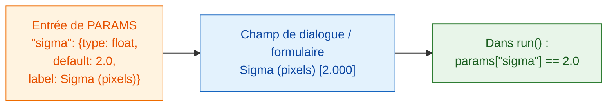

# PARAMS = votre boîte de dialogue

## L'idée en mots simples

`PARAMS`, c'est la **carte** que votre serveur tend au client. Vous listez
ce qu'on peut choisir, et le visualiseur dessine les champs pour vous : Fiji
sous forme de boîte de dialogue, napari sous forme de formulaire dans le
panneau Wavu. Pas de boutons ni de fenêtres à programmer, et le même
`PARAMS` fonctionne dans les deux. Chaque entrée a un **nom** (ce
qu'utilise votre code), un **type** (quel genre de champ), une valeur par
**défaut** (ce qui est rempli au départ) et un **libellé** facultatif (le
texte que l'utilisateur lit).



## Tous les types de champ dans un seul exemple

```python
"""Field types demo -- one of each."""

PARAMS = {
    "image":  {"type": "image", "label": "Nuclei image"},
    "sigma":  {"type": "float", "default": 2.0, "label": "Sigma (pixels)"},
    "n":      {"type": "int",   "default": 3},
    "name":   {"type": "str",   "default": "cells"},
    "fast":   {"type": "bool",  "default": True},
    "method": {"type": "choice", "choices": ["otsu", "li"], "default": "otsu"},
}
```

Chaque visualiseur en fait ses propres champs ; votre code reçoit les mêmes
valeurs :

| `type` | Champ dans Fiji | Champ dans napari | Ce que `run` reçoit |
|---|---|---|---|
| `float` | case numérique (3 décimales) | case numérique avec décimales | un nombre décimal, p. ex. `2.0`, dans `params` |
| `int` | case numérique (sans décimales) | case de nombre entier | un nombre entier, p. ex. `3`, dans `params` |
| `str` | case de texte | case de texte | du texte, p. ex. `"cells"`, dans `params` |
| `bool` | case à cocher | case à cocher | `True` ou `False`, dans `params` |
| `choice` | liste déroulante | liste déroulante | le texte choisi, p. ex. `"otsu"`, dans `params` |
| `image` | liste déroulante des **images ouvertes** | liste déroulante des **calques Image et Labels** | un tableau NumPy dans **`inputs`** (pas `params`) |

La liste déroulante des calques de napari se met à jour toute seule quand
vous ajoutez ou supprimez un calque.

## Les petits caractères

- **`default` est obligatoire** pour tous les types sauf `image`. Pour
  `choice`, on peut l'omettre ; le premier élément est alors utilisé.
- **`choices`** est obligatoire pour `choice` : une liste des options.
- **`label` est facultatif.** Sans lui, les deux visualiseurs affichent le
  nom avec une majuscule au début et les `_` remplacés par des espaces :
  `min_area` devient *Min area*.
- Les **noms** doivent être des noms Python valides : lettres, chiffres et
  `_`, sans commencer par un chiffre.
- **Les valeurs sont vérifiées** avant que votre code ne tourne. Un mauvais
  type ou une option inconnue est refusé avec un message : `run` reçoit donc
  toujours des valeurs propres, du type déclaré.
- La **première ligne de la docstring** en haut de `script.py` s'affiche en
  haut de la boîte de dialogue de Fiji et dans le panneau napari.
- La boîte de dialogue de Fiji ajoute une case supplémentaire,
  **Debug in VS Code**, pour le [débogage](../help/debug-in-vscode.md).
  Laissez-la décochée normalement.

!!! info "Un champ `image` a besoin d'une image ouverte"
    Si votre script a un champ `image` et que rien n'est ouvert, Wavu
    s'arrête avec un message : dans Fiji *"… needs an image -- open one
    first"*, dans napari *"…: open an image layer first"*. Ouvrez une image
    et relancez.

## Deux images ? Deux champs

Vous voulez une image des noyaux *et* une image du cytoplasme ? Ajoutez deux
entrées `image`. Chacune devient sa propre liste déroulante, et chacune
arrive dans `inputs` sous son propre nom :

```python
PARAMS = {
    "nuclei": {"type": "image", "label": "Nuclei"},
    "cyto":   {"type": "image", "label": "Cytoplasm"},
}

def run(ctx, inputs, params):
    nuc, cyto = inputs["nuclei"], inputs["cyto"]
    ...
```

## Tableaux, ROI, pistes et fichiers : depuis un script

La boîte de dialogue ne propose que des images. Tout le reste (un tableau
Results, les contours du ROI Manager, les pistes de TrackMate ou de napari,
les calques Points ou Shapes de napari, un dossier OME-Zarr) arrive à votre
script quand il est **appelé depuis un autre script**, comme dans un
[pipeline](../workflows/index.md). Ces données n'ont besoin d'**aucune ligne
dans `PARAMS`** : le script les lit dans `inputs` par leur nom. Indiquez dans
la docstring quels noms il attend.

| vous passez | le script reçoit dans `inputs` |
|---|---|
| une image (`ImagePlus`, tableau NumPy) | tableau NumPy |
| un tableau (`ResultsTable`, un tableau de macro, un DataFrame pandas, une liste de dicts) | DataFrame pandas (envoyé en CSV) |
| un `.zip` de ROI ImageJ (enregistré depuis le ROI Manager, ou écrit depuis des Shapes napari) | `wavu.RoiSet` (à lire avec `roifile`) |
| tout autre chemin (`.csv`, `.tif`, un dossier OME-Zarr) | le fichier chargé, ou un `pathlib.Path` pour les dossiers |

Les pistes voyagent sous forme de tableau : une ligne par spot, avec un
identifiant de piste, le numéro d'image (frame) et la position.

=== "Groovy (Fiji)"

    ```groovy
    def rm = wavu.roiManager()                               // le ROI Manager que vous voyez
    def zip = new File(IJ.getDirectory("temp"), "rois.zip")
    rm.deselect(); rm.runCommand("Save", zip.path)           // toutes les ROI -> un seul zip
    Map r = wavu.run(folder, "script", [min_area: 30],
                     [image: imp, rois: zip, spots: ResultsTable.getResultsTable()])
    ```

=== "ImageJ macro"

    Une macro passe les tableaux par titre de fenêtre avec `tables=`. Pour
    les ROI, enregistrez le zip et donnez son chemin dans un champ texte
    (`"type": "str"`) du script ; ce chemin ne doit pas contenir d'espaces :

    ```javascript
    zip = replace(getDirectory("temp"), "\\", "/") + "rois.zip";
    roiManager("Save", zip);
    run("Run Script (Macro)", "folder=[D:/scripts/measure] script=script " +
        "params=[rois_zip=" + zip + "] tables=[spots=Results]");
    ```

    Le script lit ensuite `params["rois_zip"]` avec `roifile.roiread(...)`.

=== "Python (napari)"

    ```python
    import pandas as pd
    import roifile

    pts, trk, shp = viewer.layers["spots"], viewer.layers["tracks"], viewer.layers["cells"]
    points = pd.concat([pd.DataFrame(pts.data, columns=["frame", "y", "x"]), pts.features], axis=1)
    tracks = pd.DataFrame(trk.data, columns=["track_id", "frame", "y", "x"])
    roifile.roiwrite("rois.zip", [roifile.ImagejRoi.frompoints(s[:, -2:][:, ::-1])   # (y, x) -> (x, y)
                                  for s in shp.data])

    with Worker.start("D:/scripts/measure") as w:
        res = w.run("script", {"min_area": 30},
                    {"image": viewer.layers["nuclei"].data, "points": points,
                     "tracks": tracks, "rois": "rois.zip"})
    ```

Dans le script :

```python
"""Measure inside ROIs. Inputs: image, rois (ROI zip), tracks (table)."""
import roifile

def run(ctx, inputs, params):
    img = inputs["image"]
    tracks = inputs["tracks"]                               # DataFrame
    rois = roifile.roiread(inputs["rois"].path)             # contours ; .coordinates() donne (x, y)
    ...
```

## En une phrase

Écrivez une ligne de `PARAMS` par réglage, avec un type et une valeur par
défaut, et Fiji ou napari construit les champs et vous donne les valeurs
vérifiées dans `params` (les images dans `inputs`, ainsi que les tableaux,
ROI et fichiers quand un autre script appelle le vôtre).

[Suite : ce que vous pouvez renvoyer :material-arrow-right:](outputs.md){ .md-button }
