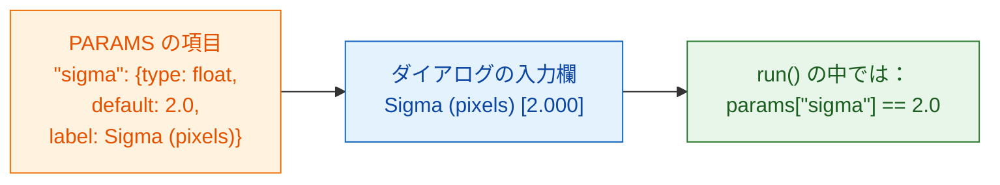
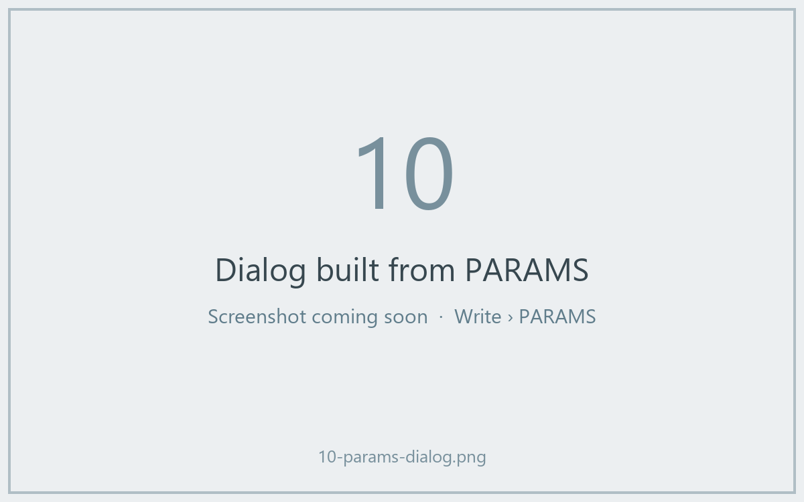

# PARAMS = あなたのダイアログ

## やさしく言うと

`PARAMS` は、ウェイターがお客さんに渡す **メニュー表** です。選べるものを
並べておけば、Fiji がダイアログを描いてくれます。ボタンやウィンドウを
プログラムする必要はありません。各項目には **名前**（コードで使うもの）、
**型**（どんな種類の入力欄か）、**既定値**（最初に入っている値）、
そして任意の **ラベル**（ユーザーが読む文字）があります。



## すべての型を 1 つの例で

```python
"""Field types demo -- one of each."""

PARAMS = {
    "image":  {"type": "image", "label": "Nuclei image"},
    "sigma":  {"type": "float", "default": 2.0, "label": "Sigma (pixels)"},
    "n":      {"type": "int",   "default": 3},
    "name":   {"type": "str",   "default": "cells"},
    "fast":   {"type": "bool",  "default": True},
    "method": {"type": "choice", "choices": ["otsu", "li"], "default": "otsu"},
}
```

Fiji はこれを次のダイアログにします。



| `type` | Fiji での入力欄 | `run` が受け取るもの |
|---|---|---|
| `float` | 数値欄（小数 3 桁） | 小数、たとえば `2.0`、`params` の中 |
| `int` | 数値欄（小数なし） | 整数、たとえば `3`、`params` の中 |
| `str` | テキスト欄 | 文字列、たとえば `"cells"`、`params` の中 |
| `bool` | チェックボックス | `True` か `False`、`params` の中 |
| `choice` | ドロップダウン | 選ばれた文字列、たとえば `"otsu"`、`params` の中 |
| `image` | **開いている画像** のドロップダウン | NumPy 配列、**`inputs`** の中（`params` ではありません） |

## 細かい決まり

- **`default` は必須** です（`image` 以外のすべての型）。`choice` では
  省略でき、その場合は最初の選択肢が使われます。
- **`choices`** は `choice` に必須で、選択肢のリストです。
- **`label` は任意です。** ない場合、Fiji は名前の先頭を大文字にし、`_` を
  空白に変えて表示します。`min_area` は *Min area* になります。
- **名前** は Python の正しい名前でなければなりません。文字、数字、`_` を
  使い、数字で始めないでください。
- **Fiji は値をチェック** してからコードを動かします。型の違う値や知らない
  選択肢はメッセージ付きで拒否されるので、`run` には必ず宣言した型の
  きれいな値が届きます。
- `script.py` の先頭にある **docstring の 1 行目** は、ダイアログの上部に
  表示されます。
- ダイアログには **Debug in VS Code** というチェックボックスが 1 つ
  追加されます。これは [デバッグ](../help/debug-in-vscode.md) 用です。
  普段はオフのままにします。

!!! info "`image` 欄には開いた画像が必要です"
    スクリプトに `image` 欄があるのに Fiji で画像が開いていないと、Wavu は
    *"… needs an image -- open one first"* と言って止まります。画像を
    開いてから、もう一度実行してください。

## 画像が 2 枚？ 入力欄も 2 つ

核の画像 *と* 細胞質の画像がほしいですか？ `image` の項目を 2 つ足します。
それぞれが自分のドロップダウンになり、それぞれの名前で `inputs` に届きます。

```python
PARAMS = {
    "nuclei": {"type": "image", "label": "Nuclei"},
    "cyto":   {"type": "image", "label": "Cytoplasm"},
}

def run(ctx, inputs, params):
    nuc, cyto = inputs["nuclei"], inputs["cyto"]
    ...
```

## ひとことで言うと

設定ごとに型と既定値を付けて `PARAMS` に 1 行ずつ書けば、Fiji がダイアログを
作り、チェック済みの値を `params` で（画像は `inputs` で）渡してくれます。

[次へ：返せるもの :material-arrow-right:](outputs.md){ .md-button }
