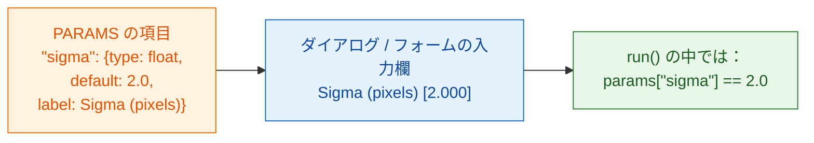

# PARAMS = あなたのダイアログ

## やさしく言うと

`PARAMS` は、ウェイターがお客さんに渡す **メニュー表** です。選べるものを
並べておけば、ビューアーが入力欄を描いてくれます。Fiji ならダイアログ、
napari なら Wavu パネルのフォームです。ボタンやウィンドウをプログラムする
必要はなく、同じ `PARAMS` がどちらでも使えます。各項目には **名前**（コードで使うもの）、
**型**（どんな種類の入力欄か）、**既定値**（最初に入っている値）、
そして任意の **ラベル**（ユーザーが読む文字）があります。



## すべての型を 1 つの例で

```python
"""Field types demo -- one of each."""

PARAMS = {
    "image":  {"type": "image", "label": "Nuclei image"},
    "sigma":  {"type": "float", "default": 2.0, "label": "Sigma (pixels)"},
    "n":      {"type": "int",   "default": 3},
    "name":   {"type": "str",   "default": "cells"},
    "fast":   {"type": "bool",  "default": True},
    "method": {"type": "choice", "choices": ["otsu", "li"], "default": "otsu"},
}
```

それぞれのビューアーがこれを自分の入力欄にします。コードが受け取る値は同じです。

| `type` | Fiji での入力欄 | napari での入力欄 | `run` が受け取るもの |
|---|---|---|---|
| `float` | 数値欄（小数 3 桁） | 小数付きの数値欄 | 小数、たとえば `2.0`、`params` の中 |
| `int` | 数値欄（小数なし） | 整数の数値欄 | 整数、たとえば `3`、`params` の中 |
| `str` | テキスト欄 | テキスト欄 | 文字列、たとえば `"cells"`、`params` の中 |
| `bool` | チェックボックス | チェックボックス | `True` か `False`、`params` の中 |
| `choice` | ドロップダウン | ドロップダウン | 選ばれた文字列、たとえば `"otsu"`、`params` の中 |
| `image` | **開いている画像** のドロップダウン | **Image と Labels のレイヤー** のドロップダウン | NumPy 配列、**`inputs`** の中（`params` ではありません） |

napari のレイヤーのドロップダウンは、レイヤーを足したり消したりすると
自動で更新されます。

## 細かい決まり

- **`default` は必須** です（`image` 以外のすべての型）。`choice` では
  省略でき、その場合は最初の選択肢が使われます。
- **`choices`** は `choice` に必須で、選択肢のリストです。
- **`label` は任意です。** ない場合、どちらのビューアーも名前の先頭を大文字に
  し、`_` を空白に変えて表示します。`min_area` は *Min area* になります。
- **名前** は Python の正しい名前でなければなりません。文字、数字、`_` を
  使い、数字で始めないでください。
- コードを動かす前に **値がチェックされます**。型の違う値や知らない
  選択肢はメッセージ付きで拒否されるので、`run` には必ず宣言した型の
  きれいな値が届きます。
- `script.py` の先頭にある **docstring の 1 行目** は、Fiji のダイアログの
  上部と napari のパネルに表示されます。
- Fiji のダイアログには **Debug in VS Code** というチェックボックスが 1 つ
  追加されます。これは [デバッグ](../help/debug-in-vscode.md) 用です。
  普段はオフのままにします。

!!! info "`image` 欄には開いた画像が必要です"
    スクリプトに `image` 欄があるのに何も開いていないと、Wavu はメッセージを
    出して止まります。Fiji では *"… needs an image -- open one first"*、
    napari では *"…: open an image layer first"* です。画像を開いてから、
    もう一度実行してください。

## 画像が 2 枚？ 入力欄も 2 つ

核の画像 *と* 細胞質の画像がほしいですか？ `image` の項目を 2 つ足します。
それぞれが自分のドロップダウンになり、それぞれの名前で `inputs` に届きます。

```python
PARAMS = {
    "nuclei": {"type": "image", "label": "Nuclei"},
    "cyto":   {"type": "image", "label": "Cytoplasm"},
}

def run(ctx, inputs, params):
    nuc, cyto = inputs["nuclei"], inputs["cyto"]
    ...
```

## 表・ROI・トラック・ファイル：スクリプトから

ダイアログで選べるのは画像だけです。それ以外のもの（Results の表、ROI Manager
の輪郭、TrackMate や napari のトラック、napari の Points や Shapes、OME-Zarr
フォルダー）は、[パイプライン](../workflows/index.md) のようにスクリプトが
**別のスクリプトから呼ばれた** ときに届きます。こうした入力には
**`PARAMS` の項目はいりません**。スクリプトは名前で `inputs` から読みます。
どの名前を受け取るつもりかを docstring に書いておきましょう。

| 渡すもの | スクリプトが `inputs` で受け取るもの |
|---|---|
| 画像（`ImagePlus`、NumPy 配列） | NumPy 配列 |
| 表（`ResultsTable`、マクロの表、pandas DataFrame、dict のリスト） | pandas DataFrame（CSV で送られます） |
| ImageJ ROI の `.zip`（ROI Manager から保存したもの、または napari の Shapes から書き出したもの） | `wavu.RoiSet`（`roifile` で読みます） |
| その他のパス（`.csv`、`.tif`、OME-Zarr フォルダー） | 読み込んだファイル。フォルダーなら `pathlib.Path` |

トラックは表として運ばれます。スポットごとに 1 行で、トラック ID、フレーム、
位置が入ります。

=== "Groovy (Fiji)"

    ```groovy
    def rm = wavu.roiManager()                               // 画面に見えている ROI Manager
    def zip = new File(IJ.getDirectory("temp"), "rois.zip")
    rm.deselect(); rm.runCommand("Save", zip.path)           // すべての ROI -> 1 つの zip
    Map r = wavu.run(folder, "script", [min_area: 30],
                     [image: imp, rois: zip, spots: ResultsTable.getResultsTable()])
    ```

=== "ImageJ macro"

    マクロは `tables=` でウィンドウのタイトルを指定して表を渡します。ROI は
    zip に保存し、そのパスをスクリプトのテキスト欄（`"type": "str"`）として
    渡します。パスには空白を入れないでください。

    ```javascript
    zip = replace(getDirectory("temp"), "\\", "/") + "rois.zip";
    roiManager("Save", zip);
    run("Run Script (Macro)", "folder=[D:/scripts/measure] script=script " +
        "params=[rois_zip=" + zip + "] tables=[spots=Results]");
    ```

    スクリプトは `params["rois_zip"]` を `roifile.roiread(...)` で読みます。

=== "Python (napari)"

    ```python
    import pandas as pd
    import roifile

    pts, trk, shp = viewer.layers["spots"], viewer.layers["tracks"], viewer.layers["cells"]
    points = pd.concat([pd.DataFrame(pts.data, columns=["frame", "y", "x"]), pts.features], axis=1)
    tracks = pd.DataFrame(trk.data, columns=["track_id", "frame", "y", "x"])
    roifile.roiwrite("rois.zip", [roifile.ImagejRoi.frompoints(s[:, -2:][:, ::-1])   # (y, x) -> (x, y)
                                  for s in shp.data])

    with Worker.start("D:/scripts/measure") as w:
        res = w.run("script", {"min_area": 30},
                    {"image": viewer.layers["nuclei"].data, "points": points,
                     "tracks": tracks, "rois": "rois.zip"})
    ```

スクリプトの中では：

```python
"""Measure inside ROIs. Inputs: image, rois (ROI zip), tracks (table)."""
import roifile

def run(ctx, inputs, params):
    img = inputs["image"]
    tracks = inputs["tracks"]                               # DataFrame
    rois = roifile.roiread(inputs["rois"].path)             # 輪郭。.coordinates() は (x, y)
    ...
```

## ひとことで言うと

設定ごとに型と既定値を付けて `PARAMS` に 1 行ずつ書けば、Fiji や napari が
入力欄を作り、チェック済みの値を `params` で（画像は `inputs` で、別の
スクリプトから呼ばれたときは表・ROI・ファイルも `inputs` で）渡してくれます。

[次へ：返せるもの :material-arrow-right:](outputs.md){ .md-button }
