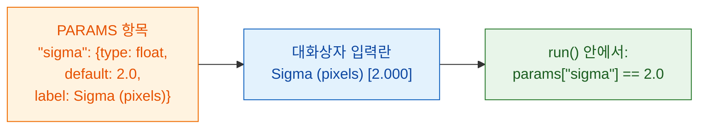

# PARAMS = 나의 대화상자

## 쉬운 말로 설명하면

`PARAMS`는 웨이터가 손님에게 건네는 **메뉴판**이에요. 고를 수 있는 것을
적어 두면 Fiji가 대화상자를 그려 줘요. 버튼이나 창을 프로그래밍할 필요가
없어요. 항목마다 **이름**(코드에서 쓰는 것), **type**(어떤 종류의 입력란),
**default**(처음에 채워진 값), 그리고 선택 사항인 **label**(사용자가 읽는
글)이 있어요.



## 예제 하나에 모든 입력란 종류

```python
"""Field types demo -- one of each."""

PARAMS = {
    "image":  {"type": "image", "label": "Nuclei image"},
    "sigma":  {"type": "float", "default": 2.0, "label": "Sigma (pixels)"},
    "n":      {"type": "int",   "default": 3},
    "name":   {"type": "str",   "default": "cells"},
    "fast":   {"type": "bool",  "default": True},
    "method": {"type": "choice", "choices": ["otsu", "li"], "default": "otsu"},
}
```

Fiji는 이걸 이런 대화상자로 바꿔요.

| `type` | Fiji의 입력란 | `run`이 받는 것 |
|---|---|---|
| `float` | 숫자 상자(소수점 3자리) | 소수, 예: `2.0`, `params`로 |
| `int` | 숫자 상자(소수점 없음) | 정수, 예: `3`, `params`로 |
| `str` | 텍스트 상자 | 글, 예: `"cells"`, `params`로 |
| `bool` | 체크박스 | `True` 또는 `False`, `params`로 |
| `choice` | 드롭다운 | 고른 글, 예: `"otsu"`, `params`로 |
| `image` | **열린 이미지들**의 드롭다운 | NumPy 배열, **`inputs`**로(`params`가 아니에요) |

## 작은 글씨

- `image`를 뺀 모든 type에는 **`default`가 꼭 필요해요.** `choice`는
  빼도 되고, 그러면 첫 항목이 쓰여요.
- `choice`에는 **`choices`**가 꼭 필요해요. 선택지의 목록이에요.
- **`label`은 선택이에요.** 없으면 Fiji가 이름의 첫 글자를 대문자로 바꾸고
  `_`를 띄어쓰기로 바꿔서 보여 줘요. `min_area`는 *Min area*가 돼요.
- **이름**은 올바른 Python 이름이어야 해요. 글자, 숫자, `_`만 쓰고, 숫자로
  시작하면 안 돼요.
- **Fiji가 값을 확인해요.** 코드가 돌기 전에 잘못된 type이나 모르는 선택지는
  메시지와 함께 거부되니, `run`은 언제나 선언한 type의 깨끗한 값을 받아요.
- `script.py` 맨 위 **docstring의 첫 줄**은 대화상자 맨 위에 나와요.
- 대화상자에는 [디버깅](../help/debug-in-vscode.md)용 체크박스
  **Debug in VS Code**가 하나 더 붙어요. 평소에는 꺼 두세요.

!!! info "`image` 입력란에는 열린 이미지가 필요해요"
    스크립트에 `image` 입력란이 있는데 Fiji에 열린 이미지가 없으면, Wavu는
    *"… needs an image -- open one first"*라며 멈춰요. 이미지를 하나 열고
    다시 실행하세요.

## 이미지가 두 장이면? 입력란도 둘

핵 이미지*와* 세포질 이미지가 필요한가요? `image` 항목을 두 개 추가하세요.
각각 자기 드롭다운이 되고, 각각 자기 이름으로 `inputs`에 들어와요.

```python
PARAMS = {
    "nuclei": {"type": "image", "label": "Nuclei"},
    "cyto":   {"type": "image", "label": "Cytoplasm"},
}

def run(ctx, inputs, params):
    nuc, cyto = inputs["nuclei"], inputs["cyto"]
    ...
```

## 한 문장으로

설정마다 type과 default를 넣어 `PARAMS`에 한 줄씩 쓰면, Fiji가 대화상자를
만들고 확인된 값을 `params`로(이미지는 `inputs`로) 넘겨줘요.

[다음: 돌려줄 수 있는 것 :material-arrow-right:](outputs.md){ .md-button }
