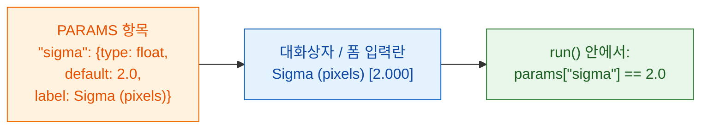

# PARAMS = 나의 대화상자

## 쉬운 말로 설명하면

`PARAMS`는 웨이터가 손님에게 건네는 **메뉴판**이에요. 고를 수 있는 것을
적어 두면 뷰어가 입력란을 그려 줘요. Fiji는 대화상자로, napari는 Wavu
패널의 폼으로요. 버튼이나 창을 프로그래밍할 필요가 없고, 같은 `PARAMS`가
둘 다에서 돌아가요. 항목마다 **이름**(코드에서 쓰는 것), **type**(어떤 종류의 입력란),
**default**(처음에 채워진 값), 그리고 선택 사항인 **label**(사용자가 읽는
글)이 있어요.



## 예제 하나에 모든 입력란 종류

```python
"""Field types demo -- one of each."""

PARAMS = {
    "image":  {"type": "image", "label": "Nuclei image"},
    "sigma":  {"type": "float", "default": 2.0, "label": "Sigma (pixels)"},
    "n":      {"type": "int",   "default": 3},
    "name":   {"type": "str",   "default": "cells"},
    "fast":   {"type": "bool",  "default": True},
    "method": {"type": "choice", "choices": ["otsu", "li"], "default": "otsu"},
}
```

뷰어마다 이걸 자기 입력란으로 바꾸고, 코드는 같은 값을 받아요.

| `type` | Fiji의 입력란 | napari의 입력란 | `run`이 받는 것 |
|---|---|---|---|
| `float` | 숫자 상자(소수점 3자리) | 소수점 있는 숫자 상자 | 소수, 예: `2.0`, `params`로 |
| `int` | 숫자 상자(소수점 없음) | 정수 상자 | 정수, 예: `3`, `params`로 |
| `str` | 텍스트 상자 | 텍스트 상자 | 글, 예: `"cells"`, `params`로 |
| `bool` | 체크박스 | 체크박스 | `True` 또는 `False`, `params`로 |
| `choice` | 드롭다운 | 드롭다운 | 고른 글, 예: `"otsu"`, `params`로 |
| `image` | **열린 이미지들**의 드롭다운 | **Image와 Labels 레이어들**의 드롭다운 | NumPy 배열, **`inputs`**로(`params`가 아니에요) |

napari의 레이어 드롭다운은 레이어를 추가하거나 지우면 저절로 바뀌어요.

## 작은 글씨

- `image`를 뺀 모든 type에는 **`default`가 꼭 필요해요.** `choice`는
  빼도 되고, 그러면 첫 항목이 쓰여요.
- `choice`에는 **`choices`**가 꼭 필요해요. 선택지의 목록이에요.
- **`label`은 선택이에요.** 없으면 두 뷰어 모두 이름의 첫 글자를 대문자로 바꾸고
  `_`를 띄어쓰기로 바꿔서 보여 줘요. `min_area`는 *Min area*가 돼요.
- **이름**은 올바른 Python 이름이어야 해요. 글자, 숫자, `_`만 쓰고, 숫자로
  시작하면 안 돼요.
- **값은 확인을 거쳐요.** 코드가 돌기 전에 잘못된 type이나 모르는 선택지는
  메시지와 함께 거부되니, `run`은 언제나 선언한 type의 깨끗한 값을 받아요.
- `script.py` 맨 위 **docstring의 첫 줄**은 Fiji 대화상자 맨 위와 napari
  패널에 나와요.
- Fiji의 대화상자에는 [디버깅](../help/debug-in-vscode.md)용 체크박스
  **Debug in VS Code**가 하나 더 붙어요. 평소에는 꺼 두세요.

!!! info "`image` 입력란에는 열린 이미지가 필요해요"
    스크립트에 `image` 입력란이 있는데 아무것도 열려 있지 않으면, Wavu는
    메시지와 함께 멈춰요. Fiji에서는 *"… needs an image -- open one first"*,
    napari에서는 *"…: open an image layer first"*예요. 이미지를 하나 열고
    다시 실행하세요.

## 이미지가 두 장이면? 입력란도 둘

핵 이미지*와* 세포질 이미지가 필요한가요? `image` 항목을 두 개 추가하세요.
각각 자기 드롭다운이 되고, 각각 자기 이름으로 `inputs`에 들어와요.

```python
PARAMS = {
    "nuclei": {"type": "image", "label": "Nuclei"},
    "cyto":   {"type": "image", "label": "Cytoplasm"},
}

def run(ctx, inputs, params):
    nuc, cyto = inputs["nuclei"], inputs["cyto"]
    ...
```

## 표, ROI, 트랙, 파일: 스크립트에서

대화상자에서는 이미지만 고를 수 있어요. 나머지(Results 표, ROI Manager의
윤곽, TrackMate나 napari의 트랙, napari Points나 Shapes, OME-Zarr 폴더)는
[파이프라인](../workflows/index.md)처럼 스크립트가 **다른 스크립트에서 불릴 때**
들어와요. 이런 입력에는 **`PARAMS` 항목이 필요 없어요.** 스크립트가
`inputs`에서 이름으로 읽어요. 어떤 이름을 기대하는지 docstring에 적어 두세요.

| 넘기는 것 | 스크립트가 `inputs`로 받는 것 |
|---|---|
| 이미지(`ImagePlus`, NumPy 배열) | NumPy 배열 |
| 표(`ResultsTable`, 매크로 표, pandas DataFrame, dict의 리스트) | pandas DataFrame(CSV로 전송돼요) |
| ImageJ ROI의 `.zip`(ROI Manager에서 저장했거나 napari Shapes에서 쓴 것) | `wavu.RoiSet`(`roifile`로 읽어요) |
| 그 밖의 경로(`.csv`, `.tif`, OME-Zarr 폴더) | 불러온 파일, 폴더라면 `pathlib.Path` |

트랙은 표로 전달돼요. 스폿마다 한 행이고, 트랙 id, 프레임, 위치가 들어 있어요.

=== "Groovy (Fiji)"

    ```groovy
    def rm = wavu.roiManager()                               // 눈에 보이는 ROI Manager
    def zip = new File(IJ.getDirectory("temp"), "rois.zip")
    rm.deselect(); rm.runCommand("Save", zip.path)           // 모든 ROI -> zip 하나
    Map r = wavu.run(folder, "script", [min_area: 30],
                     [image: imp, rois: zip, spots: ResultsTable.getResultsTable()])
    ```

=== "ImageJ macro"

    매크로는 `tables=`로 창 제목을 지정해 표를 넘겨요. ROI는 zip으로 저장하고,
    그 경로를 스크립트의 텍스트 입력란(`"type": "str"`)으로 넘기세요. 경로에는
    띄어쓰기가 없어야 해요.

    ```javascript
    zip = replace(getDirectory("temp"), "\\", "/") + "rois.zip";
    roiManager("Save", zip);
    run("Run Script (Macro)", "folder=[D:/scripts/measure] script=script " +
        "params=[rois_zip=" + zip + "] tables=[spots=Results]");
    ```

    그러면 스크립트가 `params["rois_zip"]`을 `roifile.roiread(...)`로 읽어요.

=== "Python (napari)"

    ```python
    import pandas as pd
    import roifile

    pts, trk, shp = viewer.layers["spots"], viewer.layers["tracks"], viewer.layers["cells"]
    points = pd.concat([pd.DataFrame(pts.data, columns=["frame", "y", "x"]), pts.features], axis=1)
    tracks = pd.DataFrame(trk.data, columns=["track_id", "frame", "y", "x"])
    roifile.roiwrite("rois.zip", [roifile.ImagejRoi.frompoints(s[:, -2:][:, ::-1])   # (y, x) -> (x, y)
                                  for s in shp.data])

    with Worker.start("D:/scripts/measure") as w:
        res = w.run("script", {"min_area": 30},
                    {"image": viewer.layers["nuclei"].data, "points": points,
                     "tracks": tracks, "rois": "rois.zip"})
    ```

스크립트에서는:

```python
"""Measure inside ROIs. Inputs: image, rois (ROI zip), tracks (table)."""
import roifile

def run(ctx, inputs, params):
    img = inputs["image"]
    tracks = inputs["tracks"]                               # DataFrame
    rois = roifile.roiread(inputs["rois"].path)             # 윤곽; .coordinates()는 (x, y)
    ...
```

## 한 문장으로

설정마다 type과 default를 넣어 `PARAMS`에 한 줄씩 쓰면, Fiji나 napari가
입력란을 만들고 확인된 값을 `params`로(이미지는 `inputs`로, 다른 스크립트가
부를 때는 표, ROI, 파일도 `inputs`로) 넘겨줘요.

[다음: 돌려줄 수 있는 것 :material-arrow-right:](outputs.md){ .md-button }
