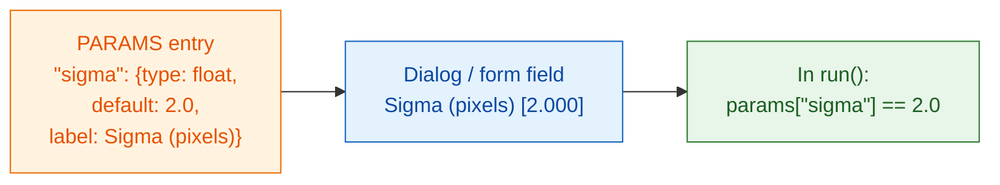

# PARAMS = your dialog

## The idea in plain words

`PARAMS` is the **menu card** your waiter hands to the customer. You list
what can be chosen, and the viewer draws the fields for you: Fiji as a
dialog, napari as a form in the Wavu panel. No buttons or windows to program,
and the same `PARAMS` works in both. Each entry has a **name** (what your code uses), a **type** (what
kind of field), a **default** (what is filled in at first) and an optional
**label** (the text the user reads).



## Every field type in one example

```python
"""Field types demo -- one of each."""

PARAMS = {
    "image":  {"type": "image", "label": "Nuclei image"},
    "sigma":  {"type": "float", "default": 2.0, "label": "Sigma (pixels)"},
    "n":      {"type": "int",   "default": 3},
    "name":   {"type": "str",   "default": "cells"},
    "fast":   {"type": "bool",  "default": True},
    "method": {"type": "choice", "choices": ["otsu", "li"], "default": "otsu"},
}
```

Each viewer turns that into its own fields; your code gets the same values:

| `type` | Field in Fiji | Field in napari | What `run` receives |
|---|---|---|---|
| `float` | number box (3 decimals) | number box with decimals | a decimal number, e.g. `2.0`, in `params` |
| `int` | number box (no decimals) | whole-number box | a whole number, e.g. `3`, in `params` |
| `str` | text box | text box | text, e.g. `"cells"`, in `params` |
| `bool` | checkbox | checkbox | `True` or `False`, in `params` |
| `choice` | drop-down | drop-down | the chosen text, e.g. `"otsu"`, in `params` |
| `image` | drop-down of the **open images** | drop-down of the **Image and Labels layers** | a NumPy array in **`inputs`** (not `params`) |

napari's drop-down of layers updates by itself when you add or remove a
layer.

## The small print

- **`default` is required** for every type except `image`. For `choice` it
  may be left out; the first item is used.
- **`choices`** is required for `choice`: a list of the options.
- **`label` is optional.** Without it, both viewers show the name with the
  first letter capitalised and `_` turned into spaces: `min_area` becomes
  *Min area*.
- **Names** must be valid Python names: letters, digits and `_`, not
  starting with a digit.
- **The values are checked** before your code runs. A wrong type or an
  unknown option is refused with a message, so `run` always gets clean
  values of the declared type.
- The **first line of the docstring** at the top of `script.py` is shown at
  the top of Fiji's dialog and in the napari panel.
- Fiji's dialog adds one extra checkbox, **Debug in VS Code**, for
  [debugging](../help/debug-in-vscode.md). Leave it off normally.

!!! info "An `image` field needs an open image"
    If your script has an `image` field and nothing is open, Wavu stops
    with a message: in Fiji *"… needs an image -- open one first"*, in
    napari *"…: open an image layer first"*. Open one and run again.

## Two images? Two fields

Want a nuclei image *and* a cytoplasm image? Add two `image` entries. Each
becomes its own drop-down, and each arrives in `inputs` under its own name:

```python
PARAMS = {
    "nuclei": {"type": "image", "label": "Nuclei"},
    "cyto":   {"type": "image", "label": "Cytoplasm"},
}

def run(ctx, inputs, params):
    nuc, cyto = inputs["nuclei"], inputs["cyto"]
    ...
```

## In one sentence

Write one `PARAMS` line per setting, with a type and a default, and Fiji or
napari builds the fields and hands you the checked values in `params`
(images in `inputs`).

[Next: what you can return :material-arrow-right:](outputs.md){ .md-button }
