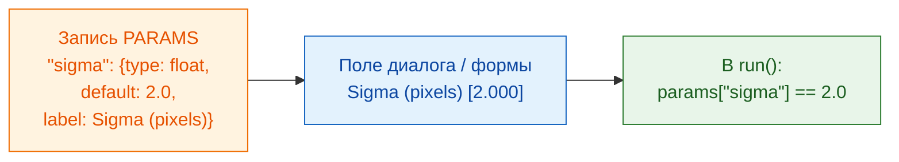

# PARAMS = ваш диалог

## Идея простыми словами

`PARAMS` — это **меню**, которое официант подаёт гостю. Вы перечисляете, что
можно выбрать, а просмотрщик рисует поля за вас: Fiji — как диалог, napari —
как форму в панели Wavu. Никаких кнопок и окон программировать не нужно, и
один и тот же `PARAMS` работает в обоих. У каждой записи есть **имя** (его
использует ваш код), **тип** (какое это поле), **значение по умолчанию** (что
заполнено сначала) и необязательная **подпись** (текст, который видит
пользователь).



## Все типы полей в одном примере

```python
"""Field types demo -- one of each."""

PARAMS = {
    "image":  {"type": "image", "label": "Nuclei image"},
    "sigma":  {"type": "float", "default": 2.0, "label": "Sigma (pixels)"},
    "n":      {"type": "int",   "default": 3},
    "name":   {"type": "str",   "default": "cells"},
    "fast":   {"type": "bool",  "default": True},
    "method": {"type": "choice", "choices": ["otsu", "li"], "default": "otsu"},
}
```

Каждый просмотрщик превращает это в свои поля; ваш код получает одни и те же
значения:

| `type` | Поле в Fiji | Поле в napari | Что получает `run` |
|---|---|---|---|
| `float` | числовое поле (3 знака после запятой) | числовое поле с дробной частью | дробное число, например `2.0`, в `params` |
| `int` | числовое поле (без дробной части) | поле для целого числа | целое число, например `3`, в `params` |
| `str` | текстовое поле | текстовое поле | текст, например `"cells"`, в `params` |
| `bool` | галочка | галочка | `True` или `False`, в `params` |
| `choice` | выпадающий список | выпадающий список | выбранный текст, например `"otsu"`, в `params` |
| `image` | выпадающий список **открытых изображений** | выпадающий список **слоёв Image и Labels** | массив NumPy в **`inputs`** (не в `params`) |

Выпадающий список слоёв в napari обновляется сам, когда вы добавляете или
удаляете слой.

## Мелкий шрифт

- **`default` обязателен** для всех типов, кроме `image`. Для `choice` его
  можно опустить; тогда берётся первый вариант.
- **`choices`** обязателен для `choice`: это список вариантов.
- **`label` необязателен.** Без него оба просмотрщика показывают имя с
  заглавной первой буквой и пробелами вместо `_`: `min_area` превращается в
  *Min area*.
- **Имена** должны быть допустимыми именами Python: буквы, цифры и `_`, и не
  начинаться с цифры.
- **Значения проверяются** до запуска кода. Неверный тип или неизвестный
  вариант отклоняется с сообщением, так что `run` всегда получает чистые
  значения объявленного типа.
- **Первая строка docstring** в начале `script.py` показывается вверху
  диалога Fiji и в панели napari.
- Диалог Fiji добавляет ещё одну галочку, **Debug in VS Code**, для
  [отладки](../help/debug-in-vscode.md). Обычно оставляйте её выключенной.

!!! info "Полю `image` нужно открытое изображение"
    Если в скрипте есть поле `image`, а ничего не открыто, Wavu остановится с
    сообщением: в Fiji *"… needs an image -- open one first"*, в napari
    *"…: open an image layer first"*. Откройте изображение и запустите
    снова.

## Два изображения? Два поля

Нужно изображение ядер *и* изображение цитоплазмы? Добавьте две записи
`image`. Каждая станет своим выпадающим списком и придёт в `inputs` под своим
именем:

```python
PARAMS = {
    "nuclei": {"type": "image", "label": "Nuclei"},
    "cyto":   {"type": "image", "label": "Cytoplasm"},
}

def run(ctx, inputs, params):
    nuc, cyto = inputs["nuclei"], inputs["cyto"]
    ...
```

## Таблицы, ROI, треки и файлы: из скрипта

Диалог предлагает только изображения. Всё остальное (таблица Results,
контуры из ROI Manager, треки из TrackMate или napari, слои Points или Shapes
в napari, папка OME-Zarr) попадает в ваш скрипт, когда его **вызывает другой
скрипт**, как в [конвейере](../workflows/index.md). Таким входным данным **не
нужна запись в `PARAMS`**: скрипт читает их из `inputs` по имени. Укажите в
docstring, какие имена он ожидает.

| вы передаёте | скрипт получает в `inputs` |
|---|---|
| изображение (`ImagePlus`, массив NumPy) | массив NumPy |
| таблицу (`ResultsTable`, таблицу макроса, pandas DataFrame, список словарей) | pandas DataFrame (передаётся как CSV) |
| `.zip` с ROI ImageJ (сохранённый из ROI Manager или записанный из Shapes в napari) | `wavu.RoiSet` (читайте его с помощью `roifile`) |
| любой другой путь (`.csv`, `.tif`, папку OME-Zarr) | загруженный файл, а для папок — `pathlib.Path` |

Треки передаются как таблица: одна строка на точку, с номером трека, кадром
и положением.

=== "Groovy (Fiji)"

    ```groovy
    def rm = wavu.roiManager()                               // ROI Manager, который вы видите
    def zip = new File(IJ.getDirectory("temp"), "rois.zip")
    rm.deselect(); rm.runCommand("Save", zip.path)           // все ROI -> один zip
    Map r = wavu.run(folder, "script", [min_area: 30],
                     [image: imp, rois: zip, spots: ResultsTable.getResultsTable()])
    ```

=== "ImageJ macro"

    Макрос передаёт таблицы по заголовку окна через `tables=`. Для ROI
    сохраните zip и передайте его путь как текстовое поле (`"type": "str"`)
    скрипта; в этом пути не должно быть пробелов:

    ```javascript
    zip = replace(getDirectory("temp"), "\\", "/") + "rois.zip";
    roiManager("Save", zip);
    run("Run Script (Macro)", "folder=[D:/scripts/measure] script=script " +
        "params=[rois_zip=" + zip + "] tables=[spots=Results]");
    ```

    Затем скрипт читает `params["rois_zip"]` с помощью `roifile.roiread(...)`.

=== "Python (napari)"

    ```python
    import pandas as pd
    import roifile

    pts, trk, shp = viewer.layers["spots"], viewer.layers["tracks"], viewer.layers["cells"]
    points = pd.concat([pd.DataFrame(pts.data, columns=["frame", "y", "x"]), pts.features], axis=1)
    tracks = pd.DataFrame(trk.data, columns=["track_id", "frame", "y", "x"])
    roifile.roiwrite("rois.zip", [roifile.ImagejRoi.frompoints(s[:, -2:][:, ::-1])   # (y, x) -> (x, y)
                                  for s in shp.data])

    with Worker.start("D:/scripts/measure") as w:
        res = w.run("script", {"min_area": 30},
                    {"image": viewer.layers["nuclei"].data, "points": points,
                     "tracks": tracks, "rois": "rois.zip"})
    ```

В скрипте:

```python
"""Measure inside ROIs. Inputs: image, rois (ROI zip), tracks (table)."""
import roifile

def run(ctx, inputs, params):
    img = inputs["image"]
    tracks = inputs["tracks"]                               # DataFrame
    rois = roifile.roiread(inputs["rois"].path)             # контуры; .coordinates() даёт (x, y)
    ...
```

## Одним предложением

Напишите по одной строке `PARAMS` на каждую настройку, с типом и значением
по умолчанию, и Fiji или napari построит поля и передаст вам проверенные
значения в `params` (изображения — в `inputs`, а когда ваш скрипт вызывает
другой скрипт, то и таблицы, ROI и файлы).

[Далее: что можно вернуть :material-arrow-right:](outputs.md){ .md-button }
