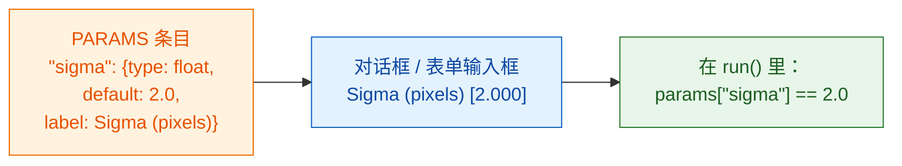

# PARAMS = 你的对话框

## 用大白话说

`PARAMS` 是服务员递给客人的**菜单**。你列出能选的东西，Fiji 或 napari 就替你画出输入框：
Fiji 画成对话框，napari 画成 Wavu 面板里的表单。不用自己写任何按钮或窗口，
同一份 `PARAMS` 在两边都能用。每一项都有一个**名字**（代码里用的）、一个**类型**
（哪种输入框）、一个**默认值**（一开始填好的内容），以及一个可选的
**标签**（用户看到的文字）。



## 一个例子看全所有字段类型

```python
"""Field types demo -- one of each."""

PARAMS = {
    "image":  {"type": "image", "label": "Nuclei image"},
    "sigma":  {"type": "float", "default": 2.0, "label": "Sigma (pixels)"},
    "n":      {"type": "int",   "default": 3},
    "name":   {"type": "str",   "default": "cells"},
    "fast":   {"type": "bool",  "default": True},
    "method": {"type": "choice", "choices": ["otsu", "li"], "default": "otsu"},
}
```

Fiji 和 napari 会各自把它变成自己的输入框；你的代码拿到的值是一样的：

| `type` | Fiji 里的字段 | napari 里的字段 | `run` 收到什么 |
|---|---|---|---|
| `float` | 数字框（3 位小数） | 带小数的数字框 | 一个小数，比如 `2.0`，在 `params` 里 |
| `int` | 数字框（无小数） | 整数框 | 一个整数，比如 `3`，在 `params` 里 |
| `str` | 文本框 | 文本框 | 文本，比如 `"cells"`，在 `params` 里 |
| `bool` | 复选框 | 复选框 | `True` 或 `False`，在 `params` 里 |
| `choice` | 下拉菜单 | 下拉菜单 | 选中的文本，比如 `"otsu"`，在 `params` 里 |
| `image` | 列出**已打开图像**的下拉菜单 | 列出 **Image 和 Labels 图层**的下拉菜单 | 一个 NumPy 数组，在 **`inputs`** 里（不是 `params`） |

napari 的图层下拉菜单会在你添加或删除图层时自动更新。

## 细则

- 除 `image` 外，每种类型都**必须有 `default`**。`choice` 可以不写；
  不写时用第一个选项。
- `choice` **必须有 `choices`**：一个选项列表。
- **`label` 可选。** 不写的话，Fiji 和 napari 都显示名字本身，首字母大写、
  `_` 换成空格：`min_area` 会显示成 *Min area*。
- **名字**必须是合法的 Python 名称：只能用字母、数字和 `_`，且不能以数字开头。
- **取值会先经过检查**，再运行你的代码。类型不对或选项不存在都会被拒绝并给出提示，
  所以 `run` 拿到的总是干净的、类型正确的值。
- `script.py` 顶部 **docstring 的第一行**会显示在 Fiji 对话框最上方和 napari 面板里。
- Fiji 的对话框会额外加一个复选框 **Debug in VS Code**，用于
  [调试](../help/debug-in-vscode.md)。平时别勾。

!!! info "`image` 字段需要先打开图像"
    如果脚本有 `image` 字段，而没有打开任何图像，Wavu 会停下并给出提示：
    Fiji 里是 *"… needs an image -- open one first"*，napari 里是
    *"…: open an image layer first"*。打开一张图像再运行一次。

## 两张图像？两个字段

既要细胞核图像*又*要细胞质图像？加两个 `image` 条目。每个都会变成独立的下拉菜单，
并以各自的名字出现在 `inputs` 里：

```python
PARAMS = {
    "nuclei": {"type": "image", "label": "Nuclei"},
    "cyto":   {"type": "image", "label": "Cytoplasm"},
}

def run(ctx, inputs, params):
    nuc, cyto = inputs["nuclei"], inputs["cyto"]
    ...
```

## 表格、ROI、轨迹和文件：从脚本传入

对话框只能选图像。其他东西（Results 表格、ROI Manager 里的轮廓、TrackMate 或 napari 的轨迹、
napari 的 Points 或 Shapes、OME-Zarr 文件夹）要在脚本**被另一个脚本调用**时才会传进来，
就像[分析流程](../workflows/index.md)里那样。这类输入**不需要写进 `PARAMS`**：
脚本直接按名字从 `inputs` 读取。请在 docstring 里写明它需要哪些名字。

| 你传入 | 脚本在 `inputs` 里收到 |
|---|---|
| 图像（`ImagePlus`、NumPy 数组） | NumPy 数组 |
| 表格（`ResultsTable`、宏表格、pandas DataFrame、dict 列表） | pandas DataFrame（以 CSV 发送） |
| ImageJ ROI 的 `.zip`（从 ROI Manager 保存，或从 napari Shapes 写出） | `wavu.RoiSet`（用 `roifile` 读取） |
| 其他任何路径（`.csv`、`.tif`、OME-Zarr 文件夹） | 加载后的文件；文件夹则是 `pathlib.Path` |

轨迹以表格形式传递：每个点一行，包含轨迹 ID、帧和位置。

=== "Groovy (Fiji)"

    ```groovy
    def rm = wavu.roiManager()                               // 你看到的 ROI Manager
    def zip = new File(IJ.getDirectory("temp"), "rois.zip")
    rm.deselect(); rm.runCommand("Save", zip.path)           // 所有 ROI -> 一个 zip
    Map r = wavu.run(folder, "script", [min_area: 30],
                     [image: imp, rois: zip, spots: ResultsTable.getResultsTable()])
    ```

=== "ImageJ macro"

    宏用 `tables=` 按窗口标题传递表格。ROI 则先存成 zip，再把路径作为脚本的
    文本字段（`"type": "str"`）传入；路径里不要有空格：

    ```javascript
    zip = replace(getDirectory("temp"), "\\", "/") + "rois.zip";
    roiManager("Save", zip);
    run("Run Script (Macro)", "folder=[D:/scripts/measure] script=script " +
        "params=[rois_zip=" + zip + "] tables=[spots=Results]");
    ```

    然后脚本用 `roifile.roiread(...)` 读取 `params["rois_zip"]`。

=== "Python (napari)"

    ```python
    import pandas as pd
    import roifile

    pts, trk, shp = viewer.layers["spots"], viewer.layers["tracks"], viewer.layers["cells"]
    points = pd.concat([pd.DataFrame(pts.data, columns=["frame", "y", "x"]), pts.features], axis=1)
    tracks = pd.DataFrame(trk.data, columns=["track_id", "frame", "y", "x"])
    roifile.roiwrite("rois.zip", [roifile.ImagejRoi.frompoints(s[:, -2:][:, ::-1])   # (y, x) -> (x, y)
                                  for s in shp.data])

    with Worker.start("D:/scripts/measure") as w:
        res = w.run("script", {"min_area": 30},
                    {"image": viewer.layers["nuclei"].data, "points": points,
                     "tracks": tracks, "rois": "rois.zip"})
    ```

在脚本里：

```python
"""Measure inside ROIs. Inputs: image, rois (ROI zip), tracks (table)."""
import roifile

def run(ctx, inputs, params):
    img = inputs["image"]
    tracks = inputs["tracks"]                               # DataFrame
    rois = roifile.roiread(inputs["rois"].path)             # 轮廓；.coordinates() 是 (x, y)
    ...
```

## 一句话总结

每个参数在 `PARAMS` 里写一行，带上类型和默认值，Fiji 或 napari 就会生成输入框，
并把检查过的值放在 `params` 里交给你（图像在 `inputs` 里；被另一个脚本调用时，
表格、ROI 和文件也在 `inputs` 里）。

[下一步：可以返回什么 :material-arrow-right:](outputs.md){ .md-button }
