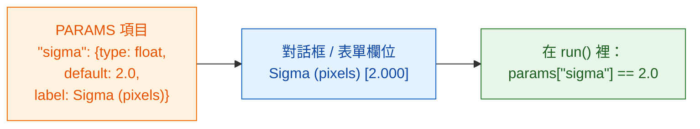

# PARAMS = 你的對話框

## 用白話說

`PARAMS` 是服務生遞給客人的**菜單**。你列出可以選的東西，Fiji 或 napari 就幫你畫出欄位：
Fiji 畫成對話框，napari 畫成 Wavu 面板裡的表單。不用自己寫任何按鈕或視窗，
同一份 `PARAMS` 在兩邊都能用。每一項都有一個**名稱**（你的程式碼用的）、一個**型別**
（哪一種欄位）、一個**預設值**（一開始填好的內容），以及一個選用的
**標籤**（使用者看到的文字）。



## 一個範例看遍所有欄位型別

```python
"""Field types demo -- one of each."""

PARAMS = {
    "image":  {"type": "image", "label": "Nuclei image"},
    "sigma":  {"type": "float", "default": 2.0, "label": "Sigma (pixels)"},
    "n":      {"type": "int",   "default": 3},
    "name":   {"type": "str",   "default": "cells"},
    "fast":   {"type": "bool",  "default": True},
    "method": {"type": "choice", "choices": ["otsu", "li"], "default": "otsu"},
}
```

Fiji 和 napari 各自把它變成自己的欄位；你的程式碼拿到的值都一樣：

| `type` | Fiji 裡的欄位 | napari 裡的欄位 | `run` 收到的東西 |
|---|---|---|---|
| `float` | 數字框（3 位小數） | 有小數的數字框 | 一個小數，例如 `2.0`，在 `params` 裡 |
| `int` | 數字框（沒有小數） | 整數框 | 一個整數，例如 `3`，在 `params` 裡 |
| `str` | 文字框 | 文字框 | 文字，例如 `"cells"`，在 `params` 裡 |
| `bool` | 核取方塊 | 核取方塊 | `True` 或 `False`，在 `params` 裡 |
| `choice` | 下拉選單 | 下拉選單 | 選到的文字，例如 `"otsu"`，在 `params` 裡 |
| `image` | 列出**已開啟影像**的下拉選單 | 列出 **Image 和 Labels 圖層**的下拉選單 | 一個 NumPy 陣列，在 **`inputs`** 裡（不是 `params`） |

你新增或移除圖層時，napari 的圖層下拉選單會自動更新。

## 細節說明

- 除了 `image` 以外，每種型別都**必須有 `default`**。`choice` 可以省略；
  省略時會用第一個選項。
- `choice` **必須有 `choices`**：一個列出選項的串列。
- **`label` 是選用的。** 沒寫的話，Fiji 和 napari 都會顯示名稱，把第一個字母改成大寫、
  `_` 換成空格：`min_area` 會變成 *Min area*。
- **名稱**必須是合法的 Python 名稱：只能用字母、數字和 `_`，而且不能以數字開頭。
- **值會先經過檢查**，再執行你的程式碼。型別錯誤或未知的選項會被拒絕並顯示訊息，
  所以 `run` 拿到的永遠是乾淨、型別正確的值。
- `script.py` 最上方 **docstring 的第一行**會顯示在 Fiji 對話框頂端和 napari 面板裡。
- Fiji 的對話框會多加一個核取方塊 **Debug in VS Code**，用來
  [除錯](../help/debug-in-vscode.md)。平常不要勾。

!!! info "`image` 欄位需要先開啟影像"
    如果你的腳本有 `image` 欄位，而沒有開著任何影像，Wavu 會停下來並顯示訊息：
    Fiji 是 *"… needs an image -- open one first"*，napari 是
    *"…: open an image layer first"*。開啟一張影像再執行一次。

## 兩張影像？兩個欄位

想要一張細胞核影像*和*一張細胞質影像？加兩個 `image` 項目。每個都會變成自己的下拉選單，
也各自用自己的名稱出現在 `inputs` 裡：

```python
PARAMS = {
    "nuclei": {"type": "image", "label": "Nuclei"},
    "cyto":   {"type": "image", "label": "Cytoplasm"},
}

def run(ctx, inputs, params):
    nuc, cyto = inputs["nuclei"], inputs["cyto"]
    ...
```

## 一句話總結

每個設定在 `PARAMS` 裡寫一行，附上型別和預設值，Fiji 或 napari 就會產生欄位，
把檢查過的值放在 `params` 交給你（影像在 `inputs`）。

[下一步：可以回傳什麼 :material-arrow-right:](outputs.md){ .md-button }
