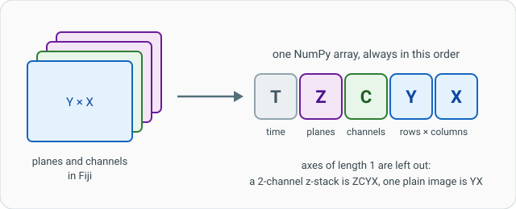

# 真实图像

## 用大白话说

*Blobs* 只是一张平面图片。你的显微镜图像往往是**一摞图片**：好几个颜色通道、
好几个焦平面（z-stack），可能还有好几个时间点。Wavu 把**整摞图片**作为一个
NumPy 数组交给你的脚本，并告诉你它是怎么摞起来的。就像收到一盒载玻片，
外加一张标签，写明它们按什么顺序排列。

{ width="640" }

## 数组的形状

轴总是按这个顺序排列，长度为 1 的轴会被去掉：

**T**（时间）· **Z**（平面）· **C**（通道）· **Y** · **X**，RGB 彩色图像
最后还多一个长度为 3 的轴 **S**。

| Fiji 里的图像 | `inputs["image"].shape` | `ctx.meta["image"]["axes"]` |
|---|---|---|
| 一张二维灰度图，512 × 512 | `(512, 512)` | `"YX"` |
| 3 个通道 | `(3, 512, 512)` | `"CYX"` |
| 20 个平面、2 个通道的 z-stack | `(20, 2, 512, 512)` | `"ZCYX"` |
| 一张 RGB 照片 | `(512, 512, 3)` | `"YXS"` |

所以对 `ZCYX` 图像来说，“每个平面的第 2 个通道”就是 `img[:, 1]`。Fiji 会把
8 位、16 位、32 位或 RGB 像素原样发过来。

## 你还能拿到什么：`ctx.meta`

`ctx.meta["image"]` 里存着 Fiji 对 `"image"` 字段所选图像了解的信息：

- `"axes"`：轴的字母，同上；
- `"pixel_um"`：像素尺寸（微米），前提是图像做过标定；
- `"title"`：窗口标题。

```python
def run(ctx, inputs, params):
    img = inputs["image"]
    axes = ctx.meta["image"]["axes"]
    ctx.log(f"Got {img.shape} with axes {axes}")
    if img.ndim != 2:
        raise ValueError("Please pick a single 2-D channel (Image › Duplicate…)")
    ...
```

先检查形状、抛出清楚的 `ValueError`，比让代码在后面崩掉更友好：
Fiji 会在错误窗口里显示这句话。

## 多大算太大？

Wavu 是为**交互式处理一张能轻松放进内存的图像**设计的，大约到
**1–2 GB**。小图像用一条消息就能传过去；大一些的会通过磁盘上的临时
TIFF 文件传递。你什么都不用做：不管哪种方式，`inputs["image"]` 都是 NumPy 数组。

超过这个大小，或者要处理成百上千个文件时，Wavu 就不是合适的工具了。请转成
OME-Zarr，改用批处理或 HPC 工作流。

## 首次运行很慢（以及如何让用户安心） { #slow-first-runs-and-how-to-keep-users-calm }

有两件事会让*首次*运行变慢，而且都只发生一次：

1. **构建环境。** pixi 会下载 `pixi.toml` 里列出的包。如果带上 PyTorch
   （Cellpose 需要），可能有 **1–2 GB**、要好几分钟。下载期间 Fiji 的 Log 会有提示。
2. **下载模型权重。** Cellpose 这类工具第一次使用时会从网上下载训练好的模型。
   这发生在*你的脚本内部*，Fiji 对此一无所知，看上去可能像卡死了。

**在慢步骤之前一定要写日志**，让用户知道发生了什么：

```python
ctx.log("Loading the Cellpose model (the first time, it is downloaded)...")
ctx.progress(0.1)
model = models.Cellpose(gpu=params["use_gpu"], model_type="nuclei")
ctx.log("Model ready")
```

!!! tip "一套能用的 Cellpose 配置"
    Wavu 仓库里有一个完整的 Cellpose 细胞核脚本，包括一份带 PyTorch、
    Cellpose 和可选 NVIDIA GPU 配置的 `pixi.toml`：
    [`examples/cellpose_nuclei`](https://github.com/Oxford-Zeiss-Centre-of-Excellence/Wavu/tree/main/examples/cellpose_nuclei)。
    把其中的 `[dependencies]` 和 `[pypi-dependencies]` 几行复制到你自己的
    `pixi.toml` 里。Apple 芯片的 Mac 开箱即可用 GPU。

## 一句话总结

你的脚本拿到的是整张图像，一个按 **T Z C Y X** 顺序排列的数组（看
`ctx.meta` 确认），大小最好在 1–2 GB 以内，并且在任何慢步骤（比如首次下载模型）
之前都要先 `ctx.log`。

[下一步：不用 Fiji 也能测试 :material-arrow-right:](test-without-fiji.md){ .md-button }
