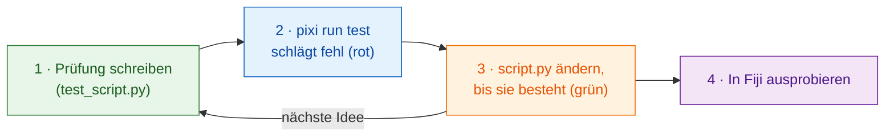

# Zuerst testen

!!! success "Dringend empfohlen: Beginnen Sie jede Änderung hier"
    Sie *können* die Tests auslassen und direkt zu Fiji gehen. Aber die
    Prüfung **vor** dem Code zu schreiben ist die Gewohnheit, die am meisten
    Zeit spart, und sie zählt vor allem dann, wenn ein **KI-Assistent** den
    Code für Sie schreibt (siehe unten).

## Die Idee in einfachen Worten

Ein Koch legt fest, wie das Gericht schmecken soll, **bevor** er kocht, und
probiert dann zwischendurch. Ein **Test** ist diese Festlegung, schriftlich:
eine winzige Prüfung, die Ihre Funktion `run` auf einem ausgedachten Bild
laufen lässt und *bestanden* oder *fehlgeschlagen* meldet, **ohne Fiji zu
öffnen**. Den Test zuerst zu schreiben heißt *testgetriebene Entwicklung*
(englisch *test-driven development*, TDD).

Wavu gibt Ihnen eine Fiji-Attrappe, `FakeCtx`, die Log-Meldungen und
Fortschritt aufzeichnet, statt sie anzuzeigen.



Warum zuerst? Eine Prüfung, die *nach* dem Code entsteht, testet meist, was
der Code tut, nicht was Sie wollten. Zuerst geschrieben ist sie Ihr Plan;
ein rotes Ergebnis vor dem Start beweist, dass die Prüfung wirklich etwas
untersucht.

## Wie ein Test aussieht

Die Vorlage hat schon ein paar, in `test_script.py`:

```python
from pathlib import Path
import numpy as np
from wavu.testing import FakeCtx, run_script

SCRIPT = Path(__file__).with_name("script.py")


def test_blur_smooths_a_single_bright_pixel():
    img = np.zeros((32, 32), dtype=np.uint16)
    img[16, 16] = 1000                         # ein einzelner heller Punkt
    ctx = FakeCtx()
    out = run_script(SCRIPT, {"image": img}, {"sigma": 2.0}, ctx=ctx)

    assert out["blurred"].shape == img.shape   # gleiche Größe zurück
    assert out["blurred"][16, 16] < 1000       # der Punkt wurde weicher
    assert ctx.progress_values[-1] == 1.0      # Fortschritt hat 100 % erreicht
```

- `run_script` ruft Ihr `run` genau so auf wie Fiji und füllt für alles,
  was Sie weglassen, die Standardwerte aus `PARAMS` ein.
- `ctx.messages` enthält alles, was Sie ins Log geschrieben haben;
  `ctx.progress_values` jeden Fortschrittswert.
- `FakeCtx(cancel_after=2)` tut so, als hätte der Benutzer nach zwei
  Prüfungen Esc gedrückt; so können Sie testen, ob das Abbrechen
  funktioniert.

**Ihr erster Test** für eine neue Idee darf so klein sein: Bauen Sie ein
Bild, bei dem Sie die Antwort kennen (ein helles Quadrat, zwei getrennte
Flecken), und prüfen Sie diese Antwort (`labels.max() == 2`).

## Die Tests ausführen { #run-the-tests }

Das ist die eine Stelle, an der ein Terminal der einfachste Weg ist. Wählen
Sie in VS Code **Terminal › New Terminal** (es öffnet sich in Ihrem
Skriptordner) und tippen Sie:

```sh
pixi run test
```

Sie sollten eine kurze Reihe von Punkten und eine Zusammenfassung wie
`3 passed in 1.2s` sehen. Ein rotes `F` und `failed` bedeuten, dass eine
Prüfung nicht gestimmt hat; der Text darüber sagt, in welcher Zeile und
warum.

!!! tip "Kein `pixi` im Terminal?"
    Das pixi, das Fiji heruntergeladen hat, liegt versteckt. Für das
    Terminal installieren Sie pixi einmal von [pixi.sh](https://pixi.sh),
    dann schließen und öffnen Sie das Terminal neu.

    === "Windows"

        ```powershell
        powershell -ExecutionPolicy ByPass -c "irm -useb https://pixi.sh/install.ps1 | iex"
        ```

    === "macOS / Linux"

        ```sh
        curl -fsSL https://pixi.sh/install.sh | sh
        ```

    Danach gibt `pixi --version` eine Versionsnummer aus.

## Mit einem KI-Assistenten arbeiten

Programmierassistenten (Claude, Copilot, ChatGPT…) schreiben schnell Code
und klingen sehr überzeugt, auch wenn der Code falsch ist. Ein Test ist ein
Versprechen, um das sie sich nicht herumreden können:

1. **Sie** schreiben den Test oder segnen ihn ab: das Eingabebild und die
   Antwort, die Sie erwarten.
2. Bitten Sie den Assistenten: *„Bring `pixi run test` zum Bestehen, ohne
   die Tests zu ändern.“*
3. **Führen Sie die Tests selbst aus**, bevor Sie dem Ergebnis trauen, und
   probieren Sie es dann in Fiji aus.

Lesen Sie die Tests, die der Assistent schreibt, so sorgfältig wie seinen
Code: Eine Prüfung, die nie fehlschlagen kann, schützt nichts.

## In einem Satz

Schreiben Sie zuerst die Prüfung, sehen Sie sie fehlschlagen, ändern Sie
`script.py`, bis `pixi run test` besteht, und probieren Sie es erst dann in
Fiji aus.

[Weiter: vom Notebook zu Wavu :material-arrow-right:](from-notebook.md){ .md-button }
