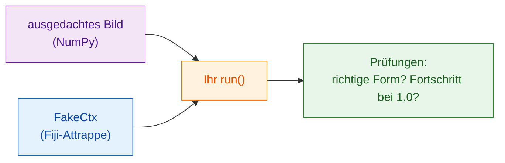

# Ohne Fiji testen

!!! note "Optional"
    Sie können nützliche Skripte schreiben, ohne das hier je zu tun. Es
    lohnt sich, sobald Ihr Skript wächst oder bevor Sie es weitergeben.

## Die Idee in einfachen Worten

Ein Koch probiert die Soße, bevor sie rausgeht; niemand möchte den Fehler
erst am Tisch des Gasts entdecken. Ein **Test** ist eine winzige Prüfung,
die Ihre Funktion `run` auf einem ausgedachten Bild laufen lässt und
bestätigt, dass die Antwort stimmt, **ohne Fiji zu öffnen**. Wavu gibt Ihnen
dafür eine Fiji-Attrappe, `FakeCtx`, die Log-Meldungen und Fortschritt
aufzeichnet, statt sie anzuzeigen.



## Wie ein Test aussieht

Die Vorlage hat schon einen, in `test_script.py`:

```python
from pathlib import Path
import numpy as np
from wavu.testing import FakeCtx, run_script

SCRIPT = Path(__file__).with_name("script.py")


def test_blur_smooths_a_single_bright_pixel():
    img = np.zeros((32, 32), dtype=np.uint16)
    img[16, 16] = 1000                         # ein einzelner heller Punkt
    ctx = FakeCtx()
    out = run_script(SCRIPT, {"image": img}, {"sigma": 2.0}, ctx=ctx)

    assert out["blurred"].shape == img.shape   # gleiche Größe zurück
    assert out["blurred"][16, 16] < 1000       # der Punkt wurde weicher
    assert ctx.progress_values[-1] == 1.0      # Fortschritt hat 100 % erreicht
```

- `run_script` ruft Ihr `run` genau so auf wie Fiji und füllt für alles,
  was Sie weglassen, die Standardwerte aus `PARAMS` ein.
- `ctx.messages` enthält alles, was Sie ins Log geschrieben haben;
  `ctx.progress_values` jeden Fortschrittswert.
- `FakeCtx(cancel_after=2)` tut so, als hätte der Benutzer nach zwei
  Prüfungen Esc gedrückt; so können Sie testen, ob das Abbrechen
  funktioniert.

## Die Tests ausführen { #run-the-tests }

Das ist die eine Stelle, an der ein Terminal der einfachste Weg ist. Wählen
Sie in VS Code **Terminal › New Terminal** (es öffnet sich in Ihrem
Skriptordner) und tippen Sie:

```sh
pixi run test
```

Sie sollten eine kurze Reihe von Punkten und eine Zusammenfassung wie
`3 passed in 1.2s` sehen. Ein rotes `F` und `failed` bedeuten, dass eine
Prüfung nicht gestimmt hat; der Text darüber sagt, in welcher Zeile und
warum.

!!! tip "Kein `pixi` im Terminal?"
    Das pixi, das Fiji heruntergeladen hat, liegt versteckt. Für das
    Terminal installieren Sie pixi einmal von [pixi.sh](https://pixi.sh),
    dann schließen und öffnen Sie das Terminal neu.

    === "Windows"

        ```powershell
        powershell -ExecutionPolicy ByPass -c "irm -useb https://pixi.sh/install.ps1 | iex"
        ```

    === "macOS / Linux"

        ```sh
        curl -fsSL https://pixi.sh/install.sh | sh
        ```

    Danach gibt `pixi --version` eine Versionsnummer aus.

## An einem echten Bild testen { #testing-on-a-real-image }

Sie können auch das ganze Skript an einer TIFF-Datei ausprobieren, ohne
Fiji, und die Ergebnisse in einem Ordner speichern:

```sh
pixi run wavu run script.py --in image=cells.tif --param sigma=3 --out results
```

## In einem Satz

Mit `FakeCtx` und `run_script` prüfen Sie `run` per `pixi run test` an
einem kleinen ausgedachten Bild, sodass Fehler auffallen, bevor Fiji oder
eine Kollegin sie sieht.

[Weiter: mit dem eigenen Labor teilen :material-arrow-right:](../share/with-your-lab.md){ .md-button }
