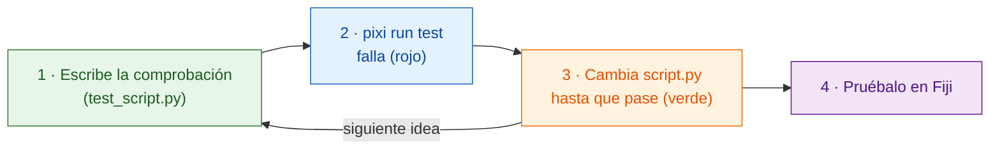

# Primero el test

!!! success "Muy recomendable: empieza aquí cada cambio"
    *Puedes* saltarte los tests e ir directamente a Fiji. Pero escribir la
    comprobación **antes** que el código es el hábito que más tiempo ahorra, y
    importa sobre todo cuando un **asistente de IA** escribe el código por ti
    (ver más abajo).

## La idea en palabras sencillas

Un cocinero decide cómo debe saber el plato **antes** de cocinar, y luego va
probando sobre la marcha. Un **test** es esa decisión por escrito: una pequeña
comprobación que ejecuta tu función `run` sobre una imagen inventada y dice
*pasa* o *falla*, **sin abrir Fiji**. Escribirlo primero se llama
*desarrollo guiado por tests* (TDD, del inglés *test-driven development*).

Wavu te da un sustituto de Fiji, `FakeCtx`, que guarda los mensajes del Log y
el progreso en lugar de mostrarlos.



¿Por qué primero? Una comprobación escrita *después* del código tiende a
probar lo que el código hace, no lo que tú querías. Escrita primero, es tu
plan; un resultado rojo antes de empezar demuestra que la comprobación de
verdad mira algo.

## Cómo es un test

La plantilla ya trae algunos, en `test_script.py`:

```python
from pathlib import Path
import numpy as np
from wavu.testing import FakeCtx, run_script

SCRIPT = Path(__file__).with_name("script.py")


def test_blur_smooths_a_single_bright_pixel():
    img = np.zeros((32, 32), dtype=np.uint16)
    img[16, 16] = 1000                         # un punto brillante
    ctx = FakeCtx()
    out = run_script(SCRIPT, {"image": img}, {"sigma": 2.0}, ctx=ctx)

    assert out["blurred"].shape == img.shape   # vuelve con el mismo tamaño
    assert out["blurred"][16, 16] < 1000       # el punto se ha suavizado
    assert ctx.progress_values[-1] == 1.0      # el progreso llegó al 100 %
```

- `run_script` llama a tu `run` igual que lo haría Fiji, rellenando con los
  valores por defecto de `PARAMS` todo lo que no indiques.
- `ctx.messages` guarda todo lo que escribiste en el Log; `ctx.progress_values`,
  cada valor de progreso.
- `FakeCtx(cancel_after=2)` simula que el usuario pulsó Esc después de dos
  comprobaciones, para que puedas probar que cancelar funciona.

**Tu primer test** para una idea nueva puede ser así de pequeño: crea una
imagen cuya respuesta conoces (un cuadrado brillante, dos manchas separadas)
y comprueba esa respuesta (`labels.max() == 2`).

## Ejecutar los tests { #run-the-tests }

Este es el único sitio donde una terminal es lo más sencillo. En VS Code
elige **Terminal › New Terminal** (se abre en la carpeta de tu script) y
escribe:

```sh
pixi run test
```

Deberías ver una línea corta de puntos y un resumen como
`3 passed in 1.2s`. Una `F` roja y `failed` significan que una comprobación
no se cumplió; el texto de encima te dice qué línea y por qué.

!!! tip "¿No hay `pixi` en la terminal?"
    El pixi que descargó Fiji está guardado fuera de la vista. Para la
    terminal, instala pixi una vez desde [pixi.sh](https://pixi.sh), y luego
    cierra y vuelve a abrir la terminal.

    === "Windows"

        ```powershell
        powershell -ExecutionPolicy ByPass -c "irm -useb https://pixi.sh/install.ps1 | iex"
        ```

    === "macOS / Linux"

        ```sh
        curl -fsSL https://pixi.sh/install.sh | sh
        ```

    Después, `pixi --version` muestra un número de versión.

## Trabajar con un asistente de IA

Los asistentes de programación (Claude, Copilot, ChatGPT…) escriben código
rápido y suenan muy seguros, incluso cuando el código está mal. Un test es una
promesa que no pueden esquivar con palabras:

1. **Tú** escribes o apruebas el test: la imagen de entrada y la respuesta
   que esperas.
2. Pide al asistente: *"haz que `pixi run test` pase sin cambiar los
   tests."*
3. **Ejecuta tú los tests** antes de fiarte del resultado, y luego pruébalo
   en Fiji.

Lee los tests que escribe el asistente con el mismo cuidado que su código:
una comprobación que nunca puede fallar no protege nada.

## En una frase

Escribe primero la comprobación, mira cómo falla, cambia `script.py` hasta
que `pixi run test` pase, y solo entonces pruébalo en Fiji.

[Siguiente: del notebook a Wavu :material-arrow-right:](from-notebook.md){ .md-button }
