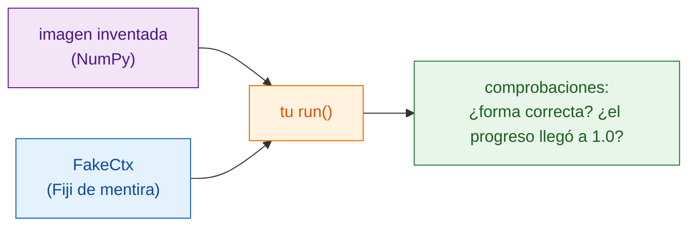

# Probar sin Fiji

!!! note "Opcional"
    Puedes escribir scripts útiles sin hacer nunca esto. Merece la pena cuando
    tu script crece, o antes de compartirlo.

## La idea en palabras sencillas

Un cocinero prueba la salsa antes de que salga; nadie quiere descubrir el
error en la mesa del cliente. Un **test** es una pequeña comprobación que
ejecuta tu función `run` sobre una imagen inventada y confirma que la
respuesta tiene buena pinta, **sin abrir Fiji**. Wavu te da un sustituto de
Fiji, `FakeCtx`, que guarda los mensajes del Log y el progreso en lugar de
mostrarlos.



## Cómo es un test

La plantilla ya trae uno, en `test_script.py`:

```python
from pathlib import Path
import numpy as np
from wavu.testing import FakeCtx, run_script

SCRIPT = Path(__file__).with_name("script.py")


def test_blur_smooths_a_single_bright_pixel():
    img = np.zeros((32, 32), dtype=np.uint16)
    img[16, 16] = 1000                         # un punto brillante
    ctx = FakeCtx()
    out = run_script(SCRIPT, {"image": img}, {"sigma": 2.0}, ctx=ctx)

    assert out["blurred"].shape == img.shape   # vuelve con el mismo tamaño
    assert out["blurred"][16, 16] < 1000       # el punto se ha suavizado
    assert ctx.progress_values[-1] == 1.0      # el progreso llegó al 100 %
```

- `run_script` llama a tu `run` igual que lo haría Fiji, rellenando con los
  valores por defecto de `PARAMS` todo lo que no indiques.
- `ctx.messages` guarda todo lo que escribiste en el Log; `ctx.progress_values`,
  cada valor de progreso.
- `FakeCtx(cancel_after=2)` simula que el usuario pulsó Esc después de dos
  comprobaciones, para que puedas probar que cancelar funciona.

## Ejecutar los tests { #run-the-tests }

Este es el único sitio donde una terminal es lo más sencillo. En VS Code
elige **Terminal › New Terminal** (se abre en la carpeta de tu script) y
escribe:

```sh
pixi run test
```

Deberías ver una línea corta de puntos y un resumen como
`3 passed in 1.2s`. Una `F` roja y `failed` significan que una comprobación
no se cumplió; el texto de encima te dice qué línea y por qué.

!!! tip "¿No hay `pixi` en la terminal?"
    El pixi que descargó Fiji está guardado fuera de la vista. Para la
    terminal, instala pixi una vez desde [pixi.sh](https://pixi.sh), y luego
    cierra y vuelve a abrir la terminal.

    === "Windows"

        ```powershell
        powershell -ExecutionPolicy ByPass -c "irm -useb https://pixi.sh/install.ps1 | iex"
        ```

    === "macOS / Linux"

        ```sh
        curl -fsSL https://pixi.sh/install.sh | sh
        ```

    Después, `pixi --version` muestra un número de versión.

## Probar con una imagen real

También puedes probar el script completo con un archivo TIFF, sin Fiji, y
guardar los resultados en una carpeta:

```sh
pixi run wavu run script.py --in image=cells.tif --param sigma=3 --out results
```

## En una frase

`FakeCtx` y `run_script` te permiten comprobar `run` con una pequeña imagen
inventada usando `pixi run test`, para que los errores aparezcan antes de que
los vea Fiji o un colega.

[Siguiente: compartir con tu laboratorio :material-arrow-right:](../share/with-your-lab.md){ .md-button }
