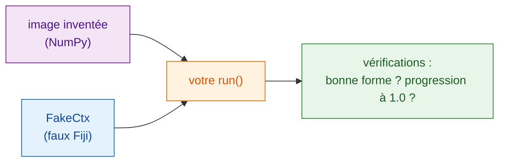

# Tester sans Fiji

!!! note "Facultatif"
    Vous pouvez écrire des scripts utiles sans jamais faire cela. C'est
    rentable quand votre script grandit, ou avant de le partager.

## L'idée en mots simples

Un chef goûte la sauce avant qu'elle parte en salle ; personne n'a envie de
découvrir l'erreur à la table du client. Un **test** est une toute petite
vérification qui lance votre fonction `run` sur une image inventée et
confirme que la réponse a l'air juste, **sans ouvrir Fiji**. Wavu vous donne
une doublure de Fiji, `FakeCtx`, qui enregistre les messages du Log et la
progression au lieu de les afficher.



## À quoi ressemble un test

Le modèle en contient déjà un, dans `test_script.py` :

```python
from pathlib import Path
import numpy as np
from wavu.testing import FakeCtx, run_script

SCRIPT = Path(__file__).with_name("script.py")


def test_blur_smooths_a_single_bright_pixel():
    img = np.zeros((32, 32), dtype=np.uint16)
    img[16, 16] = 1000                         # un seul point brillant
    ctx = FakeCtx()
    out = run_script(SCRIPT, {"image": img}, {"sigma": 2.0}, ctx=ctx)

    assert out["blurred"].shape == img.shape   # même taille au retour
    assert out["blurred"][16, 16] < 1000       # le point s'est adouci
    assert ctx.progress_values[-1] == 1.0      # la progression a atteint 100 %
```

- `run_script` appelle votre `run` exactement comme Fiji le ferait, en
  prenant les valeurs par défaut de `PARAMS` pour tout ce que vous omettez.
- `ctx.messages` contient tout ce que vous avez écrit dans le Log ;
  `ctx.progress_values`, chaque valeur de progression.
- `FakeCtx(cancel_after=2)` fait comme si l'utilisateur avait appuyé sur
  Échap après deux vérifications : vous pouvez ainsi tester que l'annulation
  fonctionne.

## Lancer les tests { #run-the-tests }

C'est le seul endroit où un terminal est le plus simple. Dans VS Code,
choisissez **Terminal › New Terminal** (il s'ouvre dans votre dossier de
script) et tapez :

```sh
pixi run test
```

Vous devriez voir une courte ligne de points et un résumé comme
`3 passed in 1.2s`. Un `F` rouge et `failed` veulent dire qu'une
vérification n'a pas tenu ; le texte au-dessus indique quelle ligne et
pourquoi.

!!! tip "Pas de `pixi` dans le terminal ?"
    Le pixi téléchargé par Fiji est rangé à l'écart. Pour le terminal,
    installez pixi une fois depuis [pixi.sh](https://pixi.sh), puis fermez et
    rouvrez le terminal.

    === "Windows"

        ```powershell
        powershell -ExecutionPolicy ByPass -c "irm -useb https://pixi.sh/install.ps1 | iex"
        ```

    === "macOS / Linux"

        ```sh
        curl -fsSL https://pixi.sh/install.sh | sh
        ```

    Ensuite, `pixi --version` affiche un numéro de version.

## Tester sur une vraie image { #testing-on-a-real-image }

Vous pouvez aussi essayer tout le script sur un fichier TIFF, sans Fiji, et
enregistrer les résultats dans un dossier :

```sh
pixi run wavu run script.py --in image=cells.tif --param sigma=3 --out results
```

## En une phrase

`FakeCtx` et `run_script` vous permettent de vérifier `run` sur une petite
image inventée avec `pixi run test`, pour que les erreurs apparaissent avant
que Fiji ou un collègue ne les voie.

[Suite : partager avec votre labo :material-arrow-right:](../share/with-your-lab.md){ .md-button }
